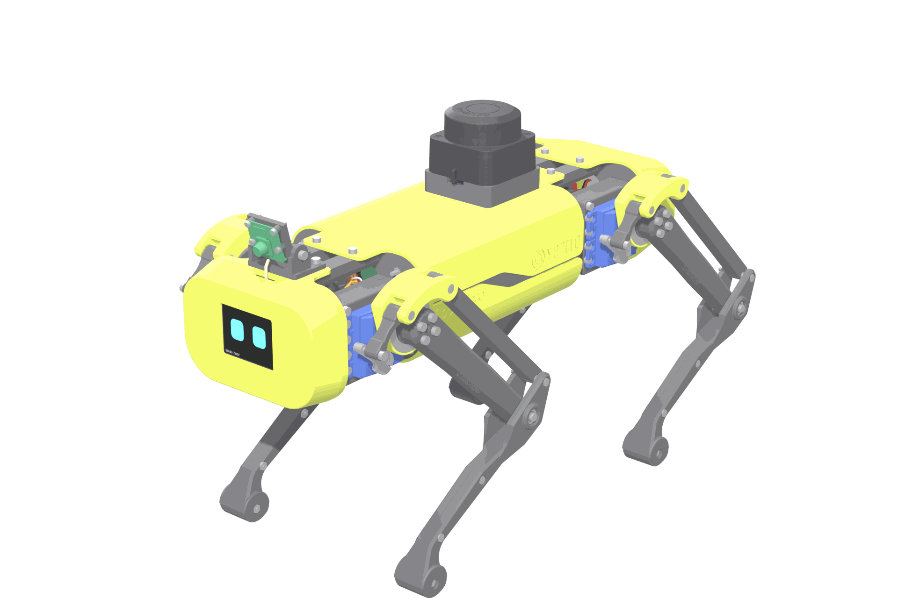

# Strido

**An open 12-DoF quadruped you can print at home, build, program and train** — Mini-Pupper-4 class, derived from [Yertle](https://github.com/Jerome-Graves/yertle) (MIT, Jerome Graves), with a face display, 360° LiDAR, wide camera, Raspberry Pi 5 + ESP32-S3, ROS 2 with a Unitree-Go2-style contract, MuJoCo/Gazebo models, a learned controller and an extension for [NT-X Studio](https://nt-x.ai/studio), where it is simulated, taught, trained and governed.



Every printed part, purchased part, bolt, pin and joint limit comes from one verified CAD model: interference, range of motion, screw fits, bearing seats, moving clearance, strength, the routed wiring harness (lead reach, hip-loop slack, cable clearance in every pose), sensor field of view, pin map and BOM coverage are executable gates.

## Start here

| I want to … | Go to |
|---|---|
| See the robot in 3D, explode it, replay the assembly | `make docs` → **3D viewer** (`docs/viewer.md`), model: `docs/viewer/strido.glb` |
| Get the catalogue & assembly book (A4 PDF) | [`docs/catalog/strido-catalog.pdf`](docs/catalog/strido-catalog.pdf) — printed parts, purchased parts, fasteners at 1:1, shopping plan, tools, all steps, wiring, software |
| Print the parts | [`hardware/print/`](hardware/print/print_list.md) — every part as an STL plus ready-to-slice 3MF plates (220 × 220 mm) |
| Buy the parts | [shopping list](docs/bom/shopping_list.md) (bundle optimiser, EU shops) and [BOM](docs/bom/README.md) |
| Build it | [assembly manual](docs/assembly/README.md) (IKEA-style, generated from the CAD) |
| Wire it | [electronics](docs/electronics.md) — power tree, wiring list, pin map, power budget |
| Program it | [software](docs/software.md) — firmware, bench CLI, ROS 2 topics and launch |
| Simulate and train | [simulation](docs/simulation.md) — MuJoCo, Gazebo, PPO |
| Run it in NT-X | [NT-X integration](docs/ntx-integration.md) — catalog robot, stand skill, serial RobotPort |
| Trust it | [verification](docs/verification.md) — what ran, at which tier, and what is not proven yet |

The documentation site (`make docs`, http://127.0.0.1:4173) renders all of this with the parts catalogue, the 3D viewer and diagrams.

## Specifications

| | |
|---|---|
| Size (standing, incl. LiDAR) | 430 × 188 × 264 mm |
| Mass (CAD, incl. battery) | ≈ 3.0 kg |
| Actuation | 12 × SPT5435LV, 35 kg·cm at 6 V; knee driven through a crank and four-bar linkage |
| Compute | Raspberry Pi 5 (4 GB) + Seeed XIAO ESP32-S3 motion controller (200 Hz) |
| Sensors | RPLIDAR C1 (unobstructed 360°), Camera Module 3 Wide, LSM6DSOX IMU, INA260 |
| Face | Waveshare 2" ST7789 LCD |
| Power | 2S 5000 mAh LiPo; 2 × 6.0 V UBEC (servos), 5 V/5.5 A logic regulator; 25 A + 7.5 A fuses; XT60 arming key |
| Software | ROS 2 Jazzy (Docker), Gazebo Harmonic, MuJoCo 3, PPO, NT-X extension, hardware MCP server |
| Cost | ≈ €965 delivered to Austria (lowest-total bundle) |

## Develop

```bash
make setup-standalone   # uv workspace (Python 3.12) and docs site: everything you need to build, verify and publish
make setup              # NT-X maintainers: also the agent harness (.harness, a private submodule)
make check-fast     # Q0: lint, strict types, layers, drift, tests, firmware native tests
make verify         # Q1: CAD verification (interference, ROM, fits, strength, clearance, wiring, sensors) ~15 min
make smoke          # Q2: MuJoCo walk, MCP server, NT-X integration
make publish        # print kit, BOM, manual, renders, 3D viewer, catalogue PDF
make docs           # documentation site
make package        # release zip in dist/
```

Runbook: [docs/harness.md](docs/harness.md). Agent rules: [AGENTS.md](AGENTS.md). Architecture: [docs/architecture.md](docs/architecture.md).

| Path | Contents |
|---|---|
| `hardware/` | hardware data (kinematics, limits, fasteners, BOM, electronics, tolerances) and the print kit |
| `packages/` | `strido-core` (robot runtime), `-cad`, `-verify`, `-publish`, `-sim`, `-ntx` |
| `firmware/` | XIAO ESP32-S3 firmware (PlatformIO) |
| `ros2/` | ROS 2 description (generated), bringup, control |
| `models/` | MuJoCo model (generated), released policy |
| `docs/`, `docs-site/`, `requirements/` | documentation sources, VitePress site, requirements |
| `upstream/yertle/` | unmodified upstream Yertle design and software |

## Licence and attribution

Software under the [Apache License 2.0](LICENSE); hardware design files (CAD, print files, drawings, wiring, BOM) under the [CERN Open Hardware Licence v2 – Permissive](LICENSE-HARDWARE). Copyright 2026 NT-X Technology. Strido is derived from [Yertle](https://github.com/Jerome-Graves/yertle) by Jerome Graves (MIT), kept unmodified in `upstream/yertle/`; see [NOTICE](NOTICE). Vendor CAD models are downloaded by `make vendor-cad` and not redistributed.
