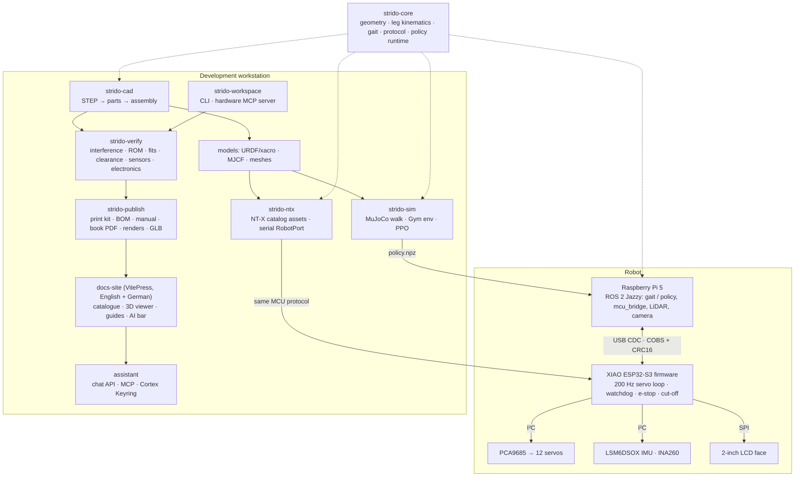
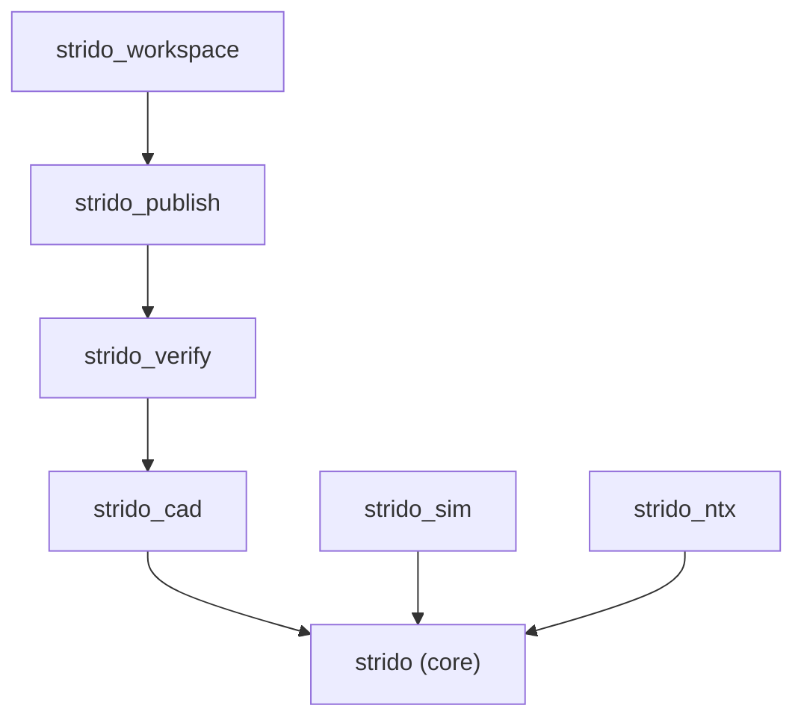
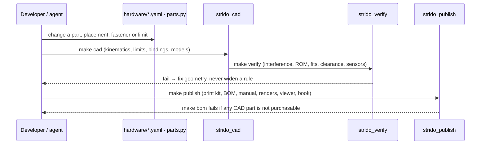

# Architecture

> **Status:** describes the repository as built (0.2). Layer rules are enforced by import-linter (`make layers`).

## System

## Repository layout

| Path | What | Owner of truth |
|---|---|---|
| `hardware/` | Tracked hardware data: kinematics, joint limits, fasteners, BOM, electronics, tolerances, contact rules, assembly corrections; the print kit (`print/`) | YAML sources; `print/` and `joint_limits.yaml` are generated |
| `packages/strido-core` | Robot runtime library (numpy + pyserial only): runs on the Pi, in ROS 2, simulation and tooling | code |
| `packages/strido-cad` | CAD pipeline: STEP registration, kinematics extraction, Strido parts (CadQuery), vendor models, fasteners, posing, code and model generation | code + `hardware/` |
| `packages/strido-verify` | Physical verification: interference, range of motion, fits and tolerances, moving clearance, sensor field of view, electronics | code + `hardware/verification/` |
| `packages/strido-publish` | BOM optimiser, print kit, assembly manual, catalogue & book PDF, renders, web 3D viewer | code |
| `packages/strido-sim` | MuJoCo walk demo, Gymnasium environment, PPO training/evaluation | code |
| `packages/strido-ntx` | NT-X extension: catalog assets, stand skill, serial `RobotPort` | code; assets generated |
| `src/strido_workspace` | `strido` CLI and the `strido-hardware` MCP server | code |
| `firmware/strido_esp32s3` | PlatformIO firmware; `lib/strido_core` is portable and natively tested | code; `geometry_generated.h` generated |
| `ros2/` | ROS 2 packages: description (generated), bringup, control | code |
| `models/` | MuJoCo models (generated) and released policies | generated |
| `docs/`, `requirements/` | Canonical documentation; `docs/{bom,assembly,catalog,viewer,verification}` are generated | Markdown |
| `docs-site/` | VitePress site; `content/{docs,requirements,de,public/*}` are synced copies (German pages rendered from `i18n/`) | site code |
| `i18n/` | German translation catalogues, one per published page and data file (`i18n/README.md`) | translations |
| `assistant/` | Assistant service behind the AI bar: conversations, documentation search, MCP server for agents | code |
| `skills/strido/` | Agent Skill for the documentation (also as a ZIP with every page) | Markdown |
| `upstream/yertle/` | Unmodified upstream Yertle design and software (reference) | upstream |
| `.harness/` | Engineering harness submodule (agents, hooks, checks) | upstream harness |

## Package layering

Contracts (`pyproject.toml`, `[tool.importlinter]`): the core never imports tooling; publish → verify → cad → core is a strict layer order; simulation and the NT-X adapter never pull in the CAD stack (they run where CadQuery is not installed).

## Data flow of a hardware change

## Interfaces

| Interface | Definition | Consumers |
|---|---|---|
| MCU wire protocol | `packages/strido-core/src/strido/protocol.py` ⇄ `firmware/.../protocol.h` (COBS + CRC16, 12 × float32 joint targets, 103-byte state payload) | ROS 2 `mcu_bridge`, `strido-cli`, NT-X `StridoSerialPort` |
| Joint convention | Go2 names and signs, order FL, FR, RL, RR × hip/thigh/calf | firmware, ROS 2, MuJoCo, NT-X |
| ROS 2 topics | [software](software.md) | teleop, Nav2, NT-X rosbridge |
| NT-X | `RobotSpec` + MJCF + skill (catalog assets), `RobotPort` (registry adapter `strido-serial`) | NT-X harness and Studio |
| Hardware knowledge | `strido-hardware` MCP tools / `strido` CLI | coding agents, humans |
