# Assembly manual

Generated from the verified CAD assembly by `strido_publish.manual`: every printed part, purchased part and fastener modelled in the CAD appears in exactly one parts box (cables are drawn in the steps that lay them; their lengths are in the [cut list](../verification/wiring.md#cut-list), consumables in the [shop](../shop.md)). Leg steps show the front-left leg; build all four (quantities are per leg). Highlighted parts are new in the step; arrows show where they go.

## Step 0 – Before you start

* Print every part in the [print list](../../hardware/print/print_list.md) (easiest: the [print kit](../print-kit.md) package with the ready plates). Remove supports and brims; test-fit bearings (625ZZ, 633ZZ, 6805-2RS) and sleeves before assembly.
* Wiring: every cable is drawn in the steps that install it; lengths are in the [cut list](../verification/wiring.md#cut-list) and the build order in [electronics › wiring harness](../electronics.md#wiring-harness). Set both UBECs to 6.0 V and measure them before any servo is connected.
* **Centre all 12 servos** before fitting any horn. Bench set-up: XIAO (flashed with `firmware/strido_esp32s3`) on USB to your computer, PCA9685 on I²C with its OE pull-up, servo power from one UBEC at 6.0 V (or a 6 V bench supply) to the servo's red/black wires, signal to the PCA9685 channel it will use. Run `strido-cli --port <usb port> center` (1500 µs on every channel; works without the INA260 and stops with an error if the controller is not driving). A centred servo is the assembly reference: hip leg vertical, femur 45° backwards, knee crank 35°.
* Tools: hex keys 1.5 / 2.0 / 2.5 mm, nut drivers 4.0 / 5.0 / 5.5 mm, flush cutters, soldering iron and solder, multimeter, crimp tool for Dupont, medium thread locker for screws into metal horns.
* Screws into printed holes marked *self-tapping*: turn until snug, never to full torque. Metal-to-metal screws (horns): one drop of medium thread locker.

## Step 1 – Prepare the electronics deck

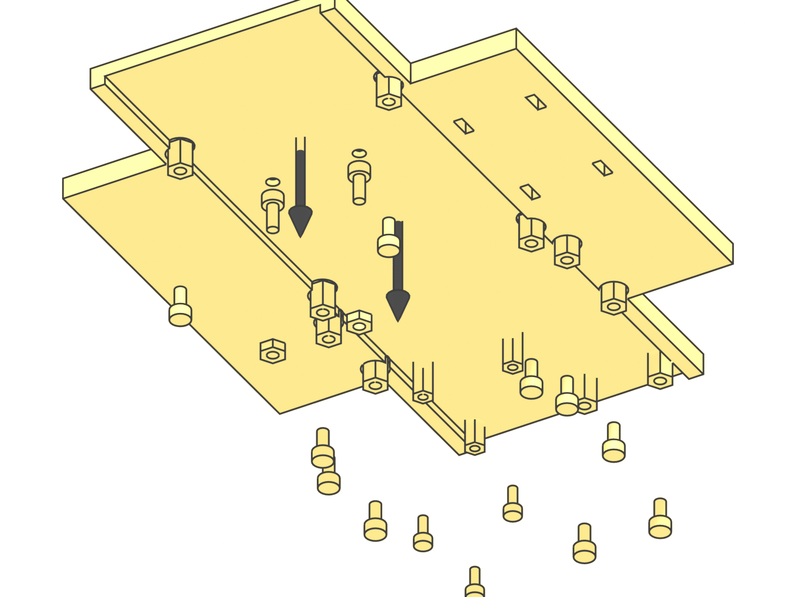

<table>
<tr><td>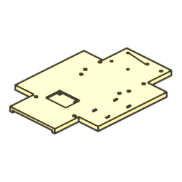</td><td><b>1×</b></td><td>Electronics deck (printed)</td></tr>
<tr><td>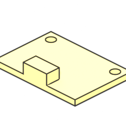</td><td><b>1×</b></td><td>LSM6DSOX IMU</td></tr>
<tr><td>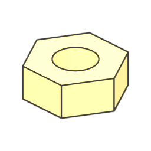</td><td><b>2×</b></td><td>M2.5 hex nut (ISO 4032)</td></tr>
<tr><td>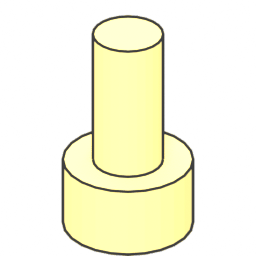</td><td><b>10×</b></td><td>M2.5 × 5 socket head screw (ISO 4762)</td></tr>
<tr><td>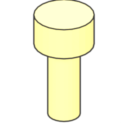</td><td><b>2×</b></td><td>M2.5 × 6 socket head screw (ISO 4762)</td></tr>
<tr><td>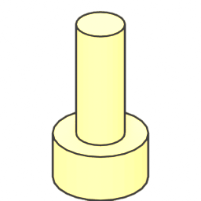</td><td><b>3×</b></td><td>M2 × 5 socket head screw (ISO 4762)</td></tr>
<tr><td>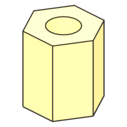</td><td><b>10×</b></td><td>M2.5 × 6 stand-off F-F (brass)</td></tr>
<tr><td>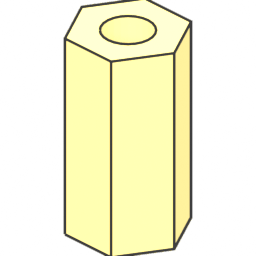</td><td><b>3×</b></td><td>M2 × 8 stand-off F-F (brass)</td></tr>
</table>

1. Press the LSM6DSOX IMU into its pocket (chip side up, STEMMA connectors towards the rear) and fix it with two M2.5 × 6 screws from the top and M2.5 nuts underneath.
2. Fix the stand-offs from below with M2.5 × 5 screws: 8 stand-offs M2.5, 6 mm long (Raspberry Pi 5 and PCA9685) and 2 more for the INA260.
3. Fix 3 stand-offs M2, 8 mm long, for the 5 V regulator with M2 × 5 screws from below.
4. The screw heads sit in the counterbores under the deck. Do not over-tighten: the deck is 3 mm thick in the centre.

## Step 2 – Chassis frame

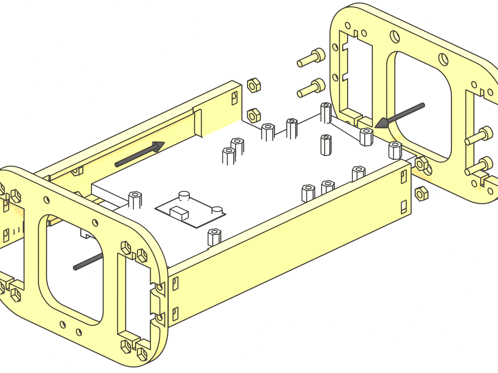

<table>
<tr><td>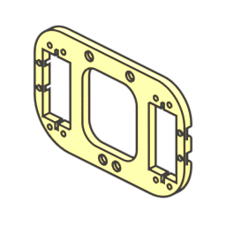</td><td><b>2×</b></td><td>Inner shoulder frame (printed)</td></tr>
<tr><td>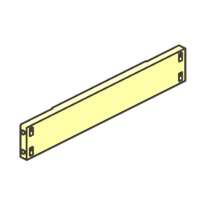</td><td><b>2×</b></td><td>Side body beam (printed)</td></tr>
<tr><td>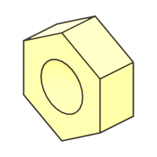</td><td><b>8×</b></td><td>M3 hex nut (ISO 4032)</td></tr>
<tr><td>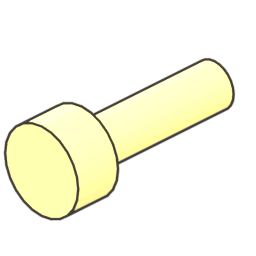</td><td><b>8×</b></td><td>M3 × 10 socket head screw (ISO 4762)</td></tr>
</table>

1. Slide the prepared deck into the grooves of both side body beams.
2. Close the frame with the two inner shoulder frames: 8 × M3 × 10 screws with hex nuts (nut side inside the bay).
3. Check that the frame sits flat on the table and the deck cannot move.

## Step 3 – Hip servos

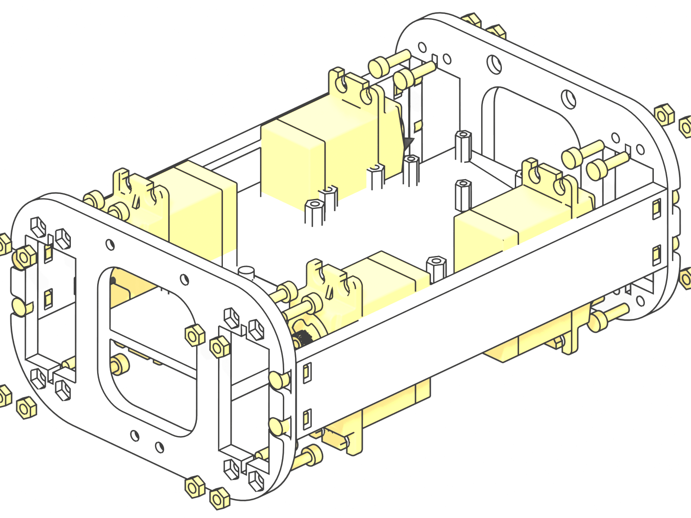

<table>
<tr><td>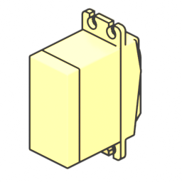</td><td><b>4×</b></td><td>Servo SPT5435LV-180W</td></tr>
<tr><td></td><td><b>16×</b></td><td>M3 hex nut (ISO 4032)</td></tr>
<tr><td></td><td><b>16×</b></td><td>M3 × 10 socket head screw (ISO 4762)</td></tr>
</table>

1. Centre all twelve servos before mounting any horn or servo (see Step 0).
2. Insert the four hip servos through the inner shoulder frames from the bay side; output shafts point outwards (front pair to the front, rear pair to the rear).
3. Fix each servo with 4 × M3 × 10 screws and hex nuts through the servo ears (16 in total).
4. Route the servo leads into the bay, they will run to the front and rear cavities later.

## Step 4 – Hip bearings and shoulder frames

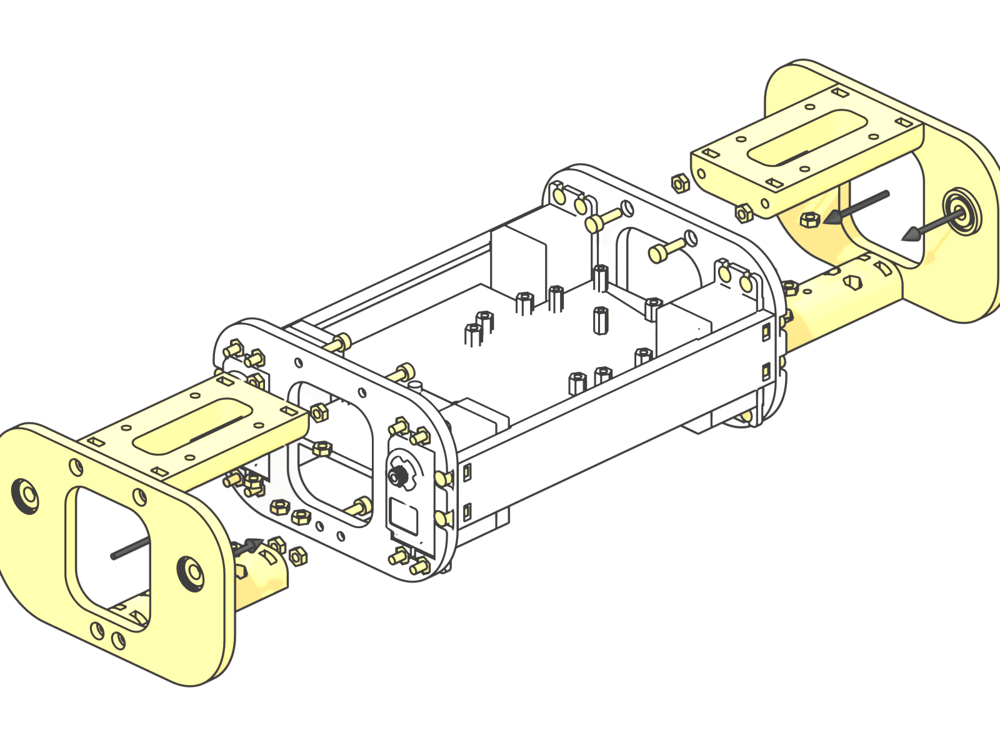

<table>
<tr><td>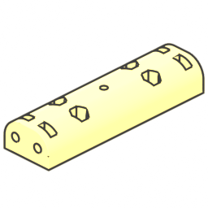</td><td><b>1×</b></td><td>Lower shoulder frame front (printed)</td></tr>
<tr><td>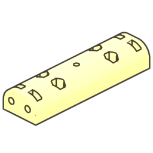</td><td><b>1×</b></td><td>Lower shoulder frame rear (printed)</td></tr>
<tr><td>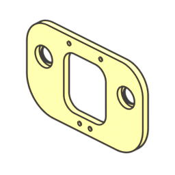</td><td><b>2×</b></td><td>Outer shoulder frame (printed)</td></tr>
<tr><td>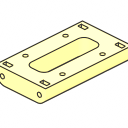</td><td><b>2×</b></td><td>Upper shoulder frame (printed)</td></tr>
<tr><td>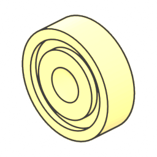</td><td><b>4×</b></td><td>Ball bearing 625ZZ</td></tr>
<tr><td></td><td><b>32×</b></td><td>M3 hex nut (ISO 4032)</td></tr>
<tr><td></td><td><b>16×</b></td><td>M3 × 10 socket head screw (ISO 4762)</td></tr>
</table>

1. Press two 625ZZ bearings into each outer shoulder frame (4 in total).
2. Assemble outer, upper and lower shoulder frames front and rear with 16 × M3 × 10 screws and hex nuts.
3. Use the Strido lower shoulder frames: `lower_shoulder_frame_front` and `_rear` have the extra pilot hole for the servo-bus holder.
4. Push M3 nuts into the nut pockets now, while they are reachable: 6 on top of the upper shoulder frames and 8 under the lower shoulder frames for the shell screws (Steps 21 and 22), and 2 more on top of the front upper shoulder frame for the camera base (Step 18).

## Step 5 – Servo power bus and motion controller

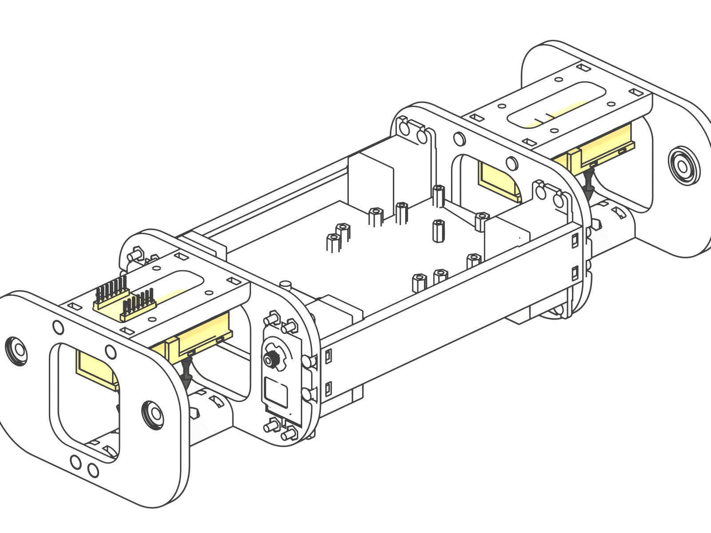

<table>
<tr><td>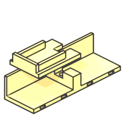</td><td><b>1×</b></td><td>Servo bus holder front (printed)</td></tr>
<tr><td>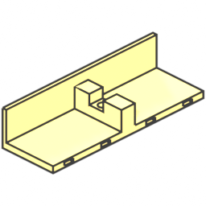</td><td><b>1×</b></td><td>Servo bus holder rear (printed)</td></tr>
<tr><td>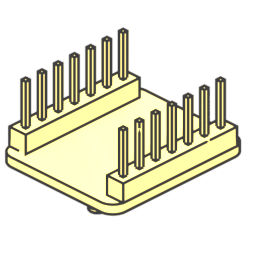</td><td><b>1×</b></td><td>Seeed XIAO ESP32-S3</td></tr>
<tr><td>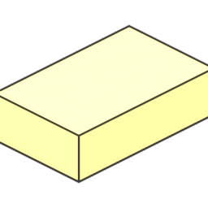</td><td><b>8×</b></td><td>WAGO 221-415</td></tr>
<tr><td>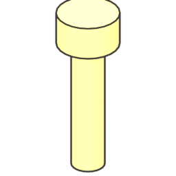</td><td><b>2×</b></td><td>M3 × 12 socket head screw (ISO 4762)</td></tr>
</table>

1. Clip four WAGO 221-415 connectors into each servo-bus holder.
2. Screw each holder to its lower shoulder frame with one M3 × 12 screw (self-tapping into the printed pilot hole).
3. Place the XIAO ESP32-S3 in the front cavity, USB-C towards the bay (foam tape).

## Step 6 – Servo UBECs

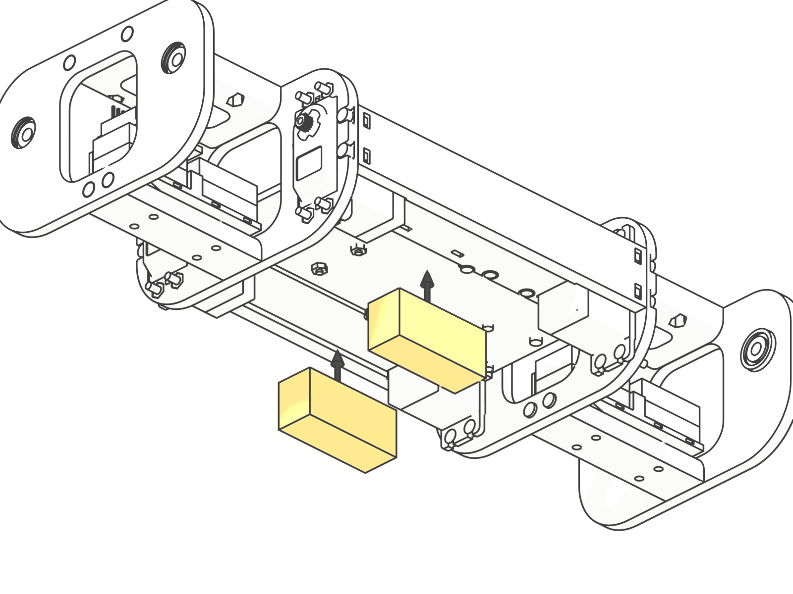

<table>
<tr><td>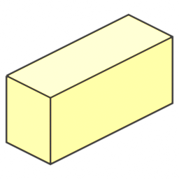</td><td><b>2×</b></td><td>Hobbywing UBEC-10A</td></tr>
</table>

1. Leave both UBEC output jumpers open (6.0 V). Measure 6.0 V before any servo is connected.
2. Foam-tape one UBEC into each side pocket next to the battery bay, standing on its long edge, leads towards the deck.

## Step 7 – Boards on the deck

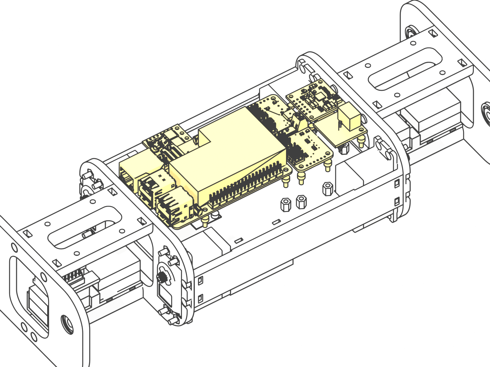

<table>
<tr><td>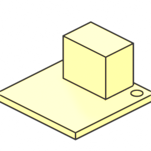</td><td><b>1×</b></td><td>INA260 power monitor</td></tr>
<tr><td>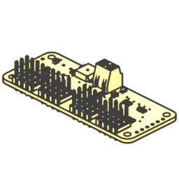</td><td><b>1×</b></td><td>PCA9685 servo driver</td></tr>
<tr><td>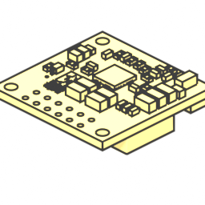</td><td><b>1×</b></td><td>Pololu D36V50F5 5 V regulator</td></tr>
<tr><td>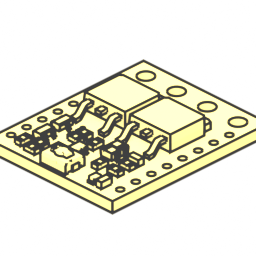</td><td><b>1×</b></td><td>Pololu #2813 pushbutton switch</td></tr>
<tr><td>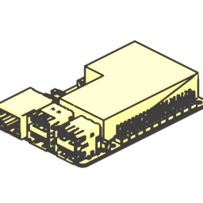</td><td><b>1×</b></td><td>Raspberry Pi 5 + Active Cooler</td></tr>
<tr><td></td><td><b>10×</b></td><td>M2.5 × 5 socket head screw (ISO 4762)</td></tr>
<tr><td></td><td><b>3×</b></td><td>M2 × 5 socket head screw (ISO 4762)</td></tr>
</table>

1. Raspberry Pi 5 with Active Cooler: ports to the front, 4 × M2.5 × 5 screws.
2. PCA9685: first solder the 2.2 kΩ OE pull-up (OE to VCC on the header, wiring W20), then mount it with the servo headers towards the right side, 4 × M2.5 × 5 screws. Leave its V+ terminal unconnected.
3. INA260 (bridge A0 first, address 0x41): 2 × M2.5 × 5 screws. Pololu D36V50F5: 3 × M2 × 5 screws.
4. Pololu pushbutton switch on foam tape in the right side strip, its two 5 mm terminal blocks soldered on (VIN/GND and VOUT/GND).

## Step 8 – Leg servo module (×4 legs)

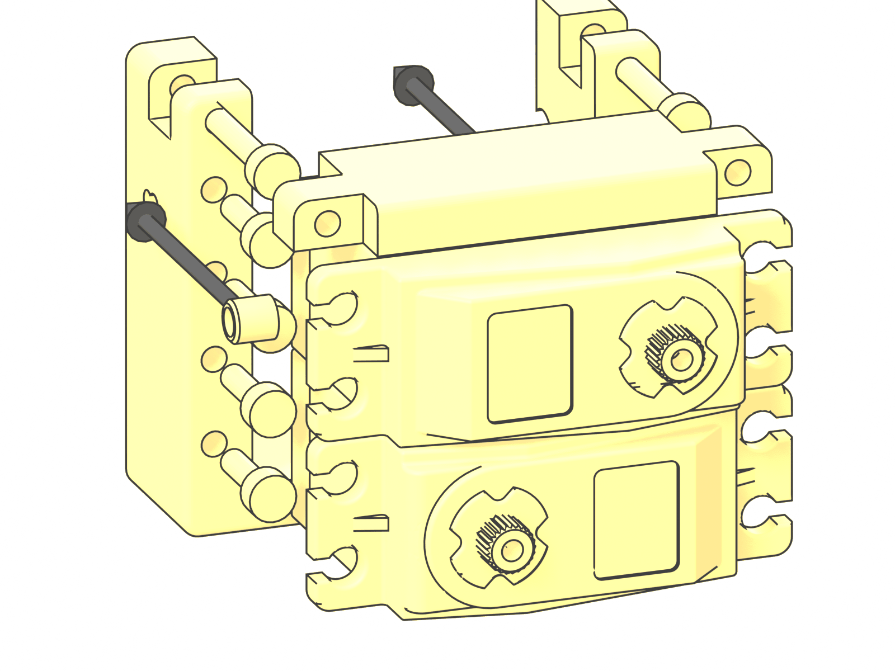

<table>
<tr><td>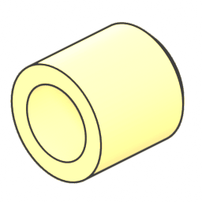</td><td><b>1×</b></td><td>Hip bearing pin (printed)</td></tr>
<tr><td>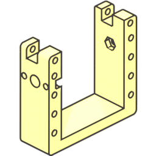</td><td><b>1×</b></td><td>Left servo mount (printed) – legs RR only</td></tr>
<tr><td>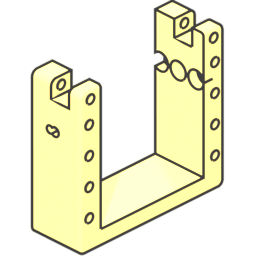</td><td><b>1×</b></td><td>Left servo mount fl (printed) – legs FL only</td></tr>
<tr><td>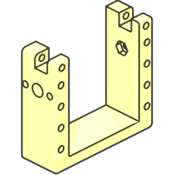</td><td><b>1×</b></td><td>Right servo mount (printed) – legs RL only</td></tr>
<tr><td>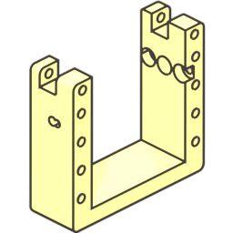</td><td><b>1×</b></td><td>Right servo mount fr (printed) – legs FR only</td></tr>
<tr><td>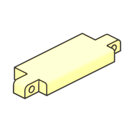</td><td><b>1×</b></td><td>Servo mount top bracket (printed)</td></tr>
<tr><td></td><td><b>2×</b></td><td>Servo SPT5435LV-180W</td></tr>
<tr><td></td><td><b>8×</b></td><td>M3 × 10 socket head screw (ISO 4762)</td></tr>
<tr><td>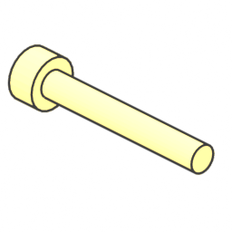</td><td><b>2×</b></td><td>M3 × 20 socket head screw (ISO 4762)</td></tr>
</table>

1. Build one leg at a time; the drawing shows the front-left leg. Front-left and rear-right legs use the *left* servo mount, front-right and rear-left the *right* one. The front legs use the Strido variants `left_servo_mount_fl` / `right_servo_mount_fr` (extra hip-pivot pilot).
2. Mount the thigh servo and the knee servo in the servo mount with 8 × M3 × 10 screws through the servo ears, then close it with the top bracket: 2 × M3 × 20 screws.
3. Press the hip bearing pin into the mount; the hip disc horn is fitted in Step 13.

## Step 9 – Thigh (×4 legs)

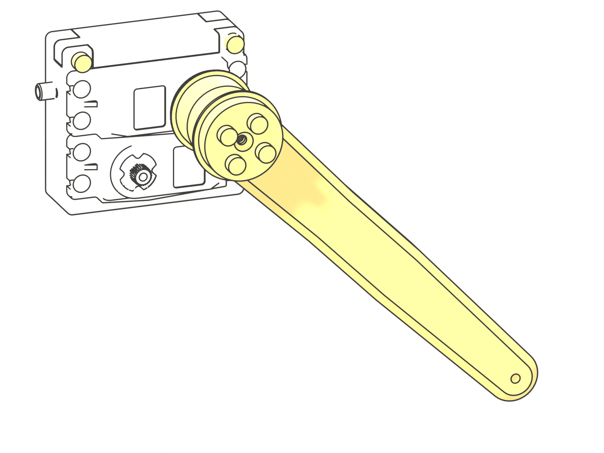

<table>
<tr><td>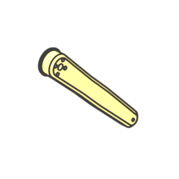</td><td><b>1×</b></td><td>Femur (printed)</td></tr>
<tr><td>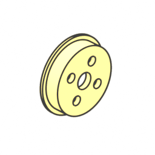</td><td><b>1×</b></td><td>Femur servo connector (printed)</td></tr>
<tr><td>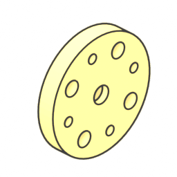</td><td><b>1×</b></td><td>25T aluminium disc horn</td></tr>
<tr><td></td><td><b>4×</b></td><td>M3 × 20 socket head screw (ISO 4762)</td></tr>
<tr><td>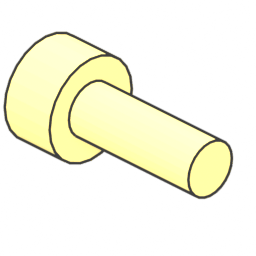</td><td><b>1×</b></td><td>M3 × 8 socket head screw (ISO 4762)</td></tr>
</table>

1. Fix the femur and the femur servo connector to a 25T aluminium disc horn with 4 × M3 × 20 screws.
2. With the thigh servo centred, push the horn on the spline with the femur pointing 45° backwards (assembly reference) and fix it with the M3 × 8 centre screw.

## Step 10 – Knee drive crank (×4 legs)

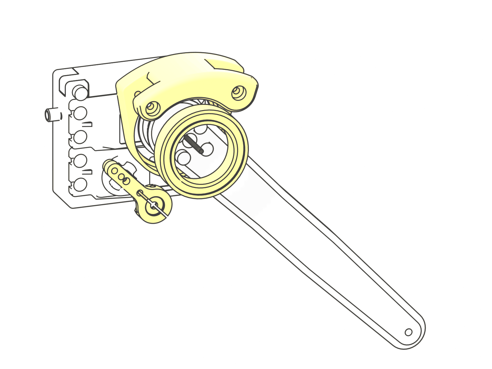

<table>
<tr><td></td><td><b>1×</b></td><td>Left shoulder (printed) – legs FL, RL only</td></tr>
<tr><td></td><td><b>1×</b></td><td>Right shoulder (printed) – legs FR, RR only</td></tr>
<tr><td></td><td><b>1×</b></td><td>Ball bearing 6805-2RS</td></tr>
<tr><td></td><td><b>1×</b></td><td>25T aluminium arm horn</td></tr>
<tr><td></td><td><b>1×</b></td><td>M3 × 8 socket head screw (ISO 4762)</td></tr>
</table>

1. Press the 6805-2RS bearing into the shoulder crank (left or right version per leg) and fit it over the femur servo connector: it turns freely about the thigh axis.
2. With the knee servo centred, push the 25T aluminium arm horn on its spline at 35° (assembly reference) and fix it with the M3 × 8 centre screw.

## Step 11 – Lower leg (×4 legs)

<table>
<tr><td></td><td><b>1×</b></td><td>Foot spacer (printed)</td></tr>
<tr><td></td><td><b>1×</b></td><td>Inner tibia (printed)</td></tr>
<tr><td></td><td><b>1×</b></td><td>Outer tibia (printed)</td></tr>
<tr><td></td><td><b>2×</b></td><td>Ball bearing 633ZZ</td></tr>
<tr><td></td><td><b>3×</b></td><td>M3 lock nut (nylon insert) (DIN 985)</td></tr>
<tr><td></td><td><b>2×</b></td><td>M3 × 10 socket head screw (ISO 4762)</td></tr>
<tr><td></td><td><b>2×</b></td><td>M3 × 12 socket head screw (ISO 4762)</td></tr>
<tr><td></td><td><b>1×</b></td><td>M3 × 20 socket head screw (ISO 4762)</td></tr>
<tr><td></td><td><b>2×</b></td><td>M3 washer (ISO 7089)</td></tr>
</table>

1. Press two 633ZZ bearings into the tibia halves.
2. Join inner and outer tibia with 2 × M3 × 12 screws and lock nuts; clamp the foot spacer with the M3 × 20 screw and lock nut.
3. Fit the knee axle: 2 × M3 × 10 screws with washers from both sides through the femur.

## Step 12 – Knee linkage (×4 legs)

<table>
<tr><td></td><td><b>1×</b></td><td>Short link (printed)</td></tr>
<tr><td></td><td><b>1×</b></td><td>Stiff long link (printed)</td></tr>
<tr><td></td><td><b>4×</b></td><td>Sleeve bearings 3×5×5 (pair)</td></tr>
<tr><td></td><td><b>1×</b></td><td>M3 lock nut (nylon insert) (DIN 985)</td></tr>
<tr><td></td><td><b>1×</b></td><td>M3 × 16 socket head screw (ISO 4762)</td></tr>
<tr><td></td><td><b>3×</b></td><td>M3 × 25 socket head screw (ISO 4762)</td></tr>
<tr><td></td><td><b>1×</b></td><td>M3 washer (ISO 7089)</td></tr>
</table>

1. Press two 3 × 5 × 5 sleeve bearings into every link eye (8 per leg).
2. Connect the links as drawn: 2 × M3 × 25 crank pins through the shoulder crank, the M3 × 16 screw with washer at the arm horn, and 1 × M3 × 25 with a lock nut at the tibia.
3. Tighten the lock nuts only until the joint is free of play: the links must swing under their own weight.

## Step 13 – Mount the legs

<table>
<tr><td></td><td><b>4×</b></td><td>25T aluminium disc horn</td></tr>
<tr><td></td><td><b>4×</b></td><td>M3 × 10 socket head screw (ISO 4762)</td></tr>
<tr><td></td><td><b>12×</b></td><td>M3 × 8 socket head screw (ISO 4762)</td></tr>
<tr><td></td><td><b>4×</b></td><td>M3 washer (ISO 7089)</td></tr>
</table>

1. Fix a disc horn to each leg module with 2 × M3 × 8 screws.
2. With the hip servo centred, push the leg on the hip servo spline (leg vertical) and fix it with the M3 × 8 centre screw.
3. Insert the hip pivot screw (M3 × 10 with washer) through the 625 bearing into the hip bearing pin.

## Step 14 – Power entry

<table>
<tr><td></td><td><b>1×</b></td><td>ATO fuse holder</td></tr>
<tr><td></td><td><b>1×</b></td><td>XT60H female</td></tr>
</table>

1. Cut every wire to its length in the cut list ([wiring check](../verification/wiring.md#cut-list)); strip, tin and heat-shrink every solder joint.
2. Battery input: solder W01 (14 AWG red) and W04 (14 AWG black) to an XT60H with sockets (check the contact rule in [electronics](../electronics.md#xt60-contact-rule-the-loop-key-must-never-fit-the-battery)) and lay it in the pocket beside the battery under the deck, hood towards the rear. Slide spiral wrap over W01 (it is unfused).
3. Ground star beside it: splice W04 to the black inputs of both UBECs (14 AWG) and to the logic ground (18 AWG black, on to the switch GND).
4. Main fuse: trim both leads of a 25 A in-line holder to 20 mm, splice W01 to one and W02 to the other, lay the holder on the rear WAGO bus with its leads out through the inner and outer frame openings and tie it to the upper shoulder frame. No fuse yet.
5. W02 and W03 (to both UBEC red inputs, spliced under the deck) end behind the rear outer frame: they are soldered to the arming jack in Step 19. W09 (18 AWG red, logic feed) runs from there through the rear cavity and over the deck to the switch VIN; its other end waits for the logic fuse holder (Step 19).

## Step 15 – Servo leads and servo bus

<table>
</table>

1. Thigh and knee servo leads: tie each to its servo mount plate at the marked point (close to the hip axis), leave the free loop (front: 30 mm thigh, 32 mm knee; rear: 22 mm; it takes up the hip motion) and tie it again at the shoulder frame (thigh) or the bus holder (knee).
2. Unclip each WAGO pair from its holder before clamping (the XIAO platform blocks the levers in bay 0). At the tie peel the red and brown wires off the lead, cut them to the cut-list length, strip 11 mm and clamp them into the leg's WAGO pair: red into the upper (V+) connector, brown into the lower (GND), ports hip 1, thigh 2, knee 3; refit the pair. Hip servo leads split at the inner frame opening.
3. Cut the orange signal wire to its cut-list length (measured from the tie), crimp a female Dupont contact, push it into a 1-pin housing and plug it onto the PWM pin of its PCA9685 channel (channel map in [electronics](../electronics.md#pin-maps)).
4. UBEC outputs (W05 front, W06 rear): extend with 18 AWG into port 0 of bay 0. Jumpers W07/W08: 18 AWG from port 4 of bay 0 to port 0 of bay 1, V+ and GND separately along the WAGO faces.

## Step 16 – Logic and signal wiring

<table>
</table>

1. 18 AWG: switch VOUT to INA260 VIN+ (W10, red), INA260 VIN- to the regulator VIN (W11, red), switch GND to the regulator GND (W24, black; the INA260 terminal block takes only VIN+ and VIN-).
2. W12: four 22 AWG wires from the regulator VOUT/GND, Dupont crimps at the Pi end. Leave them unplugged: they go onto the Pi header only after the supply check in Step 20.
3. I²C: W17 (3V3, GND, SDA, SCL) and W20 (D3 to OE) are 22 AWG wires soldered to the XIAO pins and crimped (Dupont) for the PCA9685 left header. STEMMA QT cables: PCA9685 right header to the IMU (W18), IMU to the INA260 header (W19).
4. USB: Pi lower port to the XIAO (W14, fold the spare length and tie it in the front cavity). Optional W22: Pi GPIO 26 to the switch OFF pad (22 AWG, Dupont crimp at the Pi, soldered at the switch).

## Step 17 – Front display

<table>
<tr><td></td><td><b>1×</b></td><td>Display bracket (printed)</td></tr>
<tr><td></td><td><b>1×</b></td><td>Front shell display (printed)</td></tr>
<tr><td></td><td><b>1×</b></td><td>Waveshare 2&quot; LCD (ST7789)</td></tr>
<tr><td></td><td><b>4×</b></td><td>M2 × 5 socket head screw (ISO 4762)</td></tr>
<tr><td></td><td><b>2×</b></td><td>M3 × 10 socket head screw (ISO 4762)</td></tr>
</table>

1. Put the 2-inch LCD into the front shell window from the inside, screen outwards, header pins down.
2. Fix the bracket to the LCD hex studs with 4 × M2 × 5 screws, then to the shell bosses with 2 × M3 × 10 (self-tapping).
3. Plug the display cable (W21, supplied with the LCD) into the display, run it through the outer shoulder frame opening and solder its 8 wires to the XIAO pins (no room for Dupont housings under the upper shoulder frame); fold the spare length (cut list) and tie it at the opening.

## Step 18 – Front camera

<table>
<tr><td></td><td><b>1×</b></td><td>Camera mount base (printed)</td></tr>
<tr><td></td><td><b>1×</b></td><td>Camera tilt plate (printed)</td></tr>
<tr><td></td><td><b>1×</b></td><td>Camera Module 3 Wide</td></tr>
<tr><td></td><td><b>1×</b></td><td>M3 lock nut (nylon insert) (DIN 985)</td></tr>
<tr><td></td><td><b>4×</b></td><td>M2 hex nut (ISO 4032)</td></tr>
<tr><td></td><td><b>4×</b></td><td>M2 × 10 socket head screw (ISO 4762)</td></tr>
<tr><td></td><td><b>2×</b></td><td>M3 × 12 socket head screw (ISO 4762)</td></tr>
<tr><td></td><td><b>1×</b></td><td>M3 × 40 socket head screw (ISO 4762)</td></tr>
</table>

1. Fix the Camera Module 3 Wide to the tilt plate: 4 × M2 × 10 screws, M2 nuts behind the plate.
2. Hang the tilt plate between the base cheeks with the M3 × 40 pivot screw and a lock nut; tighten until the camera holds its angle (15° down is the reference).
3. Plug the 300 mm camera ribbon (W16) into CAM/DISP 0 of the Pi, run it through both shoulder frame openings and up through the front-shell slot to the camera; fold the spare length flat (no creases). Then put the front shell on and screw the camera base and shell to the upper shoulder frame with 2 × M3 × 12.

## Step 19 – Rear panel

<table>
<tr><td></td><td><b>1×</b></td><td>Arming port bezel (printed)</td></tr>
<tr><td></td><td><b>1×</b></td><td>Arming port ring (printed)</td></tr>
<tr><td></td><td><b>1×</b></td><td>Back shell button (printed)</td></tr>
<tr><td></td><td><b>1×</b></td><td>ATO fuse holder</td></tr>
<tr><td></td><td><b>1×</b></td><td>12 mm push button</td></tr>
<tr><td></td><td><b>1×</b></td><td>XT60H female</td></tr>
<tr><td></td><td><b>2×</b></td><td>M2.5 × 6 socket head screw (ISO 4762)</td></tr>
</table>

1. Mount the 12 mm power button in the small hole of the back shell and solder W13 (22 AWG pair, routed to the switch A/B pads).
2. Insert the XT60 arming port into the printed bezel from outside, clamp it with the ring from inside: 2 × M2.5 × 6.
3. Solder W02 and W03 to the two contacts of the arming jack. Logic fuse: trim the input lead of a second in-line holder to its cut length and splice it to W02 (heat-shrink); trim its output lead to 20 mm and splice W09 to it. Lay the holder in the shell between the jack and the button. No fuse yet.
4. Put the back shell on. The loop key stays out until first power-up (final step).

## Step 20 – Dress the harness and check the logic supply

<table>
<tr><td></td><td><b>2×</b></td><td>Adhesive cable-tie mount 13 × 13 mm</td></tr>
</table>

1. Supply check before the Pi is connected: plug a charged pack into the battery input (W00) for a moment, insert both fuses, loop key out, press the button and measure 4.8–5.2 V at the W12 Dupont ends (D36V50F5: 5 V ± 4 %). Press again, pull the fuses, unplug the pack. Then plug W12 onto Pi pins 2/4 (5 V) and 6/14 (GND).
2. Spiral-wrap every bundle of three or more cables and W01 where the drawing shows a sleeve; it protects the leads where they pass frames and moving parts.
3. Tie at every marked point (2.5 × 100 mm ties, cut flush); two adhesive tie mounts on the deck carry the bundles in the side strips.
4. Move every leg through its full range by hand: no cable may be pulled tight, pinched or touch a horn or link ([wiring check](../verification/wiring.md)).

## Step 21 – Top shell and LiDAR

<table>
<tr><td></td><td><b>1×</b></td><td>Lidar pedestal (printed)</td></tr>
<tr><td></td><td><b>1×</b></td><td>Top shell sensor (printed)</td></tr>
<tr><td></td><td><b>1×</b></td><td>RPLIDAR C1</td></tr>
<tr><td></td><td><b>1×</b></td><td>RPLIDAR USB adapter</td></tr>
<tr><td></td><td><b>4×</b></td><td>M2.5 × 6 socket head screw (ISO 4762)</td></tr>
<tr><td></td><td><b>4×</b></td><td>M3 × 12 socket head screw (ISO 4762)</td></tr>
<tr><td></td><td><b>6×</b></td><td>M3 × 8 socket head screw (ISO 4762)</td></tr>
</table>

1. Screw the LiDAR pedestal to the top shell from below: 4 × M3 × 12 (self-tapping).
2. Put the LiDAR USB adapter into the pedestal, behind the cable slot, USB end towards the slot (foam tape). Lead the LiDAR's own cable (W23) through the notch at the pedestal front into the adapter, then fix the RPLIDAR C1 with 4 × M2.5 × 6 (max. 4 mm into the LiDAR).
3. Plug the second USB cable (W15, from the Pi's upper USB port, routed over the Pi beside the cooler fan) into the adapter through the top-shell slot, then close the top shell over the front and back shells: 6 × M3 × 8 into the nuts inserted in Step 4.

## Step 22 – Battery and bottom shell

<table>
<tr><td></td><td><b>1×</b></td><td>Bottom shell (printed)</td></tr>
<tr><td></td><td><b>1×</b></td><td>LiPo 2S 5000 mAh</td></tr>
<tr><td></td><td><b>8×</b></td><td>M3 × 8 socket head screw (ISO 4762)</td></tr>
</table>

1. Strap the 2S LiPo under the deck (hook-and-loop strap), lead end to the rear.
2. Plug the pack's own lead (W00) into the battery input XT60H in the pocket beside the battery (the lead turns forward along the left side under the rear hip servo). Keep the loop key out.
3. Close the bottom shell: 8 × M3 × 8 screws into the nuts inserted in Step 4.

## Step 23 – Wiring, calibration and first power-up

1. Check the harness against [electronics › wiring harness](../electronics.md#wiring-harness) (W00–W23, servo leads S-*): every joint soldered and heat-shrunk, no strands outside a WAGO or terminal. Keep the fuses and the arming loop key out.
2. Fuses in, press the power button: the Pi boots, the face appears on the LCD, `ros2 topic echo /battery_state` shows the pack voltage. The servos stay limp: the controller keeps the PCA9685 outputs off until it receives position commands.
3. Fine-calibrate each joint with `strido-cli calibrate` (robot on a stand, legs free; offsets stored in the ESP32 flash).
4. Lay the robot on its belly with the legs folded (the rest pose), insert the loop key (servos stay limp), then start `ros2 launch strido_bringup robot.launch.py`: the servos move to the rest pose and the robot stands up within 3 s. Never insert the key while position commands are running: all 12 servos would jump at once (up to 6 × 3.5 A stall per cavity against a 15 A UBEC peak).
5. Teleoperate: `ros2 run teleop_twist_keyboard teleop_twist_keyboard`. Publish `true` on `/strido/estop` to stop. After releasing an e-stop or a relax, restart the launch with the robot lying in the rest pose: the gait node only ramps up on start.
