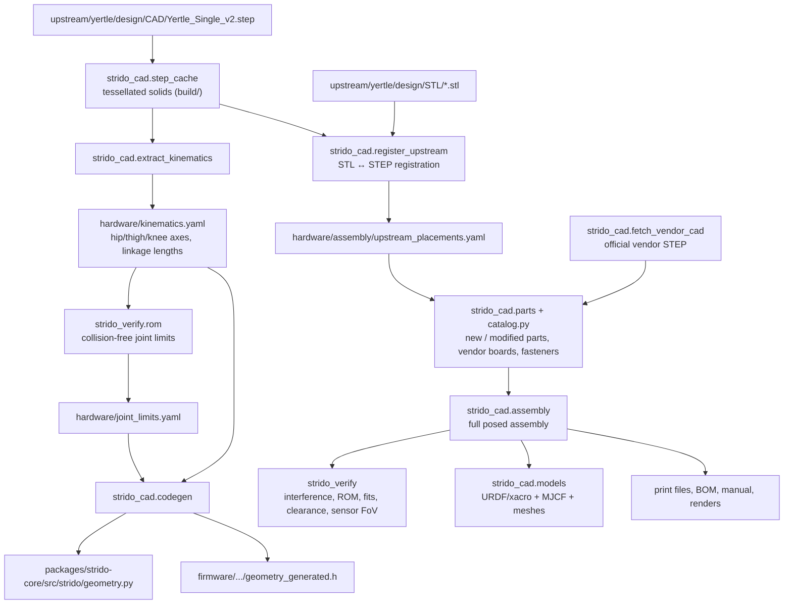

# Design and CAD pipeline

## Source of truth

The upstream Yertle STEP assembly (`upstream/yertle/design/CAD/Yertle_Single_v2.step`) and the published print STLs
(`upstream/yertle/design/STL/`) define the mechanics. Nothing is re-modelled by hand: the pipeline reads the STEP,
registers every STL to its STEP solid, measures the kinematics, and builds the Strido parts as
CadQuery booleans on top of the upstream geometry.

Frames: the STEP frame has +x = robot left, +y = robot rear, +z = up (mm). `assembly.step_to_base()`
maps it to the REP-103 `base_link` frame (x forward, y left, z up; origin between the hip axes).

## Changes compared with upstream Yertle

| Module | Part | Change and reason |
|---|---|---|
| Front display | `front_shell_display` | Upstream front shell + 43 × 33 mm window and two M3 bosses for the Waveshare 2" LCD; camera ribbon slot |
| | `display_bracket` | Clamps the LCD on its M2 hex studs to the shell bosses |
| Front camera | `camera_mount_base`, `camera_tilt_plate` | Tilting mount on the flat front-shell top; shares the two upstream shell screws (M3 × 12 instead of × 8); pivot M3 × 40 with lock nut gives a friction tilt. Moved here from the top shell because the first position saw the robot's nose in 42 % of the image (ray-cast check); now 0 % |
| Top sensors | `top_shell_sensor`, `lidar_pedestal` | 14 mm pedestal with a pocket for the C1 USB adapter lifts the scan plane above every leg pose and the camera; cable slot to the bay |
| Rear panel | `back_shell_button`, `arming_port_bezel`, `arming_port_ring` | Ø 12.2 mm hole for the power button; XT60 arming port in the existing Ø 20 mm hole |
| Electronics | `electronics_deck` | Upstream plate + IMU pocket and stand-off holes for the regulator and INA260; printable top-face-down without supports |
| Cavities | `lower_shoulder_frame_front/_rear`, `servo_bus_holder_front/_rear` | WAGO servo power bus per cavity, one extra pilot hole in the upstream frame |
| Purchased | — | Pi 5 (was Pi 4), XIAO ESP32-S3 (was ESP32 DevKit), 2 × UBEC-10A (was one SBEC), LiDAR, camera, LCD, INA260, LSM6DSOX, Pololu switch and regulator |

The upstream "servo holder3" solid in the STEP is a stale duplicate that overlaps the real holder by
2860 mm³; it is ignored. The foot spacer and hip bearing pin exist only in the STEP and are exported as
printable STLs.

## Kinematics

Each leg: hip abduction (servo in the body), thigh (servo in the leg module, direct drive) and knee.
The knee servo drives a crank; a parallelogram and a four-bar linkage transmit it to the tibia, so the
calf angle is a non-linear function of the crank angle *and* the thigh angle. `packages/strido-core/src/strido/leg.py`
and the firmware's `servo_map` solve that linkage exactly from the CAD-measured link lengths
(`hardware/kinematics.yaml`). The upstream STEP has a 1.02 mm link-length mismatch (drawn knee −98.8°,
closed linkage −101.2°); the measured lengths are used.

Joint limits come from a collision sweep of the full assembly (all parts and the Strido fasteners;
upstream joint fasteners, whose head side and nut orientation are approximated, are only in the static
interference check): thigh × calf on a 5° grid at zero abduction with a minimum linkage transmission
angle of 25°, then the hip range at the standing and mid poses with the mirrored partner leg and 0.3 mm
clearance (`hardware/joint_limits.yaml`, MECH-005). Code generation additionally keeps every joint within
±85° servo travel of its assembly neutral:

| Joint | Limit |
|---|---|
| Hip (abduction) | FL −17.5…50°, FR −50…17.5°, RL −17.5…45°, RR −45…17.5° |
| Thigh | −40…125° (front; sweep −45°, travel-limited around the 45° neutral), −15…125° (rear) |
| Calf | −150…−45° |
| Knee crank | −2.5…75° |

Assembly reference (all servos at 1500 µs): legs vertical in abduction, femur 45° backwards, knee crank 35°.

## Mass properties

Masses come from part volumes (printed parts: PETG/PLA density with the print settings' effective
infill) and datasheet masses for purchased parts (`hardware/mass_properties.yaml`); inertias from the
meshes, the routed cables by length. Total 3.07 kg; per-link values in `ros2/strido_description/config/mass_report.yaml`.
