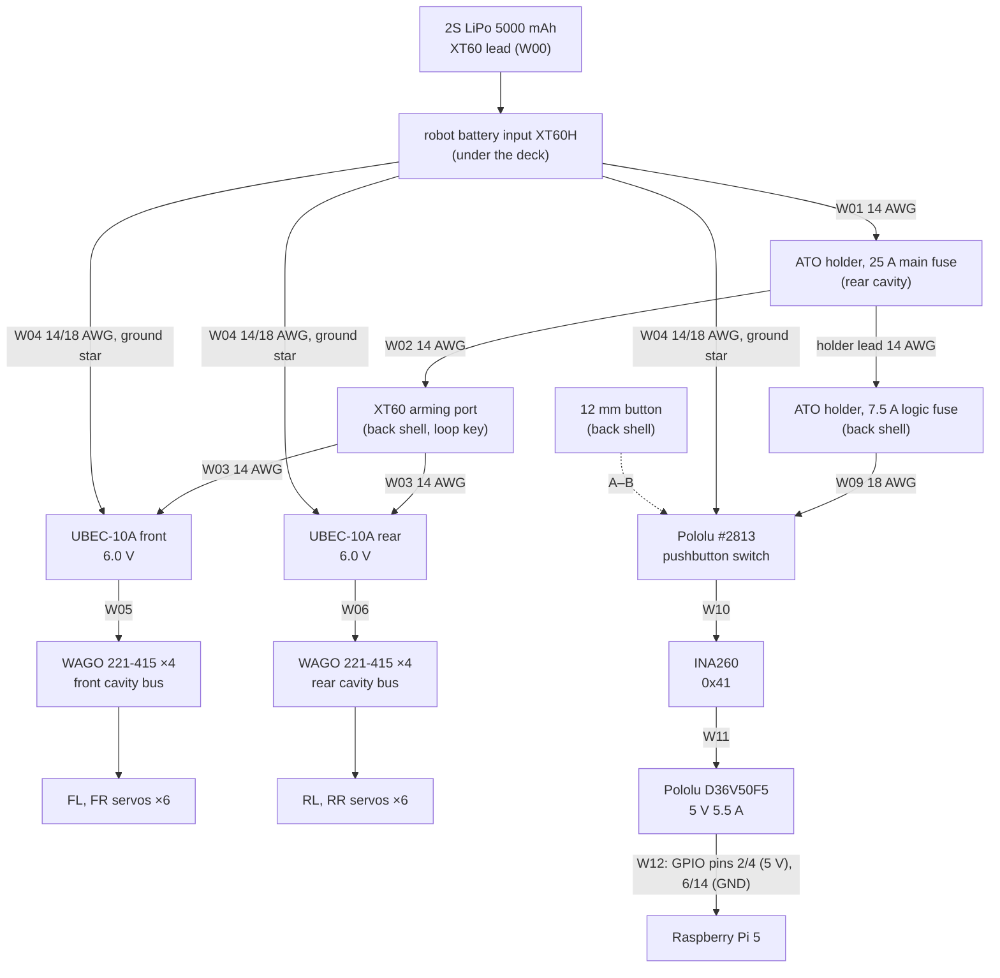
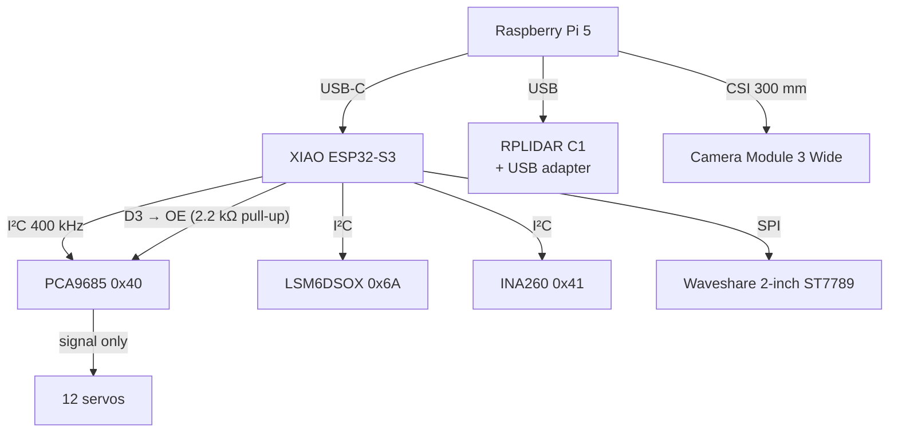
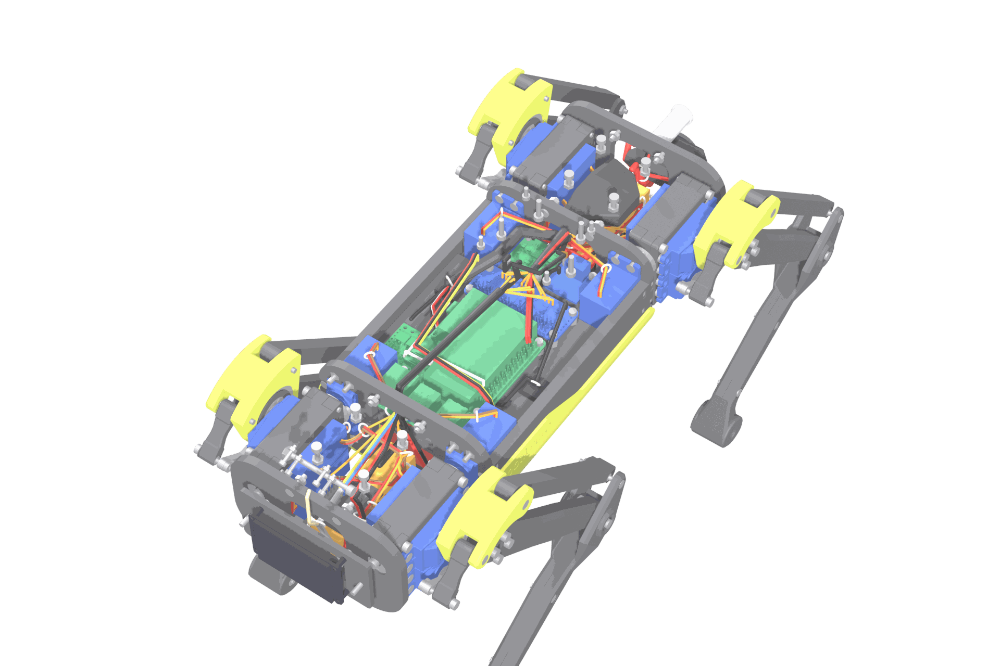

# Electronics, wiring and power

Strido splits the robot into two power domains that share one ground:

* **Servo domain (6.0 V):** battery → 25 A main fuse → arming loop key → two Hobbywing UBEC-10A → WAGO servo bus in the front and rear cavities → 12 servos. The PCA9685 supplies only the servo *signals*; servo current never flows through a logic board.
* **Logic domain (5 V):** battery → 25 A main fuse → 7.5 A logic fuse → Pololu pushbutton switch → INA260 (measures pack voltage and logic current) → Pololu D36V50F5 5 V/5.5 A → Raspberry Pi 5 GPIO 5 V pins. The Pi powers the XIAO ESP32-S3 (motion controller) and the LiDAR adapter over USB.

Board positions are in the CAD; the [interference check](verification/interference.md) covers every board, stand-off and connector body. Every cable is routed through the CAD as well (`hardware/wiring.yaml`, see [wiring harness](#wiring-harness)): the renders, the 3D viewer and the assembly manual draw it, and the [wiring check](verification/wiring.md) proves that every lead reaches, every loop across a hip joint has slack over the whole hip range and no cable touches a moving part in the operating poses.

**Power** (servo domain left, logic domain right):



**Signals:**



## Ratings and why these parts

| Element | Rating | Load in this robot | Margin / note |
|---|---|---|---|
| SPT5435LV servo | 4.8–6.0 V only; PWM signal 3.3–5.0 V; 35 kg·cm @ 6 V; stall 3.5 A | standing ≈ 0.7 N·m at the knee (MuJoCo) | 6.0 V is the upper limit: do **not** use the 7.4 V UBEC setting. The PCA9685 drives 3.3 V pulses (VCC = XIAO 3V3), exactly the servo's lowest rated signal level: in spec, without margin |
| Hobbywing UBEC-10A ×2 | 2–6S in; 6.0 V with no jumper; 10 A continuous, 15 A peak each | 6 servos each | 20 A continuous / 30 A peak total. Six stalled servos draw 21 A, more than one UBEC's 15 A peak: never command all legs into hard stops or apply power while servos are commanded (see first power-up) |
| WAGO 221-415 | 32 A, 0.2–4 mm² | ≤ 3 servos + feed per connector | 2 connectors (+/–) per leg, 8 in total |
| Main fuse (ATO) | 25 A | servo branch (≤ 2 × 10 A UBEC output ≈ 21 A at an empty pack) + logic | protects the 14 AWG trunk behind it; W01 (≈ 0.15 m from the battery input) is unfused like the pack's own lead |
| Logic fuse (ATO) | 7.5 A | logic branch ≤ 3 A | protects the 18 AWG logic wiring after its holder. The tap from W02 is the holder's own 14 AWG lead, so no wire thinner than 14 AWG sits behind the 25 A fuse alone |
| Pololu #2813 (Big Pushbutton Power Switch HP) | 4.5–40 V; 6 A continuous at 55 °C | logic branch ≤ 3 A | never in the servo branch; not an emergency stop (Pololu) |
| INA260 | 36 V, 15 A, 1.25 mA LSB | logic branch | measures pack voltage for the low-battery cut-off. **Required:** without it the firmware refuses to drive the servos |
| Pololu D36V50F5 | 5 V ± 4 %, 5.5 A typical continuous | Pi 5 + USB + camera ≈ 2–3 A | Pi needs `PSU_MAX_CURRENT=5000` (see below) |
| XT60 arming port | 30 A continuous | servo branch | the loop key is an XT60 with a 14 AWG bridge, see the gender rule below |

Every supply input and every logic signal is checked against its rated range by `python -m strido_verify.electronics` (rails, supplies and signals in `hardware/electronics.yaml`; report in [verification/electronics.md](verification/electronics.md)). Three pass without margin: the servo PWM and the LCD run at 3.3 V, the lowest level both accept, so a weak XIAO 3V3 rail (below 3.3 V) is the first thing to measure if a servo jitters or the LCD stays dark.

### XT60 contact rule (the loop key must never fit the battery)

Describe XT60 halves by their contacts, not by "male/female" (vendors use both words for both halves): one half has **pins**, the other **sockets** (Amass: XT60-M = pins, XT60-F = sockets). The loop key is a shorted connector, so it must carry the **same contact type as the battery's own connector**: then it cannot mate with the pack. The robot's battery input and the arming port carry the other type. Example: pack with sockets → robot battery input pins, arming port pins, loop key sockets. The CAD models an XT60H-F (sockets) arming port, i.e. a pack with pins; swap all three if your pack has sockets.

Check before bridging the key: take the *unbridged* key housing and try it on the pack connector; it must not fit. Never test with a bridged key. The battery itself can mate with the arming port; label the port "ARM" and always connect the pack to the battery input under the deck (W00 into the XT60H of W01/W04).

## Wiring list

Every cable of `hardware/wiring.yaml`; routes, cut lengths and the checks are in the [wiring check](verification/wiring.md) (regenerated from the CAD). Colour: red = +, black/brown = –, signals as noted.

| ID | From | To | Cable | Termination |
|---|---|---|---|---|
| W00 | battery (its own 12 AWG lead) | battery input XT60H, under the deck | supplied with the pack | plug in at Step 22 |
| W01 | battery input XT60H (+) | 25 A main fuse holder (rear cavity) | 14 AWG red in spiral wrap | solder, heat-shrink; spliced to the holder lead trimmed to 20 mm; unfused |
| W02 | main fuse out (holder lead trimmed to 20 mm) | back-shell splice → arming jack contact 1, and the logic fuse holder's own input lead (trimmed to its cut length) | 14 AWG red | solder + heat-shrink at the splices |
| W03 | arming jack contact 2 | splice under the deck → UBEC front IN+ and UBEC rear IN+ | 14 AWG red | solder; the loop key bridges the jack's two contacts |
| W04 | battery input XT60H (–) | ground star beside it → UBEC IN– ×2 (14 AWG), switch GND (18 AWG) | 14 / 18 AWG black | one star point at the battery input |
| W05 / W06 | UBEC front / rear OUT | port 0 of WAGO bay 0, front / rear cavity | UBEC lead extended with 18 AWG pair | strip 11 mm into the WAGO pair (red V+ upper, black GND lower) |
| W07 / W08 | WAGO port 4 of bay 0 | port 0 of bay 1 (second leg of the cavity) | 18 AWG, one wire per rail | along the WAGO faces |
| S-*leg*-*joint* (12) | servo lead | split at the base tie: red/brown → the leg's WAGO pair (port hip 1, thigh 2, knee 3); orange → PCA9685 channel | the servo's own 260 mm lead, cut to length | red/brown stripped into the WAGO; orange re-crimped (female Dupont, 1-pin housing) |
| W09 | 7.5 A logic fuse out (holder lead trimmed to 20 mm) | switch VIN | 18 AWG red | splice at the holder, screw terminal at the switch; its ground is W04 |
| W10 | switch VOUT | INA260 VIN+ | 18 AWG red | screw terminals; the INA260 is a high-side shunt |
| W11 | INA260 VIN– | D36V50F5 VIN | 18 AWG red | screw terminal, solder |
| W24 | switch GND | D36V50F5 GND | 18 AWG black | the INA260 terminal block takes only VIN+ and VIN–; its logic ground comes over I²C (W19) |
| W12 | D36V50F5 VOUT / GND | Pi 5 header pins 2 + 4 (5 V), 6 + 14 (GND) | 22 AWG ×4 | Dupont female crimp, one wire per pin (2 × 1.5 A per rail) |
| W13 | 12 mm pushbutton | switch A and B | 22 AWG pair | solder, heat-shrink |
| W14 | Pi 5 USB-A (lower port of the left stack) | XIAO USB-C | 20 cm USB-A (90°) → C | fold the spare length in the front cavity |
| W15 | Pi 5 USB-A (upper port) | LiDAR USB adapter (in the pedestal) | 20 cm USB-A (90°) → C | over the Pi beside the cooler fan, up through the top-shell slot |
| W16 | Pi 5 CAM/DISP 0 | Camera Module 3 Wide | 22→15 pin ribbon, 300 mm | through both shoulder-frame openings and the front-shell slot; fold flat |
| W17 | XIAO D4/D5 (SDA/SCL), 3V3, GND | PCA9685 left header (SDA, SCL, VCC, GND) | 22 AWG ×4 | soldered to the XIAO pins (no room for housings under the upper shoulder frame), Dupont crimps at the PCA |
| W18 | PCA9685 right header (VCC, SDA, SCL, GND) | LSM6DSOX STEMMA QT | STEMMA QT → female sockets, 150 mm | the IMU sits 2.5 mm under the Pi: only the low STEMMA QT plug fits |
| W19 | LSM6DSOX second STEMMA QT | INA260 header (VCC, SDA, SCL, GND) | STEMMA QT → female sockets, 150 mm | INA260 A0 jumper bridged → 0x41 |
| W20 | XIAO D3 | PCA9685 OE | 22 AWG green | high = all servo outputs off. Solder a 2.2 kΩ resistor from OE to VCC on the PCA9685 header: the board pulls OE low, so without it the outputs stay on while the XIAO resets or sits in its bootloader |
| W21 | XIAO D8, D10, D9, D0, D1, D2, 3V3, GND | LCD CLK, DIN, DC, CS, RST, BL, VCC, GND | display cable (PH2.0 8-pin, 200 mm, supplied) | its Dupont ends soldered to the XIAO pins; 3V3 and GND share the pins of W17 |
| W22 (optional) | Pi 5 GPIO 26 (pin 37) | switch OFF | 22 AWG white | Dupont crimp at the Pi, soldered at the switch; lets the Pi cut its own power after shutdown, see below |
| W23 | RPLIDAR C1 | its USB adapter | the sensor's own cable | through the notch at the pedestal front |

## Pin maps

**XIAO ESP32-S3** (`firmware/strido_esp32s3/src/board_config.h` is the source of truth)

| XIAO pin | GPIO | Function |
|---|---|---|
| D0 | 1 | LCD CS |
| D1 | 2 | LCD RST |
| D2 | 3 | LCD backlight (PWM; strapping pin, driven only after boot) |
| D3 | 4 | PCA9685 OE (active low enable; firmware holds it high until armed) |
| D4 | 5 | I²C SDA |
| D5 | 6 | I²C SCL |
| D8 | 7 | LCD SCK |
| D9 | 8 | LCD DC |
| D10 | 9 | LCD MOSI |
| — | 21 | on-board user LED (status) |

**PCA9685 channels** (200 Hz, 500–2500 µs)

| Leg | hip | thigh | knee crank |
|---|---|---|---|
| FL | 15 | 11 | 7 |
| FR | 14 | 10 | 6 |
| RL | 13 | 9 | 5 |
| RR | 12 | 8 | 4 |

**I²C bus:** PCA9685 0x40 (and its all-call 0x70), LSM6DSOX 0x6A, INA260 0x41 (A0 bridged; 0x40 would collide with the PCA9685).

## Power budget and runtime

| Consumer | Typical | Peak | Source |
|---|---|---|---|
| 12 servos standing | ≈ 30 W (≈ 5 A at 6 V) | — | [ESTIMATE] from the MuJoCo standing torques and the 3.5 A stall current at 3.43 N·m |
| 12 servos trotting | ≈ 50 W | > 150 W for ms | [ESTIMATE] |
| Pi 5 + cooler | 5–7 W | 12 W | Raspberry Pi |
| RPLIDAR C1 | ≈ 1.2 W | — | Slamtec datasheet |
| Camera, XIAO, LCD, IMU, PCA | ≈ 1.5 W | — | datasheets |
| **Total trotting** | ≈ 60 W from the pack (90 % converters) | | |

2S 5000 mAh ≈ 37 Wh, 80 % usable → **≈ 30 min trotting, ≈ 45 min standing** [ESTIMATE; measure with `/battery_state` and the arming-key current with a clamp meter]. The firmware warns at 6.8 V (3.4 V/cell) and relaxes the servos at 6.4 V (3.2 V/cell).

## Wiring harness



The harness is designed in the CAD, not improvised in the build: `hardware/wiring.yaml` names every cable, the connector each end sits on and the tie points it passes; `strido_cad.wiring` routes the legs between those points through the free space of the robot (every base part and everything the legs sweep over their joint ranges is kept out), and the result is drawn in the renders, the [3D viewer](viewer.md) and the [assembly manual](assembly/README.md) (Steps 14–16, the shell steps and Step 20). The [wiring check](verification/wiring.md) then proves, independently of the router:

* **reach:** every ready-made lead (servo leads 260 mm, USB 200 mm, ribbon 300 mm, STEMMA QT 150 mm, the pack lead) covers its route with at least 10 mm to spare;
* **stock:** the cut list (route + strip/solder allowance + 8 % slack) fits the wire, spiral wrap and ties in the BOM;
* **hip loops:** the leads of the thigh and knee servos ride on the hip and cross the hip joint near its axis; each has a free loop at least 1.2 × the largest distance its two ties reach over the whole hip range (36 mm thigh, 40 mm knee);
* **clearance:** no cable passes through a part, and against every part of another body (legs, horns, links) it keeps the running clearance of the moving-parts check in the 13 operating poses (the router keeps cables out of everything the legs sweep over a grid of joint angles);
* **ports:** one cable per WAGO entry, one plug per PCA9685 channel.

Build order (the manual draws each step):

1. **Servo bus.** Clip the four WAGO 221-415 into each bus holder: one V+ (upper) and one GND (lower) connector per leg; all entries face the robot's left side. Bay 0 (front of each cavity): UBEC feed port 0, hip/thigh/knee ports 1–3, jumper port 4. Bay 1: jumper port 0, servos 1–3, port 4 spare. Unclip a WAGO pair to open its levers: the XIAO platform blocks them in bay 0.
2. **UBECs.** Leave the output jumper open (6.0 V). Measure the unloaded output before connecting any servo: accept 5.8–6.0 V (the servo is rated up to 6.0 V; return a unit that reads higher). Foam-tape both UBECs into the side pockets under the deck.
3. **Power entry (Step 14).** Battery input XT60H with W01 (red, in spiral wrap) and W04 (black) in the pocket beside the battery; ground star; main fuse holder (leads trimmed to 20 mm) on the rear WAGO bus, tied to the upper shoulder frame; W02, W03 and W09 run to the back-shell space; no fuses yet.
4. **Servo leads (Step 15).** Tie each thigh and knee lead at the servo mount plate, leave the free loop, tie it at the shoulder frame or bus holder; split it there: red/brown cut to length into the leg's WAGO pair, orange cut to length and re-crimped for its PCA9685 channel. Hip servo leads split at the inner frame opening.
5. **Logic and signals (Step 16).** W10/W11 (18 AWG red) from the switch through the INA260 (A0 bridged) to the D36V50F5, W24 (18 AWG black) switch GND to regulator GND, W12 crimped but **not yet plugged** into the Pi, W14, W17–W20, W22.
6. **Shell steps.** Display cable W21 (Step 17), camera ribbon W16 (Step 18); rear panel (Step 19): button W13, W02/W03 soldered to the arming jack, logic fuse holder spliced into W02 and W09.
7. **Supply check and dressing (Step 20).** Pack plugged in for a moment, both fuses in, loop key out, button pressed: 4.8–5.2 V at the W12 Dupont ends (D36V50F5: 5 V ± 4 %); fuses out again, then plug W12 onto Pi pins 2/4/6/14. Spiral wrap on every bundle of three or more cables and on W01, ties at the marked points, two adhesive tie mounts on the deck; move every leg through its range by hand and check nothing pulls or rubs. The LiDAR cables go in with the top shell (Step 21), the pack lead with the battery (Step 22).
8. **Smoke test without servos:** fuses in, loop key **out**, power on → Pi boots, `ros2 topic echo /battery_state` shows the pack voltage, `/diagnostics` shows `pwm_ok`, `imu_ok`, `power_ok`. Hold the XIAO's BOOT button and press RESET: OE must read ≥ 2.4 V (outputs off) while it sits in the bootloader.

Why the harness is laid out this way: [cable management](wiki/making/cable-management.md) (decision: [ADR-011](decisions.md#adr-011-wiring-harness-routed-and-checked-in-the-cad)).

## Raspberry Pi configuration

Power through the GPIO 5 V pins bypasses USB-PD, so tell the Pi the supply can deliver 5 A:

```bash
sudo rpi-eeprom-config --edit        # add:  PSU_MAX_CURRENT=5000
echo "usb_max_current_enable=1" | sudo tee -a /boot/firmware/config.txt
```

Stable device names (`ros2/strido_bringup/config/99-strido.rules`):

```bash
sudo cp ros2/strido_bringup/config/99-strido.rules /etc/udev/rules.d/ && sudo udevadm control --reload && sudo udevadm trigger
```

Optional self power-off (W22): `dtoverlay=gpio-poweroff,gpiopin=26` in `config.txt` drives GPIO 26 high after shutdown, which pulses the switch's OFF input. [UNVERIFIED on Pi 5: test with the servos disarmed before relying on it.]

## Safety rules

* Charge only in a LiPo bag with a balance charger; never leave charging unattended.
* The loop key is the servo kill: pull it to disarm. The pushbutton switch is not an emergency stop (Pololu says so explicitly).
* `/strido/estop` latches: the firmware pulls PCA9685 OE high and stops all pulses.
* Startup order: logic on → robot lying in the rest pose (legs folded) → insert the loop key (servos stay limp; the controller sends no pulses before the first position command) → start `ros2 launch strido_bringup robot.launch.py` (servos go to the rest pose, then a 3 s stand-up). Never insert the key while position commands are running: all servos would jump at once.
* The firmware refuses to drive without a working INA260 (no low-battery cut-off otherwise). The cut-off needs 5 consecutive readings (0.5 s) below 6.4 V, so load sags do not drop the robot mid-step.
* Without commands for 200 ms the servos hold their pose; 2 s later they relax. There is no separate keep-alive: if the gait or policy node dies, the robot holds, then relaxes.
