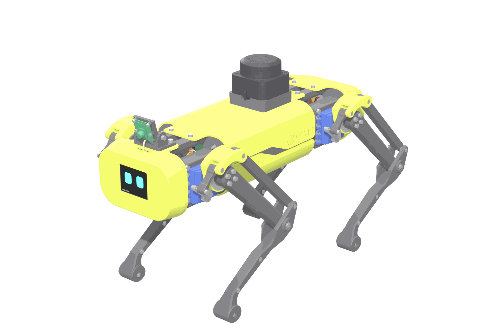

# Strido at a glance

> **Status:** design verified in CAD and simulation; no robot has been built from this revision yet (see [verification](verification.md)).

Strido is a 3D-printed, 12-DoF quadruped in the class of the Mini Pupper 4: small enough for a desk, complete enough to develop real ROS 2 and learning software that transfers to a Unitree Go2. It keeps the proven legs and frame of [Yertle](https://github.com/Jerome-Graves/yertle) (MIT, Jerome Graves) and adds the sensor head, electronics and software stack of a modern research robot.

## Specifications

| Property | Strido |
|---|---|
| Size (standing, incl. LiDAR) | 430 × 188 × 264 mm |
| Mass (CAD, incl. battery) | ≈ 3.0 kg |
| Actuation | 12 × SPT5435LV, 35 kg·cm at 6 V; knee driven through a crank and four-bar linkage |
| Compute | Raspberry Pi 5 (4 GB) + Seeed XIAO ESP32-S3 motion controller (200 Hz) |
| Sensors | RPLIDAR C1 (unobstructed 360°), Camera Module 3 Wide, LSM6DSOX IMU, INA260 power monitor |
| Face | Waveshare 2" ST7789 LCD behind the front shell |
| Power | 2S 5000 mAh LiPo; 2 × 6.0 V UBEC for the servos; 5 V/5.5 A logic regulator; 25 A main + 7.5 A logic fuse; XT60 arming key |
| Software | ROS 2 Jazzy (Docker, amd64/arm64), Gazebo Harmonic, MuJoCo 3, PPO, NT-X extension |
| Cost | from €979 incl. shipping to Austria (plan A, lowest total; see the [shop](shop.md) and the [shopping list](bom/shopping_list.md)) |

## How it compares

| | Strido | Mini Pupper 2 | Mini Pupper 4 (pre-production) | Unitree Go2 |
|---|---|---|---|---|
| Leg DoF | 12 | 12 | 12 | 12 |
| Size class | 430 mm | 210 mm | ≈ 250 mm | 700 mm |
| Motion controller | ESP32-S3 | ESP32-S3 | n/a | proprietary |
| LiDAR / camera / face | yes / yes / yes | optional / yes / yes | yes / yes / yes | yes / yes / no |
| ROS 2 contract | Go2 joint names, `/cmd_vel`, `/scan` | MangDang stack | MangDang stack | Unitree SDK2 / ROS 2 |
| Openness | full CAD, print files, firmware, sim models | partial | not published | closed |

The point is transfer: develop navigation, perception and learning at home against the same ROS 2 topics and joint conventions as the Go2, then move the application layer to the Go2 at work. Low-level gaits and learned policies do not transfer unchanged between a 3 kg hobby-servo robot and a 15 kg Go2; see [simulation](simulation.md).

## What changed compared with Yertle

* **Sensor head:** front shell with LCD window and bracket; tilting camera mount; LiDAR pedestal lifting the scan plane above every leg pose.
* **Electronics:** Pi 5 + XIAO ESP32-S3, PCA9685 with hardware output-enable kill, IMU, power monitor; servo current on two UBECs through WAGO buses, never through a logic board.
* **Mechanics fixed by the verification harness:** front servo mounts get the missing hip-pivot pilot; right-leg femur horns and connectors aligned to the printed hole pattern; LiDAR pedestal pilots deepened so the screws clamp; hip limits that keep the feet apart when both legs swing in.
* **Software:** linkage-exact knee mapping, watchdog, latched e-stop, battery cut-off, Go2-style ROS 2 contract, MuJoCo/Gazebo models generated from CAD, PPO training, NT-X integration.

Continue with [getting started](getting-started.md).
