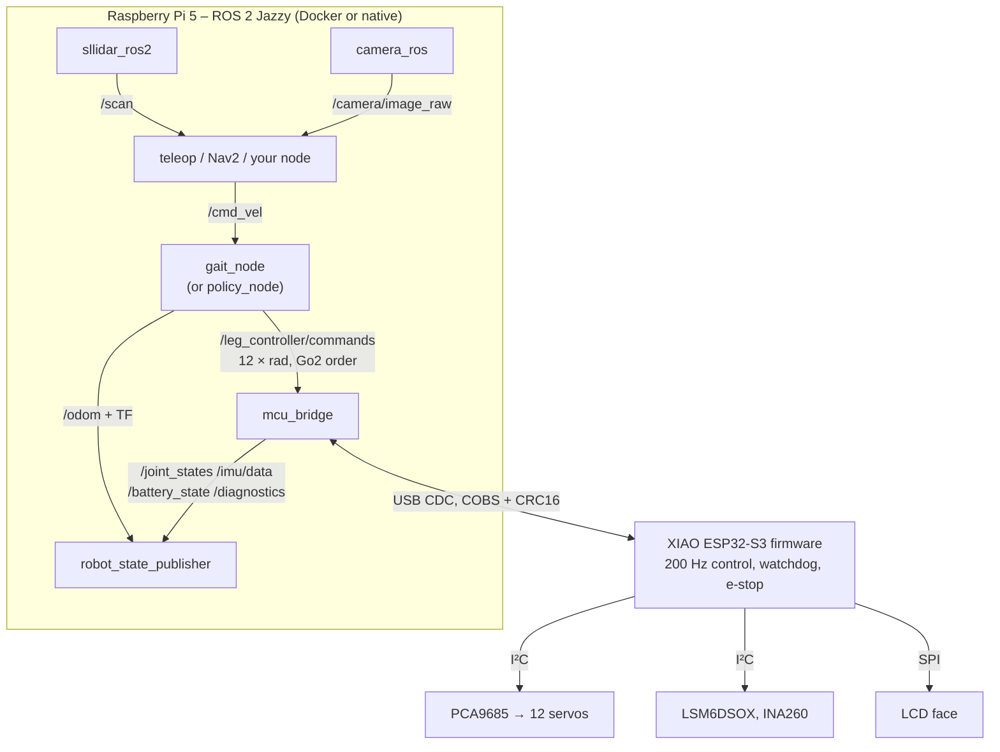

# Software



The same `/leg_controller/commands` topic is consumed by `ros2_control` in Gazebo and by `mcu_bridge` on the robot, so every node above the bridge runs unchanged in simulation and on hardware.

## ROS 2 interface (Go2-style)

| Topic | Type | Direction | Notes |
|---|---|---|---|
| `/cmd_vel` | geometry_msgs/Twist | in | vx, vy [m/s], wz [rad/s]; limits 0.30 / 0.15 / 1.0; 0.5 s timeout → stand |
| `/leg_controller/commands` | std_msgs/Float64MultiArray | internal | 12 joint angles [rad] in Go2 order FL, FR, RL, RR × hip, thigh, calf |
| `/joint_states` | sensor_msgs/JointState | out | Go2 joint names (`FL_hip_joint` …). Robot: angles the MCU applies after clamping (hobby servos have no feedback) |
| `/imu/data` | sensor_msgs/Imu | out | orientation (Mahony on the MCU), angular velocity, acceleration; frame `imu_link`; not published while the IMU reports a fault |
| `/scan` | sensor_msgs/LaserScan | out | RPLIDAR C1, frame `lidar_link`, 10 Hz |
| `/camera/image_raw` | sensor_msgs/Image | out | Camera Module 3 Wide, frame `camera_optical_frame` |
| `/battery_state` | sensor_msgs/BatteryState | out | pack voltage + logic-branch current (INA260), negative = discharging |
| `/odom` + TF `odom→base_link` | nav_msgs/Odometry | out | dead reckoning of the *commanded* velocity (gait_node only) |
| `/strido/estop` | std_msgs/Bool | in | true = latched stop (servo outputs off), false = release |
| `/strido/relax` | std_msgs/Bool | in | true = servos limp |
| `/strido/face` | std_msgs/UInt8 | in | LCD expression |
| `/diagnostics` | diagnostic_msgs/DiagnosticArray | out | MCU flags: estop, relaxed, watchdog, imu_ok, power_ok, pwm_ok, clamped |

Frames follow REP-103 (`base_link`: x forward, y left, z up); joint zero = leg straight down, thigh positive = foot backwards, calf negative = knee bent (Go2 convention).

### Porting code from a Unitree Go2

Joint names, signs, frames and `/cmd_vel` follow the Go2 ROS 2 description, so velocity-level stacks (teleop, Nav2, SLAM with `/scan`) run unchanged. Differences: the command array order is FL, FR, RL, RR (the Unitree SDK motor index order is FR, FL, RR, RL: map by joint name, not by index), there are no foot-contact or motor-torque topics, `/joint_states` are commanded values, the speed envelope is ≈ 0.3 m/s, and the low-level `unitree_go` messages are not provided.

## Packages

| Path | Contents |
|---|---|
| `ros2/strido_description` | URDF/xacro and meshes **generated from CAD** (`strido_cad.models`), ros2_control controller config, `display.launch.py` |
| `ros2/strido_bringup` | `gazebo.launch.py`, `robot.launch.py`, world, udev rules |
| `ros2/strido_control` | `gait_node`, `policy_node`, `mcu_bridge`, `walk_smoke` |
| `packages/strido-core` | pure-Python core shared by ROS, MuJoCo and tests: generated geometry, leg/linkage kinematics, trot gait, MCU protocol, numpy policy runtime, `strido-cli` |
| `firmware/strido_esp32s3` | PlatformIO firmware; `lib/strido_core` holds the portable kinematics/protocol/safety code with native unit tests |

Launch:

```bash
ros2 launch strido_bringup gazebo.launch.py headless:=false        # simulation with GUI
ros2 launch strido_bringup robot.launch.py                          # on the robot (add camera:=true once camera_ros is installed)
ros2 launch strido_bringup robot.launch.py use_policy:=true policy:=/path/policy.npz   # learned controller
ros2 launch strido_description display.launch.py                    # model + joint sliders in RViz
```

## Firmware

PlatformIO, Arduino-ESP32 3.x on the Seeed XIAO ESP32-S3:

```bash
cd firmware/strido_esp32s3
pio test -e native            # kinematics, protocol, safety unit tests on the host
pio run -e xiao_esp32s3 -t upload
```

* 200 Hz loop: command → linkage-exact joint→servo mapping (`servo_map`, generated geometry) → slew limit 6 rad/s → PCA9685 pulses (200 Hz PWM).
* Safety: only joint commands feed the watchdog (no keep-alive message): no command for 200 ms → hold, 2 s more → relax; latched e-stop; PCA9685 OE pin pulled high on relax/e-stop (plus a hardware pull-up for resets); battery warn 6.8 V, cut-off after 5 consecutive readings below 6.4 V; no driving without the INA260; non-finite commands rejected; joint and knee-crank limits from the CAD range-of-motion sweep.
* Calibration (neutral pulse, direction, limits per joint) is stored in flash (`Preferences`).

### Protocol (USB CDC)

Frames: `COBS(type | payload | CRC16-CCITT-FALSE little endian) 0x00`. Payloads are little-endian packed structs, mirrored in `packages/strido-core/src/strido/protocol.py` and `firmware/.../protocol.h`.

| Type | Name | Payload |
|---|---|---|
| 0x01 | JOINT_COMMAND | seq u16, mode u8 (0 relax, 1 position), q[12] f32 |
| 0x02 | SERVO_PULSE_COMMAND | seq u16, pulse_us[12] u16 (0 = off) – calibration only |
| 0x03 | SET_CALIBRATION | joint u8, direction i8, neutral_us u16, zero_rad f32, min_us u16, max_us u16 |
| 0x04 | SAVE_CALIBRATION | – |
| 0x05 | REQUEST_CALIBRATION | – → 12 × CALIBRATION |
| 0x06 | ESTOP | engaged u8 |
| 0x07 | DISPLAY | expression u8, length u8, text |
| 0x81 | STATE (100 Hz) | last seq u16, time_ms u32, flags u8, q[12], quat wxyz[4], gyro[3], accel[3], bus V, current A (f32) |
| 0x82 | CALIBRATION | as SET_CALIBRATION |
| 0x83 | LOG | ASCII |

## Bench tool

`strido-cli` (installed with `packages/strido-core`) talks to the controller without ROS:

```bash
strido-cli center                 # 1500 µs on every channel: the assembly reference (fit horns now; raw pulses bypass joint limits)
strido-cli pulse FL_thigh 1600    # one joint
strido-cli calibrate              # trim each joint's neutral (±5/±25 µs), saved to flash
strido-cli monitor                # battery, flags, roll/pitch
```

## Raspberry Pi setup

1. Ubuntu Server 24.04 (arm64) or Raspberry Pi OS Bookworm 64-bit; Docker Engine.
2. `docker compose -f docker/compose.yaml build ros` (ROS 2 Jazzy, Gazebo libraries, sllidar_ros2 pinned, this repo's packages).
3. Power and udev configuration: see [electronics.md](electronics.md#raspberry-pi-configuration).
4. Camera: the Pi 5 camera stack needs the Raspberry Pi libcamera fork; build `camera_ros` against it on the host (Raspberry Pi OS ships it) or use `rpicam-vid` + a GStreamer bridge, then launch with `camera:=true` (default false; the Docker image has no camera node).
