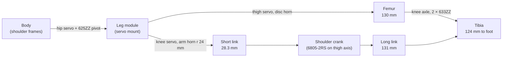

# Mechanics: legs, linkages, bearings and fits

A walking robot is a set of rigid links joined by joints, and how well it walks depends on how those joints are built: what turns on what, where the motors sit, and how much play each joint allows. This page follows one Strido leg from the body to the foot, then explains the bearings, the joint limits and why tenths of a millimetre matter on printed parts.

::: tip In Strido
- **Kinematic data:** `hardware/kinematics.yaml` (link lengths measured from the upstream STEP), `hardware/joint_limits.yaml` (collision-free limits), generated into `firmware/.../geometry_generated.h` and `packages/strido-core/src/strido/geometry.py`.
- **Printed parts per leg:** `femur`, `femur_servo_connector`, `left_shoulder` / `right_shoulder` (shoulder crank), `short_link`, `stiff_long_link` (Strido, replaces the upstream `long_link`), `inner_tibia`, `outer_tibia`, `foot_spacer`, servo mount and `servo_mount_top_bracket`, `hip_bearing_pin`.
- **Bearings:** 4 × 625ZZ, 4 × 6805-2RS, 8 × 633ZZ, 32 × sintered bronze sleeves 3 × 5 × 5 (BOM lines `bearing_625zz`, `bearing_6805`, `bearing_633zz`, `sleeve_3x5x5`).
- **Verification:** `docs/verification/fits.md` (screws and bearing seats), `clearance.md` (moving parts), `interference.md` (static overlaps), tolerance rules in `hardware/verification/tolerances.yaml`.
:::

## Degrees of freedom

Each leg has **three degrees of freedom (DoF)**, one servo each:

| Joint | Moves the leg | Servo location | Drive |
|---|---|---|---|
| Hip (abduction) | sideways, about an axis along the body | in the body, through the inner shoulder frame | direct, via a 25T disc horn |
| Thigh | forwards and backwards | in the leg module's servo mount | direct, via a 25T disc horn into the femur servo connector |
| Knee | bends the lower leg | in the same servo mount, beside the thigh servo | indirect, through a crank and two linkages |

Three DoF per leg is the minimum to put a foot anywhere in 3D space within reach. Four legs give 12 servos in total, the same layout as a Unitree Go2. That is why Strido can use the Go2 joint names and conventions.

## The kinematic chain of one leg

### Hip: supported on both sides

The hip servo's spline carries one side of the leg module. The other side turns on a **625ZZ** bearing in the outer shoulder frame, on the printed `hip_bearing_pin` and an M3 × 10 pivot screw. Supporting the axis at both ends means the leg's weight and the ground forces are not carried by the servo's own small output bearings alone, as they would be in a cantilever.

### Thigh: direct drive

The thigh servo turns the femur directly. The aluminium disc horn is clamped inside the `femur_servo_connector` and bolted to the femur with 4 × M3 × 20. The femur is 130 mm from thigh axis to knee.

### Knee: crank, parallelogram and four-bar

Putting the knee servo *at* the knee would hang 72 g of servo at the end of the thigh, where it adds the most inertia to every swing. Strido keeps the knee servo up in the leg module and transmits its motion down the leg:

1. **Servo arm → shoulder crank (parallelogram).** The knee servo's arm horn (radius 24.0 mm) drives the **short link** (28.28 mm). The short link drives the shoulder crank's first arm (radius 24.0 mm), which turns about the **thigh axis** on a **6805-2RS** bearing. The servo shaft and the thigh axis are 28.26 mm apart. Two equal cranks joined by a link as long as their spacing form a **parallelogram**: the shoulder crank copies the servo's angle exactly onto the thigh axis.
2. **Shoulder crank → tibia (four-bar).** The crank's second arm (radius 26.92 mm) pushes the **long link** (131 mm) to a 24 mm crank on the tibia. The tibia turns on two **633ZZ** bearings at the knee axle. Together with the femur (130 mm) this forms a **four-bar linkage**.

Because the four-bar's ground link is the femur itself, and the arm lengths are not equal, the calf angle depends **non-linearly** on both the crank angle *and* the thigh angle. Moving the thigh alone changes the knee angle. The firmware (`servo_map.cpp`, `kinematics.cpp`) and `strido-core` (`leg.py`) therefore solve the linkage exactly, converting every requested calf angle into a knee-crank angle.

The upstream Yertle CAD has a small inconsistency here: the drawn knee (−98.8°) and the angle at which the linkage actually closes (−101.2°) differ, a 1.02 mm link-length mismatch. Strido uses the measured lengths, not the drawn pose (`docs/design.md`).

### Transmission angle

In a four-bar, the **transmission angle** is the angle between the coupler (long link) and the output crank. Near 0° or 180° the link pushes along the crank instead of turning it. Force transmission collapses there, and the linkage can jam or snap through. The range-of-motion sweep rejects every pose with a transmission angle below **25°** (`transmission_min_deg`).

## Joint limits

The limits come from a collision sweep of the complete assembly: every printed part, bearing, horn and Strido fastener. The sweep runs over thigh × calf on a 5° grid at zero abduction, followed by a hip sweep at the standing and mid poses. A further rule keeps every servo within **±85°** of its assembly neutral, inside its ±90° travel. These are the generated values (the sweep result in `hardware/joint_limits.yaml`, clamped to the servo travel in `codegen.py` / `geometry_generated.h`; the front thigh minimum of −40° comes from that clamp):

| Joint | FL | FR | RL | RR |
|---|---|---|---|---|
| Hip | −17.5…50° | −50…17.5° | −17.5…45° | −45…17.5° |
| Thigh | −40…125° | −40…125° | −15…125° | −15…125° |
| Calf | −150…−45° | −150…−45° | −150…−45° | −150…−45° |
| Knee crank | −2.5…75° | −2.5…75° | −2.5…75° | −2.5…75° |

Front thighs sweep collision-free to −45°, but the ±85° travel rule around the 45° neutral cuts them to −40°. On the FL leg, 566 of the thigh × calf grid cells collide and 422 are feasible.

The firmware clamps every command to these limits and reports `clamped` in `/diagnostics` when it had to. Sign conventions follow the Go2: thigh positive = foot backwards, calf negative = knee bent.

## Bearings

| Bearing | Size (bore × OD × width) | Qty | Where |
|---|---|---|---|
| 625ZZ | 5 × 16 × 5 mm | 4 | hip pivot, outer shoulder frames |
| 6805-2RS | 25 × 37 × 7 mm | 4 | shoulder crank, turning about the thigh axis around the femur servo connector |
| 633ZZ | 3 × 13 × 5 mm | 8 | knee, two per tibia (inner and outer half) |
| Sintered bronze sleeve | 3 × 5 × 5 mm | 32 | link eyes, two per eye, 8 per leg |

**Suffixes:** **ZZ** means a metal shield on both sides, which keeps out dust but is not sealed. **2RS** means rubber seals on both sides, which also keep the grease in.

**Ball bearings vs sleeves.** A ball bearing rolls, so friction is low and stays low under load. That suits the joints that carry the robot's weight and turn through large angles. A **sintered bronze sleeve** is a porous, oil-impregnated plain bearing: tiny, cheap, and good for link pins that only oscillate a few tens of degrees on an M3 screw. A printed hole alone would wear oval quickly; the bronze sleeve gives the screw a hard, lubricated surface to turn in.

**How long does a ball bearing last?** Rolling contact eventually fatigues the raceways. The standard rating life (ISO 281) of a ball bearing is

$$
L_{10} = \left(\frac{C}{P}\right)^{3}\quad\text{million revolutions}
$$

where $C$ is the bearing's basic dynamic load rating from the catalogue, $P$ the equivalent load it carries, and $L_{10}$ the life that 90 % of a large batch of bearings reach. The exponent 3 applies to ball bearings (roller bearings use $10/3$). The cube makes life very sensitive to load: halving $P$ gives eight times the life. As a worked example, take the robot's 3.07 kg (`docs/design.md`) in a trot, where two legs carry the weight, so each leg sees about $P \approx 3.07\,\mathrm{kg} \times 9.81\,\mathrm{m/s^2} / 2 \approx 15.1\,\mathrm{N}$ when standing still in mid-stance. With $C \approx 1.14\,\mathrm{kN}$, a typical catalogue rating for a 625 deep-groove bearing (check your supplier's data sheet),

$$
L_{10} \approx \left(\frac{1140\,\mathrm{N}}{15.1\,\mathrm{N}}\right)^{3} \approx 4.3 \times 10^{5}\ \text{million revolutions}
$$

Dynamic foot impacts are several times the static load, and the joints only oscillate, but even a tenfold load leaves hundreds of millions of revolutions. Fatigue is not what limits these bearings; dirt, a creeping outer ring or a cracked printed seat is. See [statics and dynamics](../theory/statics-and-dynamics.md) for how joint loads arise.

Test-fit every bearing and sleeve in its printed seat **before** assembly (`docs/assembly/README.md`).

## Fits: press, transition and clearance

A **fit** describes how a shaft and hole of nominally the same size go together:

| Fit | Hole vs part | Use |
|---|---|---|
| Clearance | hole always larger | parts that must slide or turn: screws through clearance holes, link eyes on pins |
| Transition | about the same size | located parts that can still be pushed in by hand |
| Interference (press) | hole always smaller | parts that must never move in their seat: bearing outer rings, sleeves |

A bearing must turn on its **balls**, not in its seat. If the outer ring creeps in a loose seat, the plastic wears and the joint develops play. If the seat is far too tight, the printed part cracks, or the outer ring is squeezed so the bearing binds.

### Strido bearing seats

`tolerances.yaml` allows a CAD seat bore between **0.15 mm under** and **0.30 mm over** the bearing's outer diameter. FDM printers print holes about **0.15 mm undersize**, so these CAD bands already include the expected shrink. All 32 seats pass (`docs/verification/fits.md`):

| Bearing | OD | CAD seats measured | Difference to OD |
|---|---|---|---|
| 625ZZ (outer shoulder frame) | 16.0 mm | 16.17–16.21 mm | +0.17 to +0.21 mm |
| 633ZZ (tibia halves) | 13.0 mm | 13.18–13.23 mm | +0.18 to +0.23 mm |
| 6805-2RS (shoulder crank) | 37.0 mm | 36.92–36.95 mm | −0.05 to −0.08 mm |
| Sleeve, short link | 5.0 mm | 4.98–4.99 mm | about −0.02 mm |
| Sleeve, long link | 5.0 mm | 4.85–4.95 mm | −0.05 to −0.15 mm |

If a printed seat comes out loose and the bearing spins, a drop of CA glue fixes it (`tolerances.yaml`).

### Screws in printed holes

The same shrink affects every screw hole. The fits check samples 223 screws: 0 fail, 137 warnings, each with an action.

- **Clearance holes** that print tight: run a 3.2 mm drill (ISO 273 fine series for M3) through once.
- **Thread-forming holes**, where the screw cuts its own thread in plastic: the printed pilot should be 0.70–0.90 × the screw diameter. Above that the screw grips weakly: tighten by feel, and if it spins, harden the pilot with a drop of thin CA glue and re-drive (anaerobic thread locker does not cure on plastic). The upstream servo mounts sit just above the band (ADR-009). Print them with −0.15 mm X-Y hole compensation, or CA-harden their pilots.
- **Lock-nut joints** in the linkage: tighten only until the joint is free of play. The links must still swing under their own weight (`docs/assembly/README.md`, Step 12).

## Why tolerances matter so much on printed parts

`tolerances.yaml` assumes each printed surface can deviate by about 0.15 mm (0.4 mm nozzle, 0.2 mm layers). That sounds small, but leg joints act as levers. Suppose the thigh joint has a hypothetical 0.2 mm of play, measured 24 mm from its axis (the radius of the knee-drive cranks):

$$
\Delta\theta \approx \frac{s}{r} = \frac{0.2\,\mathrm{mm}}{24\,\mathrm{mm}} \approx 0.0083\,\mathrm{rad} \approx 0.48^\circ
$$

This is the small-angle form of arc length, $s = r\,\Delta\theta$. The foot can be up to $l_1 + l_2 = 130\,\mathrm{mm} + 124\,\mathrm{mm} = 254\,\mathrm{mm}$ from the thigh axis, so the same angle moves it by

$$
\Delta x \approx \Delta\theta \,(l_1 + l_2) \approx 0.0083 \times 254\,\mathrm{mm} \approx 2.1\,\mathrm{mm}
$$

Small errors in several joints add up, and the foot then lands somewhere other than where the kinematics expected. The same deviations can also make moving parts rub. The moving-clearance check therefore treats any gap below **0.3 mm** between parts on different links as a failure (it could close after printing) and below **1.0 mm** as tight (it may rub on a rough print). Across 13 poses Strido has **0 failures** and **4 tight pairs**: the front and back shells against the arm horns and shoulder cranks at full hip abduction, 0.73–0.79 mm (`docs/verification/clearance.md`).

## Check yourself

1. Why is the knee servo placed in the leg module instead of at the knee?
2. Why does moving only the thigh servo change the calf angle?
3. What goes wrong if a 633ZZ seat prints far too loose? Far too tight?
4. A screw hole for an M3 clearance fit prints at 2.95 mm. What do you do?
5. Estimate the foot wobble from 0.1 mm radial play at the 24 mm tibia crank, with the foot 124 mm from the knee.

Answers

1. To keep mass and inertia out of the swinging lower leg, so the leg can accelerate faster with the same servo torque.
2. The four-bar that drives the tibia is anchored on the femur, so rotating the femur changes the linkage geometry and therefore the knee angle.
3. Too loose: the outer ring turns in the plastic, wears the seat and adds play (fix with a drop of CA glue). Too tight: the seat cracks or the squeezed outer ring makes the bearing bind.
4. Run a 3.2 mm drill through it once (ISO 273 fine clearance for M3).
5. $\Delta\theta \approx 0.1 / 24 \approx 0.0042\,\mathrm{rad}$; $\Delta x \approx 0.0042 \times 124\,\mathrm{mm} \approx 0.5\,\mathrm{mm}$ at the foot.

## Further reading

- [Four-bar linkage (overview and transmission angle)](https://en.wikipedia.org/wiki/Four-bar_linkage)
- [Deep groove ball bearings (SKF)](https://www.skf.com/group/products/rolling-bearings/ball-bearings/deep-groove-ball-bearings)
- Related pages: [Servos](servos.md), [Kinematics and gaits](../software/kinematics-and-gaits.md), [3D printing](../making/3d-printing.md), [Fasteners](../making/fasteners.md), [CAD as code](../software/cad-as-code.md), [Assembly guide](../../assembly/README.md), [Strength, torque and failure](../making/strength.md)
- Theory: [Kinematics](../theory/kinematics.md), [Statics and dynamics](../theory/statics-and-dynamics.md)
