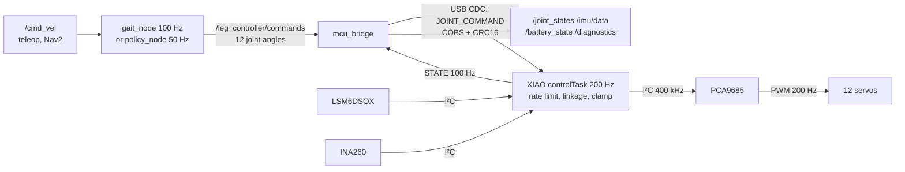

# Microcontrollers and the Raspberry Pi

Strido has two computers. A Raspberry Pi 5 runs Linux and ROS 2 and decides *where the legs should go*. A Seeed XIAO ESP32-S3 microcontroller runs one small program that turns those targets into servo pulses every 5 ms and keeps the robot safe. This page explains why the work is split this way and how data flows between them.

::: tip In Strido
- **Raspberry Pi 5, 4 GB** with Active Cooler (`pi5_4gb`, `pi5_cooler`): ROS 2 Jazzy in Docker or native, running `gait_node` / `policy_node`, `mcu_bridge`, `sllidar_ros2` and optionally `camera_ros` (`ros2/strido_control`, `ros2/strido_bringup`).
- **Seeed XIAO ESP32-S3** (`xiao_esp32s3`): firmware in `firmware/strido_esp32s3` (PlatformIO, Arduino-ESP32 3.x). Pins are in `src/board_config.h`, mirrored and checked against `hardware/electronics.yaml`.
- **PCA9685 16-channel PWM driver** (`pca9685`, Adafruit 815 layout) at I²C address 0x40: generates the 12 servo pulses.
- **Link:** USB CDC serial, Pi USB-A → XIAO USB-C (W14), device name `/dev/strido_mcu` from `ros2/strido_bringup/config/99-strido.rules`.
:::

## Two kinds of computer

| | Raspberry Pi 5 | XIAO ESP32-S3 |
|---|---|---|
| Processor | Broadcom BCM2712, 4 × Arm Cortex-A76 at 2.4 GHz | Espressif ESP32-S3, 2 × Xtensa LX7 at up to 240 MHz |
| Memory | 4 GB RAM, OS on a 64 GB microSD | 8 MB PSRAM, 8 MB flash |
| Operating system | Linux (Ubuntu Server 24.04 or Raspberry Pi OS) | FreeRTOS underneath the Arduino core |
| Strength | big software: ROS 2, Docker, Python, neural-network policy, LiDAR and camera drivers | predictable timing, instant start-up, direct control of pins and buses |
| Weakness | timing is not guaranteed; boot takes tens of seconds; SD card can be corrupted by power loss | little memory, no OS services, no ROS |
| Power | 5–7 W typical, 12 W peak with cooler | about 1 W including LCD, IMU and PCA9685 logic |

A **microcontroller** (MCU) is a whole computer on one chip, built to run one program forever and react to hardware events within microseconds. A **single-board computer** like the Pi is a small PC: a general-purpose operating system shares the CPU between many processes.

## Real-time vs "fast on average"

A control loop is **real-time** when it meets its deadline *every* cycle, not just on average. The servo loop in Strido has a 5 ms deadline (`kControlPeriodUs = 5000`): the period and the loop rate are reciprocals, $T = 1/f = 1/200\,\mathrm{Hz} = 5\,\mathrm{ms}$. Why the period matters to a controller is covered in [control](../theory/control.md).

Linux is fast but not deterministic. The scheduler, a USB interrupt, an SD-card write, Python's garbage collector or a busy ROS node can delay a process by several milliseconds. A late servo update shows up as a jerk in the leg. A frozen process on the Pi must also never leave twelve 3.43 N·m servos holding their last command forever.

The XIAO runs only its own firmware, split into two FreeRTOS tasks pinned to separate cores (`src/main.cpp`):

| Task | Core | Priority | Period | Work |
|---|---|---|---|---|
| `controlTask` | 1 | 3 (higher) | 5 ms | read IMU, update orientation, read INA260 every 100 ms, run the safety state machine, compute and write 12 servo pulses |
| `commsTask` | 0 | 2 | ~1 ms poll | parse incoming frames, send a STATE frame every 10 ms (100 Hz), update the LCD face every 50 ms |

Splitting the cores means a burst of serial traffic can never delay the servo update.

## Why both, and not one or the other

- **Pi only?** The Pi would have to generate pulses and enforce safety from Linux, with no timing guarantee. A Pi crash or a reboot would leave the servos in an unknown state.
- **ESP32 only?** It cannot run ROS 2, Nav2, the LiDAR driver, the camera stack or the learned policy with its numpy runtime.
- **Both:** each does what it is good at. The Pi plans at 100 Hz (`gait_node`, `rate_hz: 100`) or 50 Hz (`policy_node`). The XIAO executes at 200 Hz and owns everything safety-critical.

### What the XIAO guarantees on its own

These hold no matter what the Pi is doing (`docs/software.md`, `safety.h`):

- **Watchdog:** no joint command for 200 ms → hold the pose; 2 s more → relax (outputs off). Only joint commands feed the watchdog, so if the gait node dies, the robot holds, then goes limp.
- **Latched e-stop:** `/strido/estop` pulls the PCA9685 output-enable pin high. All pulses stop at once, and the stop stays latched until released.
- **Battery cut-off:** warning at 6.8 V; relax and refuse to drive after 5 readings below 6.4 V.
- **Limits:** every target is rate-limited to 6 rad/s and clamped to the joint and knee-crank limits from the CAD range-of-motion sweep. Non-finite values (NaN) are rejected.
- **No INA260, no driving:** without a power monitor there is no cut-off.

## The PCA9685 PWM driver

Why not let the ESP32 generate the twelve pulses directly?

1. **Pins.** The XIAO exposes 11 pads (D0–D10). Nine are already used, for the LCD (6), I²C (2) and the output-enable line (1). Twelve more pulse outputs are not available.
2. **Offloading.** The PCA9685 holds a 12-bit on/off count per channel and repeats the pulses by itself at 200 Hz. The firmware only writes a new value when a target changes.
3. **One kill line.** Its active-low **OE** (output enable) pin switches all 16 outputs off at once, in hardware.
4. **Continuity with upstream.** Strido keeps the upstream Yertle channel map (channels 4–15), so wiring knowledge carries over.

::: warning The OE pull-up
The PCA9685 board pulls OE **low**, which means "outputs on". While the XIAO resets or sits in its bootloader, its D3 pin floats, and the servos would follow whatever the PCA9685 last held. A **2.2 kΩ resistor from OE to VCC** keeps the outputs off until the firmware actively enables them. The smoke test checks it: in the bootloader, OE must read ≥ 2.4 V (`docs/electronics.md`, harness step 8).
:::

## Data flow

One cycle, end to end:

1. **Plan.** `gait_node` turns the velocity command into 12 joint angles in radians, Go2 order FL, FR, RL, RR × hip, thigh, calf.
2. **Send.** `mcu_bridge` packs them into a `JOINT_COMMAND` frame: sequence number, mode, 12 × float32. It adds a CRC16 checksum, COBS-encodes the frame and writes it to `/dev/strido_mcu`.
3. **Execute.** On its next 5 ms tick the XIAO:
   - rate-limits the targets;
   - converts calf angle to knee-crank angle through the linkage model (`jointsToActuators`);
   - clamps to the joint limits;
   - converts each angle to a pulse with the per-joint calibration;
   - writes the pulses to the PCA9685.
4. **Report.** Every 10 ms the XIAO sends a 103-byte `STATE` payload: the applied joint angles, the orientation quaternion, gyro and accelerometer readings, bus voltage, current and status flags. `mcu_bridge` publishes them as ROS topics.

Because both sides share one protocol definition (`packages/strido-core/src/strido/protocol.py` ⇄ `firmware/.../protocol.h`), the same frames work from ROS, from `strido-cli` on a laptop and from the NT-X adapter.

## Check yourself

1. What happens to the servos 200 ms and 2.2 s after `gait_node` crashes?
2. Name two reasons the servo pulses come from a PCA9685 rather than directly from the XIAO.
3. Why is the control task on its own core with a higher priority than the comms task?
4. What does the 2.2 kΩ resistor on the PCA9685 OE pin prevent?
5. Which component converts the calf angle into a knee-crank angle, and why is it not done on the Pi?

Answers

1. After 200 ms without commands the servos hold the last pose. After 2 s more (2.2 s in total) they relax, with outputs off.
2. Any two of: the XIAO has too few free pins; the PCA9685 repeats the pulses in hardware; its OE pin kills all outputs at once; it keeps the upstream channel map.
3. So serial traffic and LCD updates can never delay the 5 ms servo deadline.
4. Servos being driven while the XIAO resets or sits in its bootloader, when its D3 pin is not actively holding OE high.
5. The XIAO firmware (`jointsToActuators` in `servo_map.cpp`). Doing it next to the clamping and pulse generation lets the MCU enforce knee-crank limits itself, whatever the Pi sends. The same maths also exists in `strido-core` for simulation.

## Further reading

- [ESP32-S3 datasheet (Espressif)](https://www.espressif.com/sites/default/files/documentation/esp32-s3_datasheet_en.pdf)
- [Seeed XIAO ESP32-S3 getting started](https://wiki.seeedstudio.com/xiao_esp32s3_getting_started/)
- [Raspberry Pi 5 product page](https://www.raspberrypi.com/products/raspberry-pi-5/)
- [PCA9685 datasheet (NXP, Adafruit mirror)](https://cdn-shop.adafruit.com/datasheets/PCA9685.pdf)
- Related pages: [Buses](buses.md), [Servos](servos.md), [Firmware](../software/firmware.md), [ROS 2](../software/ros2.md), [Software](../../software.md), [Control theory](../theory/control.md)
