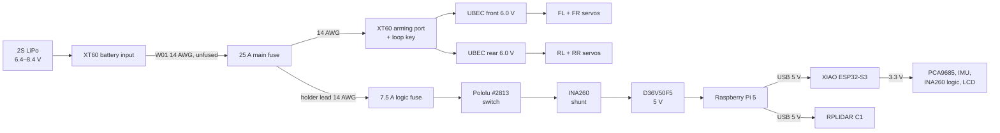

# Power distribution

Power distribution takes one battery and turns it into the right voltage for every part, with protection against the faults that would otherwise melt a wire or kill a board. Strido splits its supply into a 6.0 V **servo domain** and a 5 V / 3.3 V **logic domain** that share one ground; this page follows the current from the XT60 to the last servo.

::: tip In Strido
- **Source of truth:** `hardware/wiring.yaml` (every cable W00–W23 and the servo leads, routed through the CAD; cut list in the [wiring check](../../verification/wiring.md)), `hardware/electronics.yaml` (`power`, `rails`, `supplies`, `fuses`, `wire_ampacity_a`) and `docs/electronics.md` (wiring list, ratings table). `python -m strido_verify.electronics` reads the power cables from `wiring.yaml` and checks every wire, fuse and converter against its load (`docs/verification/electronics.md`). How the harness is laid out: [cable management](../making/cable-management.md).
- **Parts:** XT60H connectors (battery input, arming port, loop key), 2 × inline ATO fuse holder with 25 A and 7.5 A fuses, 2 × Hobbywing UBEC-10A (6.0 V), 8 × WAGO 221-415, Pololu #2813 pushbutton power switch, Adafruit INA260, Pololu D36V50F5 5 V regulator, 14 / 18 / 22 AWG silicone wire.
- **Rails:** `pack` 6.0–8.4 V, `servo_6v` 5.4–6.0 V, `logic_5v` 4.8–5.2 V, `logic_3v3` 3.2–3.4 V.
:::

## The power tree



Two branches leave the main fuse:

- **Servo branch:** arming port → two UBECs → WAGO buses → 12 servos. It carries up to about 21 A and is switched only by the loop key.
- **Logic branch:** logic fuse → pushbutton switch → INA260 → 5 V regulator → Pi 5, which feeds the XIAO and LiDAR over USB. The XIAO's own 3.3 V regulator then powers the I²C boards and the LCD. This branch draws at most about 2.7 A.

The split exists because the two loads are very different. Servos draw large, spiky currents that make the pack voltage sag. A Raspberry Pi browns out and corrupts its SD card if its supply dips. Separate regulators keep servo transients away from the computer, and you can disarm the motors while the computer keeps running.

## Connectors and the arming loop

### XT60

The XT60 is the standard high-current RC connector, rated 30 A continuous. Strido uses three XT60H halves:

| Connector | Role |
|---|---|
| Battery input | under the deck, in the pocket beside the battery; the pack's own lead (W00) plugs into it |
| Arming port | in the back shell, bezel `arming_port_bezel`; its two contacts are the two ends of the servo feed |
| Loop key | a loose XT60 with a 14 AWG bridge: plugging it in closes the servo branch |

The **loop key** is a physical, visible kill switch for every servo. Pull it out and no servo can get power, whatever the software does. The pushbutton switch is *not* an emergency stop: Pololu says so explicitly, and it only switches the logic branch.

::: danger The loop key must never fit the battery
The loop key is a shorted connector. If it mated with the pack, it would short the battery. Give it the **same contact type as the pack's own connector** (pins or sockets), so it physically cannot plug in. Test with an *unbridged* housing before soldering the bridge (`docs/electronics.md`, "XT60 contact rule").
:::

### Arming order

The safe start-up order (`docs/electronics.md`, safety rules):

1. Logic on (pushbutton). Pi and XIAO boot, and the servos stay limp.
2. Robot lying in the rest pose, legs folded.
3. Insert the loop key. The servos still get no pulses: the PCA9685 output-enable line is held off.
4. Start `ros2 launch strido_bringup robot.launch.py`: rest pose, then a 3 s stand-up.

Never insert the key while position commands are running: all twelve servos would jump at once.

## Fuses: protecting the wire, not the device

A fuse exists to stop a **wire** from overheating in a short circuit. Its rating must satisfy both:

$$
I_\mathrm{load} \le I_\mathrm{fuse} \le I_\mathrm{wire}
$$

(load current, fuse rating, and the current the wire can carry).

| Fuse | Rating | Protects | Worst-case load | Wire limit |
|---|---|---|---|---|
| Main (ATO) | 25 A | W02, W03, W04/front, W04/rear (14 AWG) | 23.6 A (servo + logic) | 32 A |
| Logic (ATO) | 7.5 A | W09, W10, W11 and the logic ground returns W24, W04/logic (18 AWG) | 2.74 A | 16 A |

The "wire limit" is that of the *thinnest* wire behind the fuse. The logic fuse holder is fed through its **own 14 AWG lead**, spliced to W02 in the back shell, so no wire thinner than 14 AWG sits behind the 25 A fuse alone, and everything after the 7.5 A fuse is at least 18 AWG. (An earlier design used a 60 mm 18 AWG tap there: covered only by the 25 A fuse, above that wire's 16 A, which is why it was replaced.)

W01, from the battery input to the main fuse, is **unfused**, like the pack's own lead. The fuse holder sits on the rear WAGO bus where its 14 AWG leads have room to bend, about 0.15 m from the battery input, so W01 is kept that short, in spiral wrap and clear of moving parts. Details: [cable management](../making/cable-management.md#fusing-a-fuse-protects-the-wire).

## Regulators: getting the right voltage

| Converter | Type | Output | Rating | Feeds |
|---|---|---|---|---|
| Hobbywing UBEC-10A ×2 | switching buck, 2–6S input | 6.0 V (jumper open) | 10 A continuous, 15 A peak each | 6 servos each |
| Pololu D36V50F5 | switching buck, 5.5–50 V input | 5 V ± 4 % | 5.5 A | Pi 5 (and via USB: XIAO, LiDAR) |
| XIAO ESP32-S3 on-board | linear regulator | 3.3 V | small | PCA9685 VCC, LSM6DSOX, INA260 VS, LCD |

### Why switching regulators

Two laws underlie every number on this page. **Ohm's law** relates the voltage across a resistance to the current through it, and electrical **power** is voltage times current:

$$
V = I R, \qquad P = V I = I^2 R = \frac{V^2}{R}
$$

A **linear** regulator is a variable resistor in series with the load: the full load current flows through it while it drops the voltage difference, so it burns $P_\mathrm{loss} = (V_\mathrm{in} - V_\mathrm{out})\, I$ as heat. Dropping 7.4 V to 5 V at 3 A would waste:

$$
P_\mathrm{loss} = (7.4\,\mathrm{V} - 5\,\mathrm{V}) \times 3\,\mathrm{A} = 7.2\,\mathrm{W}
$$

That is more than the Pi itself uses on average. A **buck** (step-down switching) converter chops the input with a transistor and smooths it with an inductor and capacitor. An ideal buck switched with duty cycle $D$ outputs $V_\mathrm{out} = D\,V_\mathrm{in}$, and because energy is conserved, $V_\mathrm{in} I_\mathrm{in} = V_\mathrm{out} I_\mathrm{out}/\eta$ with efficiency $\eta$: it converts power instead of burning it. The verification assumes 90 % efficiency (`converter_efficiency: 0.9`). Converted back to pack current at the lowest pack voltage, the logic branch's 15.8 W peak at 5 V becomes:

$$
I_\mathrm{pack} = \frac{P_\mathrm{out}}{\eta\, V_\mathrm{pack}} = \frac{15.8\,\mathrm{W}}{0.9 \times 6.4\,\mathrm{V}} \approx 2.74\,\mathrm{A}
$$

That is the figure the switch, the INA260 and the logic fuse are checked against.

### Dropout

A buck can only step **down**. Its output stays a little below its input when the input approaches the target. With an empty pack (6.4 V) and 10 A, the 6.0 V servo rail is expected to fall to about 5.4 V ([ESTIMATE] in `rails.servo_6v`). This is one reason why a 7.4 V servo rail is impossible from 2S, as `docs/bom/sources.md` points out.

### The Pi's 5 V feed

The Pi 5 is fed through its GPIO 5 V pins (2 and 4, ground on 6 and 14), not through USB-C. That bypasses USB Power Delivery, so the Pi does not know its supply can deliver 5 A. Tell it:

```bash
sudo rpi-eeprom-config --edit        # add:  PSU_MAX_CURRENT=5000
```

Without this setting the Pi limits the current its USB ports may draw, and the LiDAR and XIAO hang off those ports.

## Wire gauge and voltage drop

**AWG** (American Wire Gauge) numbers go *down* as wires get thicker. A conductor's resistance grows with its length $L$ and shrinks with its cross-section $A$:

$$
R = \frac{\rho L}{A}
$$

with copper's resistivity $\rho \approx 1.72 \times 10^{-8}\,\Omega\,\mathrm{m}$. For 18 AWG, $\rho / A = 1.72 \times 10^{-8}\,\Omega\,\mathrm{m} / 0.82 \times 10^{-6}\,\mathrm{m^2} \approx 21\,\mathrm{m\Omega/m}$, the value in the table. Thick wire has lower resistance, so it heats less ($P = I^2 R$) and loses less voltage.

| Gauge | Copper area (approx.) | Resistance (approx.) | Ampacity used by the check | Used for |
|---|---|---|---|---|
| 14 AWG | 2.1 mm² | 8.3 mΩ/m | 32 A | battery trunk W01–W04, logic fuse holder lead |
| 18 AWG | 0.82 mm² | 21 mΩ/m | 16 A | UBEC output extensions W05/W06, bus jumpers W07/W08, logic branch W09–W11, logic grounds W24 and W04/logic |
| 20 AWG | 0.52 mm² | 33 mΩ/m | 11 A | UBEC output leads |
| 22 AWG | 0.33 mm² | 53 mΩ/m | 7 A | Pi 5 V feed W12, servo leads (the servos' own 260 mm leads, cut to length; no extensions), signals |

The ampacity values come from `wire_ampacity_a` in `hardware/electronics.yaml`. They are deliberately conservative for short chassis runs in free air.

**Voltage drop** follows Ohm's law, $\Delta V = I R$, and current flows *out and back*, so count both conductors. The same current heats the wire with $P = I^2 R$: power loss grows with the *square* of current, which is why the high-current servo branch gets the thickest, shortest wires.

Lengths below come from the cut list in the [wiring check](../../verification/wiring.md). Taking the cut length as the copper in circuit gives an upper bound.

- **W05**, UBEC front to WAGO bus: 18 AWG pair, routed 190 mm, cut 222 mm, at 10 A.

  $$
  R = 0.222\,\mathrm{m} \times 21\,\mathrm{m\Omega/m} \approx 4.7\,\mathrm{m\Omega}\ \text{per conductor}
  $$

  $$
  \Delta V \approx 10\,\mathrm{A} \times 4.7\,\mathrm{m\Omega} \times 2 \approx 93\,\mathrm{mV}, \qquad P \approx (10\,\mathrm{A})^2 \times 9.3\,\mathrm{m\Omega} \approx 0.93\,\mathrm{W}
  $$

- **A servo lead's power branch**: the servo's own 22 AWG red/brown pair from the servo to its WAGO pair, no extension. The longest one is the front-left hip, 60 mm to its tie plus 88 mm to the WAGO = 148 mm routed, at the 3.5 A stall current.

  $$
  R = 0.148\,\mathrm{m} \times 53\,\mathrm{m\Omega/m} \approx 7.8\,\mathrm{m\Omega}\ \text{per conductor}
  $$

  $$
  \Delta V \approx 3.5\,\mathrm{A} \times 7.8\,\mathrm{m\Omega} \times 2 \approx 55\,\mathrm{mV}
  $$

  A 300 mm extension of the same wire, as the robot once used, would have added about 0.11 V on top, and a plug and socket per servo.

- **W12**, the Pi feed: 2 × 22 AWG in parallel per rail, routed 104 mm, cut 123 mm, 1.6 A per wire ($0.123\,\mathrm{m} \times 53\,\mathrm{m\Omega/m} \approx 6.5\,\mathrm{m\Omega}$ per wire).

  $$
  \Delta V \approx 1.6\,\mathrm{A} \times 6.5\,\mathrm{m\Omega} \times 2 \approx 21\,\mathrm{mV}
  $$

Short, adequately thick wires keep every drop well below 0.2 V. The Pi feed is doubled up anyway, because the Pi flags under-voltage below 4.63 V and the regulator's lower tolerance is already 4.8 V.

## Measuring power: the INA260

The INA260 is a current, voltage and power monitor with a built-in 2 mΩ shunt resistor. It sits **high-side** in the logic branch: current enters at VIN+, leaves at VIN−, and the chip measures the tiny voltage across its internal shunt, $V_\mathrm{shunt} = I R_\mathrm{shunt}$, and divides by the known $R_\mathrm{shunt} = 2\,\mathrm{m\Omega}$ to get the current. At the logic branch's 2.74 A that is only $5.5\,\mathrm{mV}$, and the shunt dissipates $I^2 R \approx 15\,\mathrm{mW}$.

| What it measures | Why |
|---|---|
| Bus voltage at VIN− (= pack voltage minus small losses) | the low-battery warning (6.8 V) and cut-off (6.4 V) |
| Logic-branch current (1.25 mA resolution, up to 15 A) | logic power use in `/battery_state` |

It does **not** see the servo current, which bypasses it through the arming port. Its job here is mainly the voltmeter that protects the pack. The firmware therefore refuses to drive the servos if the INA260 does not answer on I²C at address 0x41: without it there is no low-battery cut-off.

## Grounding

All domains share **one ground**, joined in a star at the battery input (W04: battery input − → ground star beside it → both UBEC inputs in 14 AWG and the switch ground in 18 AWG). The regulator and INA260 grounds go to the switch ground, and the Pi's ground pins to the regulator.

A common ground matters because a signal is only a voltage *relative to ground*. The PCA9685's 3.3 V pulse must be measured by the servo against the same reference. A star point keeps the large servo return currents from flowing through the thin logic grounds. If they did, the 21 A of six stalled servos would shift the logic reference by `I × R` and could make signals misread.

## Check yourself

1. Which components does pulling the loop key switch off, and which keep running?
2. Why may the logic fuse be 7.5 A but not 20 A?
3. Estimate the round-trip voltage drop of W06 (18 AWG pair, routed 151 mm) at 10 A.
4. Why does the firmware refuse to drive the servos without the INA260, even though the INA260 does not measure servo current?
5. Why is the Pi fed through two 5 V pins instead of one?

<details>
<summary>Answers</summary>

1. The loop key opens the servo branch, so the UBECs and all 12 servos lose power. The logic branch (Pi, XIAO, sensors, LCD) keeps running.
2. The fuse must not exceed what the protected 18 AWG wire can carry (16 A). 7.5 A is above the 2.74 A load and below 16 A; 20 A would let the wire overheat before the fuse blew.
3. $R \approx 0.151\,\mathrm{m} \times 21\,\mathrm{m\Omega/m} \approx 3.2\,\mathrm{m\Omega}$ per conductor; $\Delta V \approx 10\,\mathrm{A} \times 3.2\,\mathrm{m\Omega} \times 2 \approx 63\,\mathrm{mV}$ (with the 180 mm cut length as an upper bound, about 76 mV).
4. It measures the pack voltage. Without it the low-battery cut-off cannot work, and the pack could be over-discharged.
5. To halve the current per 22 AWG wire and Dupont contact (about 1.6 A each) and the voltage drop, keeping the Pi above its under-voltage threshold.

</details>

## Further reading

- [TI INA260 datasheet](https://www.ti.com/lit/ds/symlink/ina260.pdf)
- [Pololu D36V50F5 5 V 5.5 A step-down regulator](https://www.pololu.com/product/4091)
- [Pololu Big Pushbutton Power Switch HP (#2813)](https://www.pololu.com/product/2813)
- [Hobbywing UBEC-10A](https://www.hobbywing.com/en/products/ubec-10a-2-6s152)
- Related pages: [Batteries](batteries.md), [Servos](servos.md), [Cable management](../making/cable-management.md), [Electronics, wiring and power](../../electronics.md#wiring-harness), [wiring check](../../verification/wiring.md), [Safety](../making/safety.md)
- Horowitz and Hill, *The Art of Electronics*, 3rd ed., Cambridge University Press (Ohm's law, regulators, switching converters)
