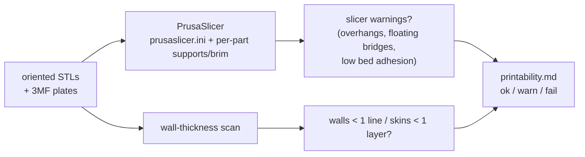

# 3D printing

Strido's frame, legs and shells are 67 printed pieces of 34 part types, all made by FDM (fused deposition modelling) on an ordinary 220 × 220 mm printer. This page explains the settings in the kit profile, why each one matters for a walking robot, and how to read the print list and the printability report.

::: tip In Strido
Every printed part is listed in the [print list](../../../hardware/print/print_list.md) with its quantity, colour, file, size on the bed, supports and notes. The verified slicer settings are in [prusaslicer.ini](../../../hardware/print/prusaslicer.ini); 13 ready 220 × 220 mm build plates (10 graphite, 3 lime) come with the [print kit](../../print-kit.md) and the build kit. The printability gate (`make printability`, report in [printability](../../verification/printability.md)) slices every part and plate with PrusaSlicer. The [print kit](../../print-kit.md) page packages all of this for download.
:::

## How FDM works

An FDM printer pushes a 1.75 mm plastic filament through a hot nozzle (0.4 mm in this kit) and lays it down as thin lines. Lines form a layer; layers stack up to form the part. Three consequences follow from this, and every setting below is about one of them:

1. **A part is a stack of welded lines, not a solid block.** It is strongest along the lines and weakest between layers.
2. **Each layer needs something underneath.** Steep overhangs and floating features need supports.
3. **Molten plastic flows and shrinks.** Holes come out slightly smaller than drawn and the first layer spreads out.

## The material: PETG (or PLA+)

The print list allows PETG or PLA+; the profile is set up for PETG (`filament_type = PETG`, density 1.27 g/cm³).

| Property | Why it matters for Strido |
|---|---|
| Tough rather than brittle | Legs take impacts at every footfall; PETG tends to bend before it cracks |
| Good layer adhesion | Fewer splits between layers in thin links such as `short_link` |
| Heat deflection at 68 °C (Prusament PETG data sheet) | Servos and UBECs warm up inside the body; PLA softens at a lower temperature |
| Low warping | Large flat parts such as `bottom_shell` and `top_shell_sensor` (114 × 208 mm) stay flat |
| Strings and sticks to smooth PEI | Use a textured or satin sheet, or glue stick on smooth PEI |
| Supports are hard to remove | Snug supports and careful use of the flush cutters (see [tools](tools-and-workshop.md)) |

Kit profile temperatures: nozzle 235 °C for the first layer, then 240 °C; bed 80 °C throughout. Prusa's PETG guide recommends 230/240 °C for the nozzle and 85/90 °C for the bed, so the kit values are in the normal range; adjust the bed to your sheet if the first layer does not stick.

::: warning Dry filament
PETG absorbs moisture from the air. Wet filament pops and strings and gives weaker layers. If you hear crackling at the nozzle, dry the spool before printing structural parts.
:::

## The kit profile, setting by setting

`hardware/print/prusaslicer.ini` mirrors the print list. Load it in PrusaSlicer with *File > Import > Import Config*. If you use another slicer, copy these values by hand.

| Setting | Value | What it does and why this value |
|---|---|---|
| Bed size | 220 × 220 mm, 250 mm tall | The largest parts (shells, 114 × 208 mm) must fit; this is also the plate size |
| Nozzle | 0.4 mm | The standard nozzle; one line is about 0.45 mm wide |
| Layer height | 0.2 mm (first layer 0.2 mm) | Half the nozzle diameter: good strength and speed; the fit and wall checks assume it |
| Perimeters | 3 (≈ 1.2 mm wall) | Walls carry most of the load around screw holes; Prusa recommends more perimeters, not more infill, for strong parts |
| Perimeter generator | Arachne | Varies the line width so thin walls are filled instead of leaving gaps |
| Top / bottom solid layers | 5 / 5 (1.0 mm skin) | Closes the infill with a stiff skin; fewer layers can show infill through the top |
| Infill | 30 % gyroid | Gyroid is strong in all directions and prints without the nozzle crossing its own lines at the same height |
| Supports | off by default, auto-detect, snug style | The gate turns supports on per part as listed; snug supports follow the part outline and are easier to remove |
| Brim | 0 by default | The gate adds a 5 mm brim to parts taller than 40 mm |
| Skirt | 1 loop | Primes the nozzle before the part starts |
| `gcode_label_objects` | firmware | Lets you cancel one failed part on a full plate without stopping the rest |

## Orientation and layer-line strength

Because layers bond less well than lines, a part loaded so that it would peel its layers apart is weakest. The kit STLs are already oriented, and the print list explains each choice in its *Note* column:

- **published orientation**: upstream Yertle's own orientation, kept where it already prints well. The note says which face would lower the overhang (e.g. `bottom_shell`: 9 % overhang as published, 1 % on its −Y face, but then 208 mm tall on a narrow edge). Lower overhang means fewer supports, but it also changes the layer direction, so keep the published orientation unless you have a reason.
- **re-oriented**: the published STL was often the part's CAD pose, tall on a small footprint; the kit lays it on the face with the most bed contact and least overhang, never with a link's long axis upright (e.g. `inner_tibia` and `outer_tibia` on their flat sides, `short_link`, `femur`, `femur_servo_connector`, `servo_mount_top_bracket`, `side_body_beam`). The femur's and the femur servo connector's bores come out vertical this way. The servo mounts lie like a U (open side up): 19 mm instead of 56 mm tall, 2 % instead of 13 % overhang, and 10 of their 13 M3 pilots (servo ears, bracket) vertical; the two hip-horn pilots and the hip-pivot pilot lie horizontal.
- **print on its base / upside down**: `camera_mount_base` stands on its base (its M3 pivot is a friction pivot, so a slightly flattened horizontal bore is fine; drill 3.4 mm if it is tight); `lidar_pedestal` is printed top plate down; `electronics_deck` top face down; `stiff_long_link` lies flat with both bushing bores vertical.

Why a vertical bore? A hole whose axis is vertical is printed as a stack of circles and comes out round. A horizontal hole is built from layers, so its top has to bridge or be supported and comes out slightly flattened. Bores that carry a pivot or bearing should be vertical whenever possible.

## Supports and brims

**Supports** are temporary structures under overhangs (surfaces steeper than the printer can bridge). The print list column *Supports* gives `yes (N % overhang)`, where N is the share of the part's surface that needs support. The profile uses `support_material_threshold = 0`, i.e. automatic overhang detection, and the snug style.

**Brims** are a few extra lines around the first layer that increase bed contact. A tall, narrow part acts as a lever on its small footprint: the nozzle knocks it loose before it is finished. Rule in this kit: brim on parts taller than 40 mm, 5 mm wide. In the printability report this applies, for example, to the shells; the servo mounts (19 mm, lying like a U) and `servo_mount_top_bracket` (6 mm, flat) need none.

**Hole steps** are the one overhang the kit removes in the model instead: where a wide hole on the bed side (a bearing seat) narrows to a smaller hole above, the ring between them hangs in the air, and a support inside a bearing seat is hard to dig out. The kit STLs cut the two layers above such a step for bridging (the *hole overhang trick*): layer 1 leaves a slot as wide as the narrow hole across the whole wide hole, so the material either side is a straight bridge between its walls; layer 2 leaves a square as wide as the narrow hole, bridging across the slot; layer 3 is the narrow hole as designed. The seat diameter and the narrow hole do not change; the bearing then rests on the two crescents either side of the slot. `strido_publish.print_bridges` finds these steps in every part as it lies on the bed (today the bearing seats of `inner_tibia`, `outer_tibia` and `outer_shoulder_frame`); the print list notes each one. In `outer_shoulder_frame` the seat opens onto the bed and slices without any support. In the tibias it sits under a boss that floats above the bed, which needs support anyway, and the slicer also fills the bore: block supports in the bearing bore (a support blocker or paint-on) and the step bridges.

Remove supports and brims before assembly (assembly manual, Step 0), and deburr any edge that touches a moving part.

## Bed adhesion and the first layer

The first layer decides whether a print succeeds:

- Clean the sheet (fingerprints are oil; PETG and PLA both release from greasy spots).
- Level/calibrate the first layer so lines are slightly squashed but do not ride up.
- For PETG on smooth PEI, use glue stick as a release layer: PETG can bond so strongly that it tears the sheet surface (Prusa).
- Let the bed cool before removing large parts like `bottom_shell`.

## Tolerances: why holes come out small

Molten lines are laid on a polygon approximation of a circle, and the first layer is squashed outwards. Both effects make holes smaller than drawn. The Strido fit check assumes holes print **0.15 mm undersize** (`expected_hole_shrink_mm: 0.15` in `hardware/verification/tolerances.yaml`); ADR-009 notes that most printers print small holes 0.2–0.3 mm undersize.

What you do about it after printing:

| Hole type | Fix | Example from the fit report |
|---|---|---|
| Clearance (screw passes through) | Run a drill through once: 3.2 mm for M3, 2.7 mm for M2.5, 2.2 mm for M2 (ISO 273 fine; medium 3.4 / 2.9 / 2.4 mm) | `bottom_shell`, 4 × M3 at 3.05 mm CAD: drill 3.2 mm |
| Thread-forming pilot (screw cuts its own thread) | Leave it; see [fasteners](fasteners.md) | `femur` M3 pilots, 2.80–2.85 mm CAD |
| Bearing seat (press fit) | Test-fit before assembly; a loose bearing gets a drop of CA glue | `outer_shoulder_frame`, 625ZZ (16 mm OD) in a 16.17–16.21 mm seat |

**Elephant foot** is the flare at the bottom edge of a part caused by the squashed first layer and the weight of the layers above. It makes bottom-facing holes and slots tighter and can stop a part from sitting flat. Most slicers have an *elephant foot compensation* setting that shrinks the first layer slightly; if a part's bottom edge flares, trim it with a deburring tool.

::: tip Hole compensation for the servo mounts
The print list asks for **X-Y hole compensation −0.15 mm** on `left_servo_mount`, `right_servo_mount`, `left_servo_mount_fl`, `right_servo_mount_fr` and `servo_mount_top_bracket`, which brings their M3 pilots down to about 2.65 mm so the screws grip (ADR-009). It acts on vertical holes; the servo mounts' hip-horn and hip-pivot pilots lie horizontal, so harden those with thin CA if a screw spins. The option has this name in Bambu Studio and OrcaSlicer; not every slicer has a hole-only compensation. If you print without it, harden those pilots with a drop of thin CA glue before driving the screws, as explained in [fasteners](fasteners.md); anaerobic thread locker is not for plastic.
:::

## Plates and colours

The kit uses two colours: **primary (graphite)** for the frame and legs and **secondary (lime)** for the shells and shoulders. The 13 ready plates in `hardware/print/plates/` (`plate_graphite_01…10.3mf`, `plate_lime_01…03.3mf`) are pre-arranged 220 × 220 mm beds, so a whole robot needs no manual arranging. Each plate was sliced as arranged by the printability gate and accepted.

Filament budget: the print list totals 943 cm³ of solid parts (≈ 659 g of PETG at the kit settings). The slicer, including infill, supports and brims for every piece, estimates **958 g and 100 h**. The BOM buys two 1 kg spools (one per colour); the print list budgets 1.2 kg including test prints.

## The printability gate

The printability gate (`python -m strido_verify.printability`, `make printability`) checks that the kit really prints with exactly these settings:

- **Slicer stage:** every part is sliced as it lies, with the supports and brim from the print list. It fails if the slicer errors or reports stability problems that those supports and brim do not prevent. Filament mass and time come from the generated G-code.
- **Wall scan:** a lateral wall is built from lines (≈ 0.45 mm each), a horizontal skin from layers (0.2 mm). Below one line (0.4 mm) or one layer (0.2 mm) the slicer drops the feature: **fail**. Below two lines (0.8 mm) or three layers (0.6 mm) it prints but is fragile: **warn**.
- **Plates:** each 3MF plate is sliced as arranged and must fit on the bed.

Current result: 34 part types and 13 plates, **0 fail, 4 warn**. The warnings are the four servo mounts, with small skin areas only 0.38–0.53 mm thick (two layers): printable, but print them carefully.

## How to read the print list

Each row of `hardware/print/print_list.md` has eight columns:

| Column | Meaning |
|---|---|
| Part | Part id, the same as in the [catalogue](../../catalog.md) and the [assembly manual](../../assembly/README.md) |
| Qty | Pieces per robot (e.g. `femur` 4, one per leg) |
| Colour | primary (graphite) or secondary (lime) |
| File | STL under `hardware/print/`, already oriented |
| Size on bed (mm) | X × Y × Z as it lies; Z is the height that decides the brim (> 40 mm) |
| Supports | `no`, or `yes (N % overhang)` |
| Source | upstream STL, upstream STEP, new Strido part, or a modified upstream part |
| Note | orientation reasons and what was changed against upstream |

Read the two paragraphs above the table too: they contain the global settings and the special instruction for the servo mounts.

## Check yourself

1. Why does the kit use three perimeters and only 30 % infill rather than more infill?
2. `bottom_shell` is 42 mm tall. Does it get a brim, and why?
3. A printed M3 clearance hole is too tight for the screw. What do you do?
4. What does the kit do where a bearing seat on the bed side narrows to a smaller hole above it?
5. What are the two failure criteria of the wall-thickness scan?

Answers

1. Loads around screw holes and edges are carried by the walls; extra perimeters add strength where it is needed, whereas infill mostly adds mass and time (Prusa gives the same advice).
2. Yes. Every part taller than 40 mm gets a 5 mm brim because a tall part on a small footprint can be knocked off the bed.
3. Run a 3.2 mm drill through once (3.4 mm for a looser fit); printed holes come out about 0.15 mm undersize.
4. It cuts the two layers above the step for bridging (the hole overhang trick): a slot as wide as the small hole across the seat, then a square, then the small hole. Every layer then bridges between walls it rests on, so the seat needs no support of its own (where the slicer still adds some, as in the tibias, block it in the bore).
5. A lateral wall thinner than one extrusion line (0.4 mm) or a horizontal skin thinner than one layer (0.2 mm).

## Further reading

- [Prusa Knowledge Base: PETG](https://help.prusa3d.com/article/petg_2059)
- [Prusa Knowledge Base: Elephant foot compensation](https://help.prusa3d.com/article/elephant-foot-compensation_114487)
- [Bambu Lab Wiki: XY hole / contour compensation](https://wiki.bambulab.com/en/software/bambu-studio/xy-hole-contour-compensation)
- [PrusaSlicer on GitHub](https://github.com/prusa3d/PrusaSlicer)
- Related in this wiki: [fasteners](fasteners.md), [CAD as code](../software/cad-as-code.md), [mechanics](../hardware/mechanics.md)
