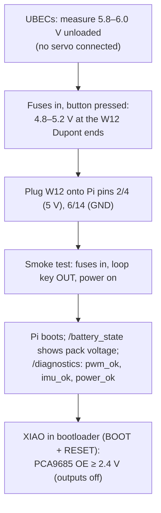

# Safety

Strido carries a lithium-polymer battery that can deliver hundreds of amperes into a short circuit, and twelve servos strong enough to trap a finger. This page explains the hazards, the protective parts the robot uses against them, and the order in which to power it up the first time.

::: tip In Strido
Safety parts: the 25 A main fuse and 7.5 A logic fuse (ATO blade fuses), the XT60 arming port with its loop key in the back shell, the Pololu #2813 pushbutton switch, the INA260 power monitor (low-battery cut-off), and the PCA9685 OE pull-up. Rules and the smoke test are in [electronics.md](../../electronics.md#safety-rules); first power-up is assembly Step 23 ([assembly manual](../../assembly/README.md)). Firmware safety (watchdog, e-stop, cut-off) is described in [software.md](../../software.md#firmware).
:::

## LiPo batteries

The pack is a **2S LiPo, 5000 mAh**, hardcase, XT60 lead. "2S" means two cells in series: 7.4 V nominal, 8.4 V full, about 37 Wh. In `hardware/electronics.yaml` its maximum discharge is listed as 300 A (60C; 500 A in bursts). A short across its terminals therefore does not blow gently: the wire glows, insulation burns and the cells can be damaged into a fire.

| Rule | Why |
|---|---|
| Charge only with a **balance charger**, inside the **LiPo bag**, never unattended | Balancing keeps both cells at the same voltage; an unbalanced cell can be overcharged and fail; the bag contains a fire long enough to react |
| Never charge above 4.2 V per cell (8.4 V for the pack) | Overcharging lithium cells is the classic cause of thermal runaway |
| Never run the pack flat | Deep discharge damages lithium cells. The firmware warns at **6.8 V** (3.4 V/cell) and relaxes the servos at **6.4 V** (3.2 V/cell); the cell checker / low-voltage alarm in the BOM gives a second opinion |
| Store at storage charge (about 3.8 V/cell; B6AC-class chargers have a storage mode) | Full packs age faster and hold more energy if something goes wrong |
| Retire a pack that is **puffed**, dented or hot after normal use | Swelling is gas from decomposing electrolyte, a sign of internal damage |
| Insulate bare leads; transport the pack in the bag | Prevents shorts from keys, tools or the other connector |

::: danger If a LiPo smokes
Do not try to save it. Move away, keep others away and ventilate. Do not cover a burning pack with your hands or a cloth. Contact your local fire service if the fire spreads. A pack that has vented is never used again.
:::

## Fuses: protecting the wire

A fuse protects the **wire** downstream of it from overheating. A wire's heating power is $P = I^2 R$, so it grows with the square of the current, and a short circuit can heat a thin wire until its insulation melts long before the battery runs out. The fuse is a deliberately weak link that melts first, so it is sized below the current the wire can carry and above the current the load needs:

$$
I_\mathrm{load} \le I_\mathrm{fuse} \le I_\mathrm{wire}
$$

For the main fuse the servo load converts back to the pack through the UBECs (90 % efficient, see [power](../hardware/power.md)). The worst case is the nearly empty pack at the $6.4\,\mathrm{V}$ cut-off: $2 \times 10\,\mathrm{A} \times 6.0\,\mathrm{V} / (0.9 \times 6.4\,\mathrm{V}) \approx 20.8\,\mathrm{A}$, plus $2.7\,\mathrm{A}$ logic $= 23.6\,\mathrm{A}$ ([electronics check](../../verification/electronics.md)). That stays below the 25 A fuse, which in turn is below the 14 AWG trunk's 32 A.

| Fuse | Rating | Protects | Wire rating (`electronics.yaml`) | Load |
|---|---|---|---|---|
| Main (ATO) | **25 A** | W02, W03, W04/front, W04/rear: the 14 AWG trunk | 32 A | servo branch ≤ 2 × 10 A UBEC output (≈ 21 A at an empty pack, see [electronics](../../electronics.md#ratings-and-why-these-parts)) + logic |
| Logic (ATO) | **7.5 A** | W09, W10, W11 and the logic ground returns W24, W04/logic: the 18 AWG logic wiring | 16 A | logic branch ≤ 3 A |

The fuses sit as close to the battery input as their holders fit, because the short-circuit hazard is largest there. The main fuse holder lies on the rear WAGO bus, about 0.15 m from the battery input; W01, the 14 AWG lead between them, is unfused like the pack's own lead, so it is kept short, in spiral wrap and away from moving parts. The logic fuse holder in the back shell is fed through **the holder's own 14 AWG lead**, spliced to W02: no wire thinner than 14 AWG sits behind the 25 A fuse alone. Why that matters: [cable management](cable-management.md#fusing-a-fuse-protects-the-wire).

Spares are in the BOM (two extra 25 A, one extra 7.5 A). Replace a blown fuse only with the **same rating**, and only after you have found why it blew. During harness building the fuses stay **out** until the wiring is checked: the power entry is wired without them (harness step 3), and they go in only for the Pi power check (harness step 6).

## First power-up without servos: the smoke test

The first time the robot gets battery power, the servos must not be able to move and the expensive boards must see the right voltages. The harness steps in [electronics.md](../../electronics.md#wiring-harness) do it in this order:

Why each check:

- **UBEC 5.8–6.0 V before servos:** the SPT5435LV is rated 4.8–6.0 V only. A unit set to (or failing at) 7.4 V would over-stress twelve servos at once.
- **5 V at the Dupont ends before the Pi:** the Pi is fed through its GPIO 5 V pins, which bypasses the USB-C power input and its power negotiation; a wrong voltage there reaches the board directly.
- **Loop key out:** the servo branch is dead, so nothing can move while you check the logic side.
- **OE ≥ 2.4 V in the bootloader:** the PCA9685 board pulls OE low (outputs on) by default. The 2.2 kΩ pull-up keeps the outputs off whenever the XIAO is resetting or not running firmware, so a reset can never send random pulses.

Keep a hand near the power button for the first boot, and switch off at once if anything gets hot or smells.

## Arming: the loop key

The **loop key** is a shorted XT60 plug that you insert into the **arming port** in the back shell to connect the servo branch. Pulling it is the servo kill: no current reaches the UBECs, whatever the software does.

- The **pushbutton switch is not an emergency stop.** It switches only the logic branch (Pololu states it is not intended as an emergency stop).
- The loop key must never fit the battery itself, otherwise it would short the pack. It therefore has the same contact type as the battery connector. Check this with the *unbridged* key housing before you solder the bridge (see the [XT60 contact rule](../../electronics.md#xt60-contact-rule-the-loop-key-must-never-fit-the-battery)).
- Label the port "ARM": the battery itself can mate with it, so always connect the pack to the battery input under the deck (its lead W00 into the XT60H).

**Startup order** (from the safety rules): logic on → robot lying in the rest pose, legs folded → insert the loop key (servos stay limp; the controller sends no pulses before the first position command) → start `ros2 launch strido_bringup robot.launch.py` (servos go to the rest pose, then a 3 s stand-up).

::: danger Never arm while commands are running
Inserting the loop key while position commands are being sent makes all twelve servos jump to their targets at once. Six stalled servos draw about 21 A, more than one UBEC's 15 A peak.
:::

Software stops, in addition to the key:

- `/strido/estop` latches: the firmware pulls PCA9685 OE high and stops all pulses.
- Watchdog: no joint command for 200 ms → servos hold; 2 s later → they relax.
- The firmware refuses to drive without a working INA260, because without it there is no low-battery cut-off.

## Pinch points and moving legs

Each SPT5435LV is rated 35 kg·cm (about 3.43 N·m at stall). Torque is force times lever arm, $\tau = F r$, so at $r = 30\,\mathrm{mm}$ from the axis the servo can press with

$$
F = \frac{\tau}{r} = \frac{3.43\,\mathrm{N\,m}}{0.03\,\mathrm{m}} \approx 114\,\mathrm{N}
$$

roughly the weight of $114\,\mathrm{N} / 9.81\,\mathrm{m/s^2} \approx 11.7\,\mathrm{kg}$, on a fingertip. Closer to the axis the force is even larger. The knee is driven through a crank and linkages, so there are scissor points between the links, the femur and the tibia that close as the knee bends.

- Keep fingers out of the legs whenever the loop key is in.
- Hold the robot by the body shell, never by a leg.
- Test new gaits or policies with the robot lifted on a stand first, legs free.
- Before reaching into the legs, pull the loop key; relaxing the servos in software is not enough.
- Long hair, sleeves and cables away from the knee linkages.

## ESD: static electricity

A static spark you do not even feel can damage the inputs of a microcontroller or sensor. The Raspberry Pi 5, XIAO ESP32-S3, LSM6DSOX IMU, INA260 and PCA9685 are bare boards with exposed pins.

- Touch a grounded metal object before handling a board; an ESD wrist strap is better.
- Hold boards by their edges; do not touch the pins or components.
- Keep boards in their anti-static bags until mounting.
- Work on a bare table or an ESD mat rather than carpet or plastic sheeting.

## Other workshop hazards

- **Burns:** the soldering iron runs at around 370–400 °C, the printer nozzle at 240 °C, the bed at 80 °C.
- **Fumes:** ventilate when soldering (flux) and printing.
- **Flying cut-offs:** wear eye protection when cutting supports, wire and resistor leads with flush cutters.

## Check yourself

1. What is the difference between pulling the loop key and pressing the pushbutton switch?
2. Why is the logic fuse 7.5 A when the logic branch only draws up to 3 A?
3. What two voltages must you measure before the first servo or the Pi is connected?
4. At what pack voltage does the firmware relax the servos, and why?
5. Why must the loop key have the same contact type as the battery connector?

Answers

1. The loop key cuts the servo power branch (servo kill); the pushbutton switches only the logic branch and is not an emergency stop.
2. The fuse protects the 18 AWG wire (rated 16 A here), not the load; it must not blow at normal load but must blow well before the wire overheats.
3. 5.8–6.0 V at each unloaded UBEC output and 4.8–5.2 V at the W12 Dupont ends.
4. 6.4 V (3.2 V per cell), after 5 consecutive readings below it, to avoid deep-discharging the LiPo.
5. So that the shorted key cannot mate with the battery and short the pack.

## Further reading

- [Battery University: Safety concerns with Li-ion (BU-304a)](https://batteryuniversity.com/article/bu-304a-safety-concerns-with-li-ion)
- [OSHA: Lithium-ion battery safety (PDF)](https://www.osha.gov/sites/default/files/publications/OSHA4480.pdf)
- [Pololu Big Pushbutton Power Switch HP (#2813)](https://www.pololu.com/product/2813)
- [Electronics, wiring and power: safety rules](../../electronics.md#safety-rules)
- Related in this wiki: [batteries](../hardware/batteries.md), [power](../hardware/power.md), [cable management](cable-management.md), [firmware](../software/firmware.md)
