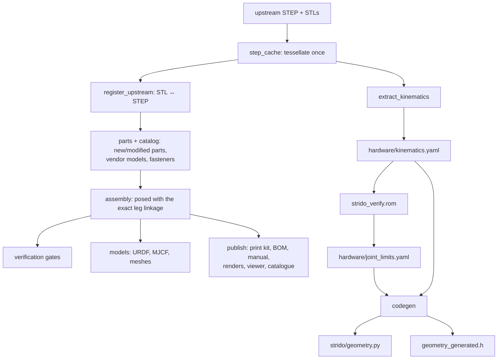

# CAD as code

In code-CAD, parts are not drawn by clicking in a GUI; they are Python programs that produce geometry. Strido takes this further: every physical claim about the robot (screws fit, legs do not collide, parts print, the wiring is within its ratings) is an executable check that can fail the build. This page explains the pipeline, the gates and why it is built this way.

::: tip In Strido
- **CAD package:** `packages/strido-cad` (CadQuery 2.8 for solids, manifold3d for robust mesh booleans, trimesh for mesh work).
- **Verification package:** `packages/strido-verify` (interference, range of motion, fits, clearance, sensor field of view, printability, electronics).
- **Publication package:** `packages/strido-publish` (print kit, BOM, manual, renders, 3D viewer, catalogue book).
- **Data:** `hardware/*.yaml` (kinematics, joint limits, BOM, electronics, fasteners), tolerance bands in `hardware/verification/tolerances.yaml`.
- **Decision record:** ADR-002 "CAD as code, verification as gates" in [decisions](../../decisions.md); evidence in [verification](../../verification.md).
:::

## Why code instead of a GUI CAD file

A GUI CAD file records *what* the geometry is. Code also records *why*: the constant `PEDESTAL_PILOT_DEPTH = 11.0` sits next to its comment "screw tip at 10.0 mm into the pedestal". Code-CAD brings software habits to hardware:

| Software habit | Effect on the robot |
|---|---|
| Version control with readable diffs | A changed hole depth is one line in a review, not an opaque binary file |
| Single source of truth | Link lengths are measured once and *generated* into Python and C++; nobody types them twice |
| Automated tests | A wrong hole fails a check before anyone prints it |
| Reproducible builds | `make publish` regenerates every STL, plate, BOM and manual page from the same inputs |

The motivation in ADR-002 is concrete: people print and assemble from this repository alone, and a wrong hole costs a reprint.

## Start from a real, built design

Strido does not re-model the robot. The mechanics come from the upstream Yertle project: its STEP assembly (`upstream/yertle/design/CAD/Yertle_Single_v2.step`) and its published print STLs, which people have actually printed and assembled. Those files are kept byte-identical (ADR-004); every Strido change is a boolean operation on top of them, and fixes to upstream defects are expressed as data (`hardware/assembly/corrections.yaml`) or derived parts (`left_servo_mount_fl`, `right_servo_mount_fr`).

## The pipeline



Key steps:

1. **`step_cache`** tessellates every solid of the 32 MB STEP once and caches the meshes, keyed by the file hash so it never goes stale silently.
2. **`extract_kinematics`** measures the robot from cylinder axes in the CAD (servo splines, bearing bores, link pins): hip/thigh/knee axes, link lengths, the two knee linkages. "Nothing is typed in by hand." It found, for example, a 1.02 mm link-length mismatch in the upstream STEP ([design](../../design.md#kinematics)).
3. **`rom`** sweeps every leg through its range on a 5° grid, posing the whole assembly with the exact knee linkage, and writes the collision-free joint limits.
4. **`codegen`** writes those numbers into `packages/strido-core/src/strido/geometry.py` and `firmware/.../geometry_generated.h`. The gait, simulation, NT-X adapter and firmware all read the same generated values ([kinematics](kinematics-and-gaits.md)).
5. **`parts`** builds the Strido parts. A real example, the LiDAR pedestal (abridged from `parts.py`):

   ```python
   outer = box(cx - PEDESTAL_HALF, cy - PEDESTAL_HALF, z0,
               cx + PEDESTAL_HALF, cy + PEDESTAL_HALF, z1).edges("|Z").fillet(4.0)
   inner = box(cx - 25.0, cy - 25.0, z0 - 1, cx + 25.0, cy + 25.0, z1 - 3.0)
   shape = outer.cut(inner)                             # hollow, 3 mm top plate
   for dx, dy in PEDESTAL_SCREWS:                       # M3 pilot holes from below
       cuts.append(cylinder((cx + dx, cy + dy, z0), (0, 0, 1), 1.3, -0.1, PEDESTAL_PILOT_DEPTH))
   return boolean(to_mesh(shape), cut=cuts)
   ```

   `box` and `cylinder` return CadQuery workplanes; `boolean` converts to manifold3d solids for the final cuts, which stay watertight even on the tessellated upstream meshes.
6. **`assembly`** places every instance (printed, purchased, fastener) on a rigid body (`base`, `FL.thigh`, `FL.crank` …) and can pose the robot at any joint angles. Every check runs on this real mechanism, not on a simplified URDF.

## The verification gates

A **gate** is a program that exits with code 1 when a rule is violated, so `make` stops. Each writes a tracked report under `docs/verification/`. Tolerance bands and contact rules live in YAML with their rationale; ADR-002 says a gate may only be relaxed by a recorded decision.

| Gate | Command | What it proves |
|---|---|---|
| Hole stacks and fasteners | `python -m strido_cad.hole_stacks`, `python -m strido_cad.fasteners` | Every coaxial hole group in the upstream parts matches exactly one fastener rule; unmatched holes fail |
| Interference | `python -m strido_verify.contacts` | No solids overlap in 4 poses, except classified contacts (thread engagement, designed seating ≤ 0.2 mm, joints) |
| Range of motion | `python -m strido_verify.rom` | Joint limits free of collision, transmission angle ≥ 25°, servo within ±85° |
| **Fits** | `python -m strido_verify.fits` | Every screw and bearing seat has a fit that will work after FDM printing |
| **Clearance** | `python -m strido_verify.clearance` | Moving parts keep a running gap in every operating pose |
| Sensor field of view | `python -m strido_verify.sensor_fov` | 720 LiDAR rays unblocked; camera does not see the robot |
| **Electronics** | `python -m strido_verify.electronics` | Pins, buses, channels and power ratings agree between YAML and firmware |
| **Printability** | `make printability` | Every part and plate slices in PrusaSlicer without stability issues; walls thick enough |
| BOM coverage | `make bom` | Every purchased part and fastener in the CAD is bought, with spares |
| Drift | `make drift` | Generated files equal what the generators would write now |

`make verify` runs the mechanical gates; `make check` runs everything (about 10 minutes).

### Fits

The fit gate samples every screw's shank axis every 0.5 mm and cuts each printed part around it to measure the hole. FDM prints holes roughly 0.1–0.2 mm undersize, so the gate assumes 0.15 mm of shrink and checks the *printed* size:

| Fit | Rule ($d$ = screw diameter) |
|---|---|
| Clearance hole | $\ge d + 0.05\,\mathrm{mm}$ (warn below $d + 0.20\,\mathrm{mm}$: chase with a drill) |
| Thread-forming pilot | printed pilot $0.70$–$0.90\,d$ ($0.93\,d$ warn: weak grip), engaged length $\ge 1.5\,d$ |
| Bearing seat | bore −0.15 … +0.30 mm relative to the bearing outer diameter |

Every screw must also end in something that holds it: a nut, a printed pilot or a threaded part. The recorded run checked 223 screws and 32 bearing seats: 0 fail, 137 with a builder action (drill this hole, CA-harden a weak pilot). It found real defects, such as LiDAR pedestal pilots 9 mm deep for screws that protrude 10 mm, which is why `PEDESTAL_PILOT_DEPTH` is now 11 mm. See [fasteners](../making/fasteners.md).

### Clearance

Interference proves nothing overlaps; clearance proves nothing *rubs*. Two printed surfaces can each be ~0.15 mm off, so moving parts on different rigid bodies must keep ≥ 0.3 mm in all 13 operating poses (stand, crouch, tall, eight trot phases, hips out and in), and below 1.0 mm they are reported as tight. This gate caught both front feet colliding in the `hips_in` pose, which led to the narrower inward hip limits (ADR-005).

### Electronics

`hardware/electronics.yaml` is the source of truth for wiring. The gate checks that the firmware header `board_config.h` defines exactly its pins, I²C addresses, servo channels and frequencies (in both directions), that no GPIO or I²C address is used twice, and that every converter, switch, fuse and wire carries its load (`load ≤ fuse ≤ wire ampacity`). Its tests prove that a swapped pin, a duplicate channel, an address clash or an undersized wire fail. See [power](../hardware/power.md).

### Printability

Static checks (closed manifold, fits a 220 × 220 × 250 mm bed, resting on z = 0) run in `make print`. The printability gate goes further: it slices every part with the real PrusaSlicer and the repo's profile (`hardware/print/prusaslicer.ini`), with supports and brim exactly as the print list prescribes, and fails on slicer errors or stability warnings (floating bridge anchors, collapsing overhangs, low bed adhesion). A ray-based scan fails walls thinner than one extrusion line or skins thinner than one layer. It also slices every 3MF plate as arranged. Result: 34 part types and 13 plates, 0 fail, 958 g of PETG and 100 h of printing. See [3D printing](../making/3d-printing.md).

::: tip Seen red
Every gate in the verification ledger records a case where it *failed* on a real problem or a deliberate break. A check that has never failed may not be checking anything.
:::

## The publish pipeline

The same verified assembly feeds every artefact you download:

```bash
make print       # oriented STLs (hardware/print/stl/), 3MF plates (hardware/print/plates/), print_list.md
make bom         # docs/bom/README.md, shopping_list.md, bom.csv + CAD coverage check
make manual      # docs/assembly/README.md + step drawings (Blender)
make renders     # hero, exploded, section, x-ray images → docs/images/
make viewer      # docs/viewer/strido.glb + assembly.json for the web 3D viewer
make catalog     # docs/catalog/parts.json + strido-catalog.pdf (WeasyPrint)
make publish     # all of the above, in that order
```

Order matters: the catalogue book reads the print list, manual and render output. Because each instance in the assembly is assigned to exactly one manual step (the build fails otherwise), the parts in the manual, the BOM, the viewer and the [catalogue](../../catalog.md) always add up to the same robot. The simulation models come from the same assembly too (`make models`, see [simulation and RL](simulation-and-rl.md)).

## Limits of the approach

The gates check the CAD, not reality. The [verification](../../verification.md) ledger states it plainly: nothing has been printed, assembled, wired or powered yet (no Q3 hardware tier). Fits assume a 0.15 mm shrink model; your printer may differ, which is why the fit report includes builder actions. Code-CAD moves errors earlier and makes them visible; it does not replace the first physical build.

## Check yourself

1. Why does Strido build on the upstream STEP instead of re-modelling the robot?
2. How does a measured link length reach the firmware without anyone typing it?
3. What is the difference between the interference gate and the clearance gate?
4. Why does the fit gate subtract 0.15 mm from CAD hole sizes?
5. Why does `make catalog` have to run after `make print`, `make manual` and `make renders`?

<details>
<summary>Answers</summary>

1. The upstream mechanics have actually been printed and built; modifying them by booleans keeps that history and lets upstream changes be diffed (ADR-001, ADR-004).
2. `extract_kinematics` writes it to `hardware/kinematics.yaml`; `codegen` generates `geometry_generated.h`; `make drift` fails if the header is stale.
3. Interference checks that no solids overlap; clearance checks that moving parts keep at least 0.3 mm in every operating pose, so they will not rub after printing.
4. FDM prints holes about 0.1–0.2 mm undersize; the gate judges the hole as it will be printed.
5. The book lays out the print list, manual steps and renders those targets produce.

</details>

## Further reading

- [CadQuery documentation](https://cadquery.readthedocs.io/en/latest/)
- [Manifold geometry library](https://github.com/elalish/manifold)
- [trimesh documentation](https://trimesh.org/)
- [PrusaSlicer command-line interface](https://github.com/prusa3d/PrusaSlicer/wiki/Command-Line-Interface)
- [Prusa knowledge base: dimensional accuracy and hole compensation](https://help.prusa3d.com/article/dimensional-accuracy_2207)
