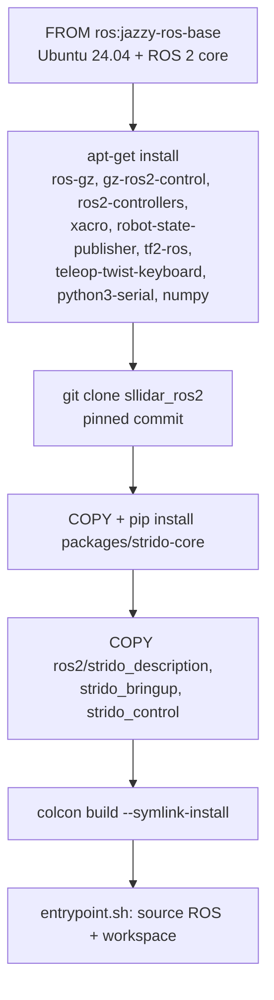

# Docker and containers

Docker packages software with everything it needs (libraries, ROS 2, Python packages) into an *image* that runs the same way on a laptop, a CI runner and the robot. Strido uses one image, `strido-ros:jazzy`, for both the Gazebo simulation and the real robot.

::: tip In Strido
- `docker/ros2/Dockerfile` builds the ROS 2 Jazzy + Gazebo Harmonic workspace image for amd64 and arm64 (Raspberry Pi 5, Apple silicon).
- `docker/compose.yaml` defines three services: `ros` (builds the image), `sim-smoke` (headless Gazebo walk test) and `robot` (runs on the Pi with access to `/dev`).
- `docker/ros2/entrypoint.sh` sources ROS 2 and the workspace; `docker/ros2/sim_smoke.sh` is the automated simulation test behind `make sim-gazebo`.
- `ROS_DOMAIN_ID` defaults to `42` ([configuration](../../configuration.md)).
:::

## Containers versus virtual machines

A **virtual machine** emulates a whole computer: its own kernel, virtual disk and virtual hardware. A **container** is just a group of normal processes on the host kernel, isolated with Linux namespaces (own file system view, process list, network) and limited with cgroups.

| | Virtual machine | Container |
|---|---|---|
| Kernel | Own guest kernel | Shares the host kernel |
| Start-up | Tens of seconds | About a second |
| Overhead | Reserved RAM and CPU | Almost none |
| Hardware access | Through emulated or passed-through devices | Host device files can be mapped in directly |

For a robot this matters: the Pi 5 has 4 GB of RAM in this build, and the `mcu_bridge` polls a USB serial port every 2 ms. A container gives near-native performance and direct access to `/dev/strido_mcu`; a VM would cost memory and add latency.

On macOS, Docker Desktop runs a small Linux VM and the containers live inside it. That is why the Gazebo test works on a Mac but USB devices are hard to reach there: you test simulation on the laptop and hardware on the Pi.

## Images and layers

An image is a stack of read-only **layers**, one per file-changing instruction in the `Dockerfile`. Docker caches layers: if an instruction and everything before it is unchanged, the cached layer is reused. The Strido Dockerfile is ordered so that slow, rarely changing steps come first:



Editing a ROS node only invalidates the last few layers, so a rebuild after a code change takes seconds to minutes instead of re-downloading Gazebo.

Details worth noticing:

- **Pinned dependencies.** The Slamtec LiDAR driver is not packaged for Jazzy, so it is cloned at a fixed commit (`ARG SLLIDAR_COMMIT=...`). Pinning means a rebuild next year produces the same driver.
- **`--no-deps` install of `strido-core`.** The core package (gait, kinematics, protocol, numpy policy runtime) has only NumPy as a runtime need, which apt already installed. No PyTorch, CadQuery or MuJoCo enters the robot image (ADR-003 in [decisions](../../decisions.md)).
- **`rm -rf /var/lib/apt/lists/*`** in the same `RUN` as `apt-get install` keeps the package index out of the layer. Deleting it in a later layer would not shrink the image, because earlier layers are immutable.
- **Multi-architecture.** `ros:jazzy-ros-base` is published for amd64 and arm64, so the same Dockerfile builds natively on the Pi and on an Apple silicon Mac.

## Containers at run time

A container is a running instance of an image plus a thin writable layer. Anything written inside disappears when the container is removed (`--rm`). That suits the robot: state that must persist (servo calibration) lives in the ESP32's flash, not in the container.

The entrypoint is three lines:

```bash
source /opt/ros/jazzy/setup.bash
source /ws/install/setup.bash
exec "$@"
```

It makes every command you pass (for example `ros2 launch ...`) see both ROS 2 and the Strido packages, and `exec` replaces the shell so signals such as Ctrl-C reach ROS directly.

## Compose: the repo's `docker/compose.yaml`

Docker Compose describes several containers in one YAML file so you do not have to remember long `docker run` command lines.

| Service | What it does | Key settings |
|---|---|---|
| `ros` | Builds `strido-ros:jazzy` from `docker/ros2/Dockerfile` (context = repo root) | `network_mode: host`, `ipc: host`, `ROS_DOMAIN_ID` |
| `sim-smoke` | Runs `/sim_smoke.sh`: Gazebo headless, stand up, walk 8 s at 0.15 m/s, check ≥ 0.4 m progress and sensor topics | exit code is the test result |
| `robot` | Runs `ros2 launch strido_bringup robot.launch.py` on the Pi | `privileged: true`, `/dev:/dev`, host network |

Commands you will use:

```bash
docker compose -f docker/compose.yaml build ros                  # build or update the image
docker compose -f docker/compose.yaml run --rm sim-smoke         # headless Gazebo test (what make sim-gazebo runs)
docker compose -f docker/compose.yaml run --rm robot             # on the Pi: bring up the robot
docker compose -f docker/compose.yaml run --rm ros bash          # interactive shell with ROS 2 sourced
docker compose -f docker/compose.yaml run --rm ros \
  ros2 run teleop_twist_keyboard teleop_twist_keyboard           # drive from a second terminal
```

`make sim-gazebo POLICY=<policy.npz>` mounts a learned policy read-only into the container (`-v ...:/policy.npz:ro`) and sets `POLICY=/policy.npz`, which makes `sim_smoke.sh` launch `policy_node` instead of `gait_node`.

### Why host networking and host IPC

ROS 2 discovers nodes with DDS multicast and, between processes on the same machine, can use shared memory. Docker's default bridge network hides multicast, and a private IPC namespace hides shared memory. `network_mode: host` and `ipc: host` put the container on the host's network and IPC so that a teleop container, the robot container and a laptop on the same Wi-Fi (same `ROS_DOMAIN_ID`) see each other's topics without extra configuration.

Use a different `ROS_DOMAIN_ID` per robot when several share a network:

```bash
ROS_DOMAIN_ID=43 docker compose -f docker/compose.yaml run --rm robot
```

## Device access

A container cannot see host hardware unless you grant it. The `robot` service does it bluntly:

```yaml
privileged: true
volumes:
  - /dev:/dev
```

Bind-mounting the whole `/dev` matters because the udev symlinks (`/dev/strido_mcu`, `/dev/rplidar`) are created by the host's udev, and a USB device that is unplugged and replugged gets a new device node. A fixed `devices:` list would only map nodes that exist when the container starts. `privileged: true` lifts the device cgroup restrictions so the new nodes are usable.

::: warning
A privileged container has nearly full control of the host. That is acceptable on a dedicated robot computer; do not use the `robot` service on your everyday laptop. For the simulation services, which need no hardware, no privileges are set.
:::

The udev rules must be installed on the **host**, not in the image ([Linux on the Pi](linux-on-the-pi.md#users-groups-and-device-permissions)).

## What is not in the image

- **Camera node.** The Pi 5 camera stack needs the Raspberry Pi libcamera fork; the image has no camera node, and `robot.launch.py` defaults to `camera:=false`. Build `camera_ros` on the host or use `rpicam-vid` with a GStreamer bridge ([software](../../software.md#raspberry-pi-setup)).
- **Firmware tools.** PlatformIO is not installed; flash the ESP32-S3 from a development machine or install PlatformIO on the Pi ([firmware](firmware.md)).
- **GUI.** Gazebo with a window (`gazebo.launch.py` without `headless:=true`) needs X11/Wayland forwarding into the container ([simulation](../../simulation.md)).

## Check yourself

1. Why does a container start faster and use less memory than a VM?
2. Which Dockerfile change triggers the shortest rebuild, and why?
3. What breaks if you remove `network_mode: host` from the `robot` service?
4. Why does the `robot` service mount all of `/dev` instead of listing two devices?
5. Where must `99-strido.rules` be installed for the container to see `/dev/strido_mcu`?

<details>
<summary>Answers</summary>

1. It shares the host kernel: no guest OS to boot and no reserved RAM; it is just isolated processes.
2. Changing files in `ros2/` only invalidates the `COPY ros2/...` layers and the `colcon build` after them; the apt and Git layers come from the cache.
3. DDS discovery across containers and machines; teleop or RViz in another container or on a laptop would no longer see the robot's topics.
4. udev on the host creates the symlinks and replugged devices get new nodes; a static device list would miss them.
5. On the host, in `/etc/udev/rules.d/`; the container sees the result through the `/dev` bind mount.

</details>

## Further reading

- [Docker overview (images, containers, layers)](https://docs.docker.com/get-started/docker-overview/)
- [Compose file reference](https://docs.docker.com/reference/compose-file/)
- [Dockerfile reference](https://docs.docker.com/reference/dockerfile/)
- [Official ROS images on Docker Hub](https://hub.docker.com/_/ros)
