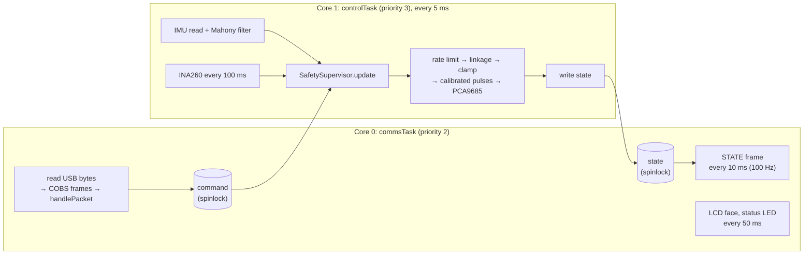
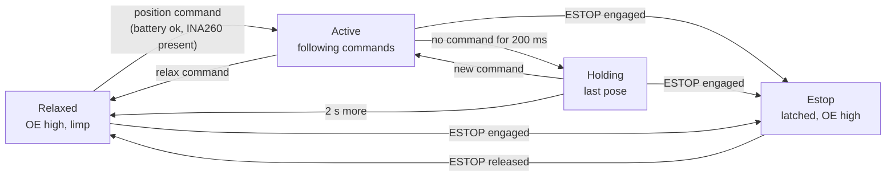

# Firmware on the ESP32-S3

The firmware is the C++ program on the Seeed XIAO ESP32-S3 that turns joint-angle commands from the Pi into servo pulses 200 times a second, reads the IMU and battery monitor, and stops the robot safely when anything goes wrong. It is small, but it is the last line of software between a bug and twelve servos.

::: tip In Strido
- **Project:** `firmware/strido_esp32s3` (PlatformIO, Arduino-ESP32 3.x).
- **Entry point:** `src/main.cpp`; pins and rates in `src/board_config.h`; LCD face in `src/face.cpp`.
- **Portable core:** `lib/strido_core` (knee linkage, servo mapping, protocol, safety), unit-tested on your computer with `pio test -e native`.
- **Generated:** `lib/strido_core/include/strido/geometry_generated.h`, written from the CAD by `strido_cad.codegen`; never edit by hand.
- **Peripherals on I²C (400 kHz):** PCA9685 servo driver `0x40`, LSM6DSOX IMU `0x6A`, INA260 power monitor `0x41`; ST7789V LCD on SPI.
- **Host side:** `mcu_bridge` (ROS 2) and `strido-cli` (bench tool) speak the same protocol through `packages/strido-core/src/strido/protocol.py`.
:::

## Why a microcontroller at all

The Pi runs Linux, which can pause any process for tens of milliseconds. A servo signal that stutters makes the leg jerk; a safety check that runs "usually" is not a safety check. The ESP32-S3 runs nothing but this firmware, so its loop period is predictable. It also keeps working if the Pi crashes, which is exactly when you need the watchdog.

The division of labour: the Pi decides **what** angles the legs should have; the ESP32 decides **how** to reach them safely (linkage maths, slew limit, clamps, calibration) and **whether** to drive at all.

## Build, test and flash with PlatformIO

PlatformIO is a build system and package manager for embedded code. `platformio.ini` pins the toolchain (`espressif32 @ ~8.0.0`), the board (`seeed_xiao_esp32s3`) and every library (Adafruit PWM Servo Driver, LSM6DS, INA260, AHRS, LovyanGFX), so everyone builds the same binary.

It defines two environments:

| Environment | Builds for | Used by |
|---|---|---|
| `xiao_esp32s3` (default) | The real board | `make firmware`, upload |
| `native` | Your computer, with the Unity test framework | `make test-firmware` |

```bash
cd firmware/strido_esp32s3
pio test -e native                      # 15 unit tests: linkage, protocol, watchdog, e-stop, battery, NaN rejection
pio run -e xiao_esp32s3                 # compile (same as `make firmware` from the repo root)
pio run -e xiao_esp32s3 -t upload       # compile and flash over USB
pio device monitor                      # serial monitor (frames are binary; use strido-cli instead)
```

`-DARDUINO_USB_CDC_ON_BOOT=1` routes `Serial` to the chip's native USB, so the board appears to Linux as a CDC-ACM device (`/dev/ttyACM*`, symlinked to `/dev/strido_mcu`). The baud rate is ignored on USB CDC. If an upload cannot connect, hold the XIAO's BOOT button while plugging in USB to force the ROM bootloader.

::: tip Why a native test environment
`lib/strido_core` contains no Arduino calls. The same kinematics, protocol and safety code compiles for the ESP32 *and* for your laptop, so `pio test -e native` checks it in seconds, without hardware, and fails in CI if someone breaks the watchdog.
:::

## Program structure

`setup()` initialises the hardware and starts two FreeRTOS tasks pinned to the two cores of the ESP32-S3. `loop()` then sleeps forever.



Why two tasks: USB traffic arrives in bursts and the LCD takes time to draw; neither must delay the servo update. The control task runs at a higher priority on its own core, and the shared data (`command`, `state`) is copied under short spinlock critical sections (`portENTER_CRITICAL`). I²C reads, which block, are never done inside a critical section.

### Start-up sequence

1. Drive the PCA9685 **OE** pin (D3) high: all servo outputs off, servos limp.
2. Start I²C on D4/D5 at 400 kHz; load calibration from flash.
3. Set the internal joint state to the assembly reference pose.
4. Start the PCA9685 at 200 Hz with every channel off; IMU at ±8 g, ±1000 °/s, 416 Hz; INA260 at `0x41`.
5. Show "ready" on the LCD (or "NO PCA9685"), start the tasks.

The servos stay limp until the host sends its first position command. That is why the start-up order in [electronics](../../electronics.md#safety-rules) works: the loop key can go in safely, and the gait node's first command is the rest pose the robot is already lying in.

## One control cycle (5 ms)

1. **IMU.** Read the LSM6DSOX, rotate its axes into the base frame (the board is mounted with its x to robot left, y to robot rear), update the Mahony orientation filter.
2. **Power.** Every 100 ms read bus voltage and current from the INA260 and feed the voltage to the safety supervisor.
3. **Safety.** `safety.update(now)` returns the drive state (below). Copy the latest command.
4. **Servos**, if the state is Active:
   - **Rate limit:** no joint moves faster than $\dot q_\mathrm{max} = 6\,\mathrm{rad/s}$, so each 5 ms step is clamped to $\lvert \Delta q \rvert \le \dot q_\mathrm{max}\,\Delta t = 0.03\,\mathrm{rad}$. The SPT5435LV's rated speed is 0.14 s per 60° at 6 V, about $7.5\,\mathrm{rad/s}$; staying below it keeps the commanded and real positions close.
   - **Knee linkage:** convert (hip, thigh, calf) into the three *actuator* angles (hip, thigh, knee crank). The knee servo drives the calf through a parallelogram and a four-bar, so the crank angle depends on both thigh and calf ([kinematics](kinematics-and-gaits.md)).
   - **Clamp** hip, thigh and crank to the generated limits, then check the calf angle that results is inside its window. An unreachable request keeps the previous pulses.
   - **Pulse:** convert each actuator angle $\theta$ to a pulse width, then clamp it to `[min_us, max_us]`:

     $$
     t_\mathrm{p} = t_\mathrm{neutral} + s \cdot 636.6\,\mu\mathrm{s/rad} \cdot (\theta - \theta_0)
     $$

     with `neutral_us` $t_\mathrm{neutral}$, `direction` $s = \pm 1$ and `zero_rad` $\theta_0$. The slope is $2000\,\mu\mathrm{s} / \pi\,\mathrm{rad} \approx 636.6\,\mu\mathrm{s/rad}$: the SPT5435LV-180W maps 500–2500 µs onto 180° ([servos](../hardware/servos.md)).
   - Write the pulses to the PCA9685 channels (`kServoChannel`: FL hip on 15 … RR calf on 4, kept identical to the upstream Yertle wiring).
5. **Report** the angles actually applied (after clamping, and the calf angle the clamped crank really produces) plus flags into the shared state.

### Why the PCA9685

The PCA9685 is a 16-channel, 12-bit PWM generator controlled over I²C. Once configured, it produces all pulses in hardware, so the ESP32 only sends new values. At 200 Hz a period is $T = 5000\,\mu\mathrm{s}$ and 12 bits give $2^{12} = 4096$ steps, $T/4096 \approx 1.2\,\mu\mathrm{s}$ per step, or roughly 0.1° of servo travel. The servo frequency is 200 Hz (the SPT5435LV accepts up to 330 Hz): a faster frame rate than the classic 50 Hz means less delay between a new command and the servo seeing it. The sampling period also bounds what any digital controller can do; see [control](../theory/control.md).

Its active-low **OE** (output enable) pin is wired to D3. Driving it high stops every pulse at once, independent of I²C. The board itself pulls OE low (outputs on), so the harness adds a 2.2 kΩ pull-up from OE to VCC (W20 in [electronics](../../electronics.md)): it holds OE high, servos off, while the ESP32 resets or sits in its bootloader.

## The serial protocol to the Pi

Messages travel over USB CDC as frames:

```text
COBS( type | payload | CRC16 little-endian ) 0x00
```

- **COBS** (Consistent Overhead Byte Stuffing) removes every zero byte from the data, so `0x00` can mark the end of a frame. A receiver that joins mid-stream, or loses a byte, resynchronises at the next zero.
- **CRC-16/CCITT-FALSE** detects corrupted frames, which are dropped. The firmware and Python share a test vector so both sides compute the same CRC.
- **Payloads** are little-endian packed structs, defined twice and tested against each other: `lib/strido_core/include/strido/protocol.h` and `packages/strido-core/src/strido/protocol.py`.

| Type | Name | Direction | Payload |
|---|---|---|---|
| `0x01` | JOINT_COMMAND | Pi → MCU | seq u16, mode u8 (0 relax, 1 position), q[12] f32 |
| `0x02` | SERVO_PULSE_COMMAND | Pi → MCU | seq u16, pulse_us[12] u16 (0 = off); calibration only |
| `0x03` | SET_CALIBRATION | Pi → MCU | joint, direction, neutral_us, zero_rad, min_us, max_us |
| `0x04` | SAVE_CALIBRATION | Pi → MCU | none |
| `0x05` | REQUEST_CALIBRATION | Pi → MCU | none → 12 × CALIBRATION |
| `0x06` | ESTOP | Pi → MCU | engaged u8 |
| `0x07` | DISPLAY | Pi → MCU | expression u8, length u8, text |
| `0x81` | STATE | MCU → Pi, 100 Hz | last seq, time, flags, q[12], quaternion, gyro, accel, bus V, current |
| `0x82` | CALIBRATION | MCU → Pi | as SET_CALIBRATION |
| `0x83` | LOG | MCU → Pi | ASCII |

A joint command is 56 bytes on the wire (51-byte payload + type + CRC + COBS overhead + delimiter); at the gait's 100 Hz that is about 5.6 kB/s, trivial for USB. The firmware rejects any joint command containing NaN or infinity at deserialisation: a NaN compares false against every limit and would otherwise slip through all the clamps.

## Calibration in flash

No two servo horns sit on their splines at exactly the same angle. Each joint therefore has a `ServoCalibration`:

| Field | Meaning |
|---|---|
| `direction` | +1 or −1: sign between shaft angle and pulse width (mirrored legs) |
| `neutral_us` | Pulse that holds the shaft at `zero_rad` (default 1500 µs) |
| `zero_rad` | Actuator angle at the neutral pulse (default: the assembly reference pose) |
| `min_us`, `max_us` | Hard pulse window (default 500–2500 µs) |

Defaults come from the generated geometry. Saved values are stored with the ESP32 `Preferences` library (key-value storage in flash, namespace `strido`, keys `cal0` … `cal11`), so they survive power-off and re-flashing the application. The bench tool drives the process:

```bash
strido-cli center        # 1500 µs on every channel: fit the horns in this reference pose
strido-cli calibrate     # trim each joint's neutral in ±5 / ±25 µs steps, saved to flash
strido-cli monitor       # battery, flags, roll/pitch
```

`strido-cli` streams commands at 20 Hz so the watchdog stays fed. Raw pulses bypass the joint limits (only the per-joint pulse window applies), which is why calibration is done with horns unfitted or legs free to move. See the [assembly manual](../../assembly/README.md) for when to do this.

## Safety and failsafes, as implemented

`SafetySupervisor` (`lib/strido_core/src/safety.cpp`) is a small state machine with four drive states:



| Failsafe | Behaviour | Why |
|---|---|---|
| Command watchdog | Only joint commands feed it; no command for 200 ms → hold; 2 s more → relax | If the gait node or the Pi dies, the robot neither freezes forever under load nor collapses instantly |
| Latched e-stop | `ESTOP` turns outputs off until released; release goes to Relaxed, so a *fresh* position command is needed | Releasing the stop must never make the robot jump back into motion |
| Hard output kill | Relaxed and Estop pull PCA9685 OE high and zero every channel | Works even if I²C is stuck |
| Battery cut-off | Warning below 6.8 V (3.4 V/cell); cut-off after 5 consecutive readings (0.5 s) below 6.4 V (3.2 V/cell); recovers only above 6.8 V | Protects the 2S LiPo; debouncing ignores the short voltage sags of a stepping leg |
| No power monitor, no driving | Without a working INA260 position commands are refused (raw calibration pulses still allowed) | Without voltage readings there is no low-battery protection |
| Rate limit | 6 rad/s per joint | No step change, even if the host sends one |
| Joint and knee-crank limits | From the CAD range-of-motion sweep, generated into the firmware | A bad command cannot drive a leg into the body or lock the linkage |
| Non-finite rejection | Commands with NaN/Inf are dropped | NaN bypasses comparisons |
| Re-enable from command | When outputs come back on, the internal state jumps to the commanded pose instead of slewing from a stale one | Servo positions are unknown after being limp |

The state of all of this reaches ROS as flags in `/diagnostics` (`estop`, `relaxed`, `watchdog`, `imu_ok`, `power_ok`, `pwm_ok`, `clamped`, `calibration_mode`).

::: danger
These are software failsafes. The servo loop key is the hardware kill and must stay within reach whenever the robot is armed ([safety](../making/safety.md)).
:::

## Check yourself

1. Why does the servo loop run on the ESP32 and not on the Pi?
2. What happens, step by step, if the gait node crashes while the robot stands?
3. Why does COBS make it safe to use `0x00` as a frame delimiter?
4. What is the maximum change of one joint angle in one 5 ms cycle?
5. Where do calibration trims live, and why do they survive a firmware upload?

<details>
<summary>Answers</summary>

1. Linux can pause processes unpredictably; the ESP32 runs only this loop, so the 200 Hz timing and the safety checks are deterministic and keep working if the Pi fails.
2. Joint commands stop; after 200 ms the supervisor goes to Holding and keeps the last pose (watchdog flag set); after 2 s more it relaxes, pulling OE high.
3. COBS encoding removes all zero bytes from the data, so the only zero in the stream is the delimiter.
4. $6\,\mathrm{rad/s} \times 0.005\,\mathrm{s} = 0.03\,\mathrm{rad}$ (about $1.7^\circ$).
5. In the ESP32's flash via `Preferences` (namespace `strido`, keys `cal0`–`cal11`); that storage partition is separate from the application, so an upload does not erase it.

</details>

## Further reading

- [PlatformIO documentation](https://docs.platformio.org/en/latest/)
- [Seeed Studio XIAO ESP32S3 getting started](https://wiki.seeedstudio.com/xiao_esp32s3_getting_started/)
- [ESP32-S3 datasheet (Espressif)](https://www.espressif.com/sites/default/files/documentation/esp32-s3_datasheet_en.pdf)
- [PCA9685 datasheet (NXP, copy hosted by Adafruit)](https://cdn-shop.adafruit.com/datasheets/PCA9685.pdf)
- [Arduino-ESP32 Preferences library](https://docs.espressif.com/projects/arduino-esp32/en/latest/api/preferences.html)
- Theory: [Control](../theory/control.md), [State estimation](../theory/state-estimation.md) (the IMU filter)
