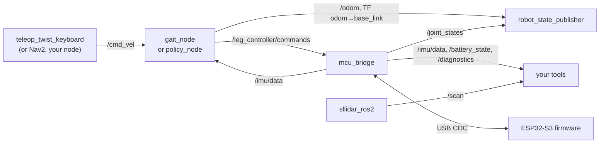
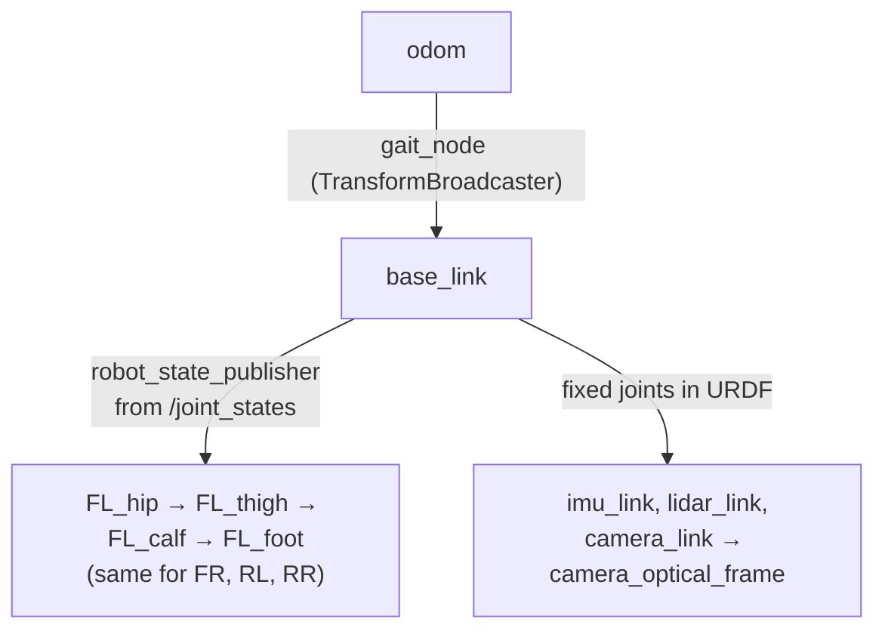

# ROS 2 Jazzy

ROS 2 (Robot Operating System 2) is not an operating system but a framework: a set of libraries and tools that let many small programs, called nodes, exchange typed messages. Strido uses ROS 2 Jazzy so that the same nodes run in Gazebo and on the real robot, and so that standard tools (teleop, RViz, Nav2, SLAM) can drive it.

::: tip In Strido
- **Packages** (in `ros2/`): `strido_description` (URDF/xacro generated from CAD, `controllers.yaml`, `display.launch.py`), `strido_bringup` (`robot.launch.py`, `gazebo.launch.py`, `worlds/flat.sdf`, udev rules), `strido_control` (`gait_node`, `policy_node`, `mcu_bridge`, `walk_smoke`).
- **Shared core:** `packages/strido-core` (plain Python, no ROS) holds the gait, kinematics, MCU protocol and policy runtime that the nodes call.
- **Interface:** Unitree Go2-style topics and joint names, listed in [software](../../software.md#ros-2-interface-go2-style).
- **Runs in:** the `strido-ros:jazzy` Docker image ([Docker](docker.md)).
:::

## Why Jazzy

Jazzy Jalisco (May 2024) is a long-term-support release, supported until May 2029, and its Tier 1 platform is Ubuntu 24.04, the base of the `ros:jazzy-ros-base` image. It pairs with Gazebo Harmonic, which the repo uses for simulation. An LTS release means the robot's software stack does not have to chase a new ROS version every year.

## The ROS graph of this robot



(`policy_node` subscribes to `/imu/data`; `gait_node` does not.)

## Nodes

A **node** is one process (or one object in a process) with a single job. Splitting the robot into nodes means you can replace one piece without touching the others: `gait_node` and `policy_node` are interchangeable because both turn `/cmd_vel` into `/leg_controller/commands`.

| Node (package `strido_control`) | Job |
|---|---|
| `gait_node` | Velocity command → trot gait → 12 joint targets at 100 Hz; publishes `/odom` and the `odom→base_link` transform by integrating the *commanded* velocity |
| `policy_node` | Runs a learned policy (`policy.npz`) at 50 Hz from `/cmd_vel` and `/imu/data` |
| `mcu_bridge` | Translates between ROS topics and the binary serial protocol of the ESP32-S3 |
| `walk_smoke` | Automated Gazebo test: walks and checks ground truth |

Plus standard nodes: `robot_state_publisher`, the Slamtec `sllidar_ros2` driver, `camera_ros` (optional), and in simulation the Gazebo bridge and `ros2_control` controllers.

Each `strido_control` node is a Python class derived from `rclpy.node.Node`, registered as a console script in `setup.py`, so you start it with:

```bash
ros2 run strido_control gait_node
```

## Topics

A **topic** is a named, typed, many-to-many stream. Publishers do not know who listens. That loose coupling is why the gait node needs no change between simulation and hardware: in Gazebo, `/leg_controller/commands` is consumed by `ros2_control`'s `leg_controller`; on the robot, by `mcu_bridge`.

The topics this repo actually uses:

| Topic | Type | Published by | Notes |
|---|---|---|---|
| `/cmd_vel` | `geometry_msgs/Twist` | you / teleop | `linear.x`, `linear.y` [m/s], `angular.z` [rad/s]; gait clamps to 0.30 / 0.15 / 1.0 |
| `/leg_controller/commands` | `std_msgs/Float64MultiArray` | gait or policy node | 12 angles [rad], order FL, FR, RL, RR × hip, thigh, calf |
| `/joint_states` | `sensor_msgs/JointState` | `mcu_bridge` (robot), `joint_state_broadcaster` (Gazebo) | names `FL_hip_joint` …; on the robot these are the commanded angles after clamping, because the servos have no feedback |
| `/imu/data` | `sensor_msgs/Imu` | `mcu_bridge` / Gazebo IMU | frame `imu_link`; not published while the IMU reports a fault |
| `/battery_state` | `sensor_msgs/BatteryState` | `mcu_bridge` | pack voltage, current negative = discharging |
| `/diagnostics` | `diagnostic_msgs/DiagnosticArray` | `mcu_bridge` | flags `estop`, `relaxed`, `watchdog`, `imu_ok`, `power_ok`, `pwm_ok`, `clamped`, `calibration_mode` |
| `/odom` | `nav_msgs/Odometry` | `gait_node` | dead reckoning of the commanded velocity |
| `/scan` | `sensor_msgs/LaserScan` | `sllidar_ros2` / Gazebo | frame `lidar_link`, 10 Hz |
| `/camera/image_raw` | `sensor_msgs/Image` | `camera_ros` / Gazebo | frame `camera_optical_frame` |
| `/strido/estop` | `std_msgs/Bool` | you | `true` latches a stop (servo outputs off) |
| `/strido/relax` | `std_msgs/Bool` | you | `true` makes the servos limp |
| `/strido/face` | `std_msgs/UInt8` | you | LCD expression id |
| `/ground_truth/odom` | `nav_msgs/Odometry` | Gazebo only | used by `walk_smoke` to measure real progress |

`/odom` from `gait_node` is pure dead reckoning: each step it rotates the commanded body velocity into the odometry frame with the current heading $\psi$ and integrates it,

$$
\begin{pmatrix} x \\ y \end{pmatrix}_{k+1} = \begin{pmatrix} x \\ y \end{pmatrix}_{k} + \begin{pmatrix} \cos\psi_k & -\sin\psi_k \\ \sin\psi_k & \cos\psi_k \end{pmatrix} \begin{pmatrix} v_x \\ v_y \end{pmatrix} \Delta t, \qquad \psi_{k+1} = \psi_k + \omega_z\,\Delta t
$$

so any difference between commanded and real motion (foot slip, a policy that undershoots) accumulates without bound. That is why `walk_smoke` judges progress with `/ground_truth/odom`, and why SLAM corrects the pose from `/scan`. See [frames and rotations](../theory/frames-and-rotations.md) and [state estimation](../theory/state-estimation.md).

Exploring them from a shell inside the container:

```bash
ros2 node list
ros2 topic list -t
ros2 topic hz /leg_controller/commands          # ≈ 100 Hz from gait_node
ros2 topic echo /battery_state --once
ros2 topic echo /diagnostics
ros2 topic pub --once /strido/estop std_msgs/msg/Bool "{data: true}"    # stop
ros2 topic pub --once /strido/estop std_msgs/msg/Bool "{data: false}"   # release (a new joint command is needed to move again)
```

## Services and actions

A **service** is a request/response call (like a function call over the network); an **action** is a long-running goal with feedback and cancellation (like "walk to this pose"). The Strido nodes define **neither**: every command, including e-stop and relax, is a topic. That is a deliberate fit for a robot whose firmware treats the command stream itself as the heartbeat (no command for 200 ms → hold, see [firmware](firmware.md)).

You still meet services through standard nodes. Every node exposes parameter services (`ros2 param ...` uses them), and the `spawner` in `gazebo.launch.py` calls the `controller_manager`'s services to load `joint_state_broadcaster` and `leg_controller`. Actions appear once you add Nav2, whose `NavigateToPose` action would publish `/cmd_vel` to this robot.

## Parameters

**Parameters** are per-node settings, declared in code with defaults and overridable at launch. The real ones:

| Node | Parameter | Default |
|---|---|---|
| `gait_node` | `rate_hz` | 100.0 |
| | `body_height` | 0.17 m |
| | `stand_up_s` | 3.0 s |
| | `cmd_timeout_s` | 0.5 s (no `/cmd_vel` for this long → stand still) |
| | `accel_limit` | 0.5 m/s² and rad/s² |
| | `publish_tf` | true |
| `policy_node` | `policy` | "" (required: path to `policy.npz`) |
| | `stand_up_s`, `cmd_timeout_s` | 3.0 s, 0.5 s |
| `mcu_bridge` | `port` | `/dev/strido_mcu` |
| `walk_smoke` | `settle_s`, `walk_s`, `vx`, `min_forward_m`, `timeout_s` | 6.0, 8.0, 0.15, 0.4, 120.0 |

The nodes read their parameters once at start-up, so set them on the command line rather than with `ros2 param set` while running:

```bash
ros2 run strido_control gait_node --ros-args -p body_height:=0.15 -p accel_limit:=0.3
```

`use_sim_time:=true` is a parameter every node has: it makes the node's clock follow Gazebo's `/clock` topic instead of wall time. `gazebo.launch.py` sets it for all its nodes.

## Launch files

A **launch file** starts a set of nodes with their parameters and arguments. Strido's are Python (`*.launch.py`).

```bash
ros2 launch strido_bringup robot.launch.py                       # on the robot
ros2 launch strido_bringup robot.launch.py lidar:=false          # without the LiDAR
ros2 launch strido_bringup robot.launch.py use_policy:=true policy:=/path/policy.npz
ros2 launch strido_bringup gazebo.launch.py headless:=true       # simulation
ros2 launch strido_description display.launch.py                 # model + joint sliders in RViz
```

| Launch file | Arguments (default) |
|---|---|
| `robot.launch.py` | `mcu_port` (`/dev/strido_mcu`), `lidar_port` (`/dev/rplidar`), `lidar` (true), `camera` (false), `use_policy` (false), `policy` ("") |
| `gazebo.launch.py` | `world` (`worlds/flat.sdf`), `headless` (false), `use_policy` (false), `policy` ("") |
| `display.launch.py` | `rviz` (true) |

`robot.launch.py` shows the main launch building blocks: `DeclareLaunchArgument`, `Node(...)`, `IfCondition`/`UnlessCondition` to choose `gait_node` or `policy_node`, `IncludeLaunchDescription` to reuse the Slamtec launch file, and `Command(["xacro ", file])` to turn the xacro into the `robot_description` string. `gazebo.launch.py` adds event handlers (`OnProcessExit`) so the controllers are spawned only after the robot exists in the simulator.

## tf2 and frames

**tf2** keeps track of coordinate frames over time, so any node can ask "where is the LiDAR relative to the odometry origin, 50 ms ago?". Frames follow REP-103: `base_link` has x forward, y left, z up.



`robot_state_publisher` reads the URDF (generated from the CAD by `strido_cad.models`) and the `/joint_states`, and publishes every link's pose. On the robot the joint states are the commanded angles after clamping: good for visualisation, but they cannot show a servo that stalls.

The `odom→base_link` transform comes from integrating the commanded velocity, with no slip model. It is enough for teleoperation and as a seed for SLAM; for navigation use a LiDAR odometry or SLAM source. `policy_node` publishes no `/odom`.

## Quality of Service (QoS)

**QoS** settings decide how messages are delivered: reliability (reliable or best effort), history depth, durability (whether late subscribers get old messages) and deadlines. A publisher and subscriber must have compatible QoS or they will silently not connect.

All Strido publishers and subscribers pass a plain integer depth (`10`; `50` for `policy_node`'s IMU subscription). In `rclpy` that means the default profile: **keep last N, reliable, volatile**. Reliable delivery is right for commands on the same machine. If you connect a sensor driver that publishes best effort (common for cameras and some LiDAR drivers), a reliable subscriber will not receive it: check with

```bash
ros2 topic info /scan --verbose      # shows each endpoint's QoS
```

## Teleoperation

Drive the robot (or the simulation) from the keyboard. The image includes `teleop_twist_keyboard`:

```bash
# terminal 1 (on the Pi, robot lying in rest pose, loop key in)
docker compose -f docker/compose.yaml run --rm robot
# terminal 2
docker compose -f docker/compose.yaml run --rm ros ros2 run teleop_twist_keyboard teleop_twist_keyboard
```

`teleop_twist_keyboard` starts with 0.5 m/s and 1.0 rad/s; `gait_node` clamps to 0.30 m/s forward, 0.15 m/s sideways and 1.0 rad/s, and ramps at 0.5 m/s². Press `z` (all speeds −10 %) or `x` (linear only) a few times so the key presses map onto the usable range. The teleop publishes a message per key press (hold a key and keyboard auto-repeat keeps it coming); `gait_node` treats `/cmd_vel` older than 0.5 s (`cmd_timeout_s`) as stale and stands still, so the robot stops when the messages stop. Kill the gait node entirely and the firmware holds the pose for 200 ms, then relaxes 2 s later.

::: danger
Teleop is not an emergency stop. Pulling the servo loop key is the hardware kill; `/strido/estop` is the software one ([safety](../making/safety.md)).
:::

## Porting from a Unitree Go2

Joint names, signs, frames and `/cmd_vel` match the Go2 ROS 2 description, so velocity-level stacks run unchanged. Differences: the command array order is FL, FR, RL, RR (the Unitree SDK uses FR, FL, RR, RL: map by name), there are no foot-contact or motor-torque topics, `/joint_states` are commanded values, and the speed envelope is about 0.3 m/s.

## Check yourself

1. Why can `gait_node` run unchanged in Gazebo and on the robot?
2. Which Strido node publishes `odom→base_link`, and what is its weakness?
3. Name one service the robot uses even though `strido_control` defines none.
4. You run `ros2 param set /gait_node body_height 0.15` and nothing changes. Why?
5. A best-effort camera driver publishes `/camera/image_raw` but your default subscriber gets nothing. What is the likely cause?

<details>
<summary>Answers</summary>

1. It only publishes `/leg_controller/commands`; in Gazebo `ros2_control`'s `leg_controller` consumes it, on the robot `mcu_bridge` does.
2. `gait_node`; it integrates the commanded velocity (dead reckoning without slip), so it drifts from reality.
3. The `controller_manager` services called by `spawner` in `gazebo.launch.py`, or the parameter services every node has.
4. The node reads its parameters only at start-up; restart it with `--ros-args -p body_height:=0.15`.
5. A QoS mismatch: a reliable subscriber does not match a best-effort publisher.

</details>

## Further reading

- [ROS 2 Jazzy concepts (nodes, topics, services, actions, parameters, launch)](https://docs.ros.org/en/jazzy/Concepts.html)
- [About Quality of Service settings](https://docs.ros.org/en/jazzy/Concepts/Intermediate/About-Quality-of-Service-Settings.html)
- [tf2 introduction](https://docs.ros.org/en/jazzy/Concepts/Intermediate/About-Tf2.html)
- [REP-103: units and coordinate conventions](https://www.ros.org/reps/rep-0103.html)
- [ros2_control documentation (Jazzy)](https://control.ros.org/jazzy/index.html)
