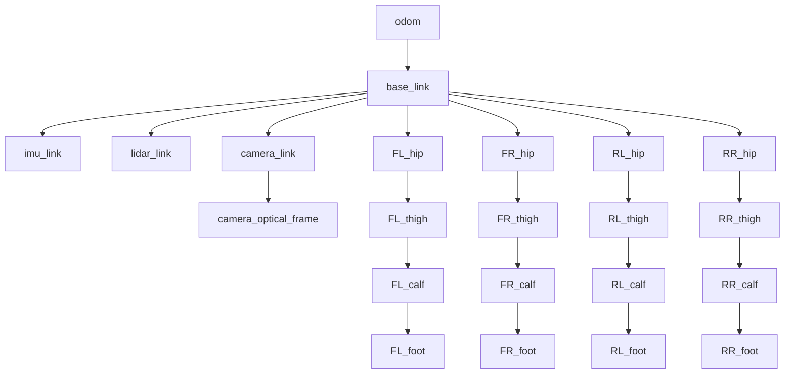

# Frames and rotations

Every number a robot uses for position or orientation is relative to some coordinate frame. This page covers frames, rotation matrices, roll–pitch–yaw angles and gimbal lock, quaternions, and homogeneous transforms, then shows how they fit together in the Strido transform (tf) tree.

::: tip In Strido
- **Base frame:** REP-103 (`x` forward, `y` left, `z` up), with the origin at the centre of the four hip-axis intersections. It is defined in `hardware/kinematics.yaml` (`base_frame`), together with the rotation from the CAD (STEP) frame.
- **Frame tree:** `ros2/strido_description/urdf/strido.urdf.xacro` defines `base_link`, `imu_link`, `lidar_link`, `camera_link`, `camera_optical_frame` and, for each leg, `*_hip`, `*_thigh`, `*_calf` and `*_foot`.
- **Orientation:** the firmware runs a Mahony filter and outputs a quaternion (`firmware/strido_esp32s3/src/main.cpp`). `mcu_bridge` publishes it as `/imu/data` in `imu_link`.
- **Leg transforms in code:** `foot_position` in `packages/strido-core/src/strido/leg.py`.
:::

## Frames

A **frame** is an origin plus three orthogonal unit axes. A point $\mathbf{p}$ has no coordinates on its own; it only has coordinates *in* a frame. We write ${}^{A}\mathbf{p}$ for "the coordinates of $\mathbf{p}$ in frame $A$". All frames here are right-handed: $\hat{\mathbf{x}} \times \hat{\mathbf{y}} = \hat{\mathbf{z}}$.

ROS fixes the conventions in [REP-103](https://www.ros.org/reps/rep-0103.html). Body frames use $x$ forward, $y$ left and $z$ up. Units are metres and radians. Strido follows this. Its `base_link` origin is the centre of the four hip-axis intersections, so the hips sit at $(\pm 0.120, \pm 0.039, 0)\,\mathrm{m}$ (`legs_base` in `hardware/kinematics.yaml`).

The CAD model uses a different frame. `hardware/kinematics.yaml` stores the rotation that maps STEP coordinates into base coordinates:

$$
\mathbf{R}_{\text{base}\leftarrow\text{STEP}} =
\begin{bmatrix} 0 & -1 & 0 \\ 1 & 0 & 0 \\ 0 & 0 & 1 \end{bmatrix}
$$

This is a $+90^\circ$ turn about $z$: the STEP $y$ axis points backwards, so STEP $-y$ becomes base $+x$.

## Rotation matrices

The orientation of frame $B$ relative to frame $A$ is a $3\times 3$ matrix ${}^{A}\mathbf{R}_{B}$. Its columns are $B$'s unit axes written in $A$ coordinates. A vector converts as ${}^{A}\mathbf{v} = {}^{A}\mathbf{R}_{B}\,{}^{B}\mathbf{v}$. Because the columns are orthonormal:

$$
\mathbf{R}^\top \mathbf{R} = \mathbf{I}, \qquad \det \mathbf{R} = +1, \qquad \mathbf{R}^{-1} = \mathbf{R}^\top
$$

Rotation matrices with these properties form the group $SO(3)$. The three elementary rotations are:

$$
\mathbf{R}_x(\theta) = \begin{bmatrix} 1 & 0 & 0 \\ 0 & \cos\theta & -\sin\theta \\ 0 & \sin\theta & \cos\theta \end{bmatrix},\quad
\mathbf{R}_y(\theta) = \begin{bmatrix} \cos\theta & 0 & \sin\theta \\ 0 & 1 & 0 \\ -\sin\theta & 0 & \cos\theta \end{bmatrix},\quad
\mathbf{R}_z(\theta) = \begin{bmatrix} \cos\theta & -\sin\theta & 0 \\ \sin\theta & \cos\theta & 0 \\ 0 & 0 & 1 \end{bmatrix}
$$

Rotations combine by multiplication, ${}^{A}\mathbf{R}_{C} = {}^{A}\mathbf{R}_{B}\,{}^{B}\mathbf{R}_{C}$. The order matters, because rotations do not commute: $\mathbf{R}_x\mathbf{R}_y \neq \mathbf{R}_y\mathbf{R}_x$ in general.

## Roll, pitch, yaw and gimbal lock

A rotation has three degrees of freedom, but its matrix has nine numbers. **Euler angles** describe it with three successive elementary rotations. ROS and URDF use **roll–pitch–yaw** (RPY): roll $\phi$ about $x$, pitch $\theta$ about $y$, yaw $\psi$ about $z$, applied about the fixed axes in that order. That gives:

$$
\mathbf{R} = \mathbf{R}_z(\psi)\,\mathbf{R}_y(\theta)\,\mathbf{R}_x(\phi)
$$

RPY is easy to read. The Strido camera is mounted with `rpy="0 0.261799 0"`, a $15^\circ$ downward pitch. A body "rolled $5^\circ$" is easy to picture.

RPY angles have a singularity. At $\theta = \pm 90^\circ$ the roll and yaw axes line up, and only $\phi \pm \psi$ is defined. One degree of freedom has gone. This is **gimbal lock**. Near it, a small change in orientation can cause a large jump in the angles, and the angle rates

$$
\dot{\phi},\ \dot{\theta},\ \dot{\psi}
$$

blow up. That is because the matrix that maps body angular velocity to $(\dot\phi,\dot\theta,\dot\psi)$ contains $1/\cos\theta$. No set of three angles avoids this everywhere; it is a topological property of $SO(3)$. A walking robot rarely pitches $90^\circ$, but a fall can. This is one reason estimators store orientation as a quaternion.

## Quaternions

A unit quaternion $\mathbf{q} = (w, x, y, z)$ with $w^2+x^2+y^2+z^2 = 1$ encodes a rotation by angle $\alpha$ about the unit axis $\hat{\mathbf{n}}$:

$$
\mathbf{q} = \left(\cos\tfrac{\alpha}{2},\ \hat{\mathbf{n}}\sin\tfrac{\alpha}{2}\right)
$$

Rotations compose by the quaternion (Hamilton) product. $\mathbf{q}$ and $-\mathbf{q}$ give the same rotation. The representation has no singularity, needs four numbers instead of nine, and can be renormalised cheaply after numerical drift. The equivalent rotation matrix is:

$$
\mathbf{R}(\mathbf{q}) =
\begin{bmatrix}
1-2(y^2+z^2) & 2(xy-wz) & 2(xz+wy) \\
2(xy+wz) & 1-2(x^2+z^2) & 2(yz-wx) \\
2(xz-wy) & 2(yz+wx) & 1-2(x^2+y^2)
\end{bmatrix}
$$

The Strido firmware gets $\mathbf{q}$ from `orientation.getQuaternion` and sends it to the Pi. The learned policy does not use the raw angles. It uses the direction of gravity seen from the body, ${}^{B}\mathbf{g} = \mathbf{R}(\mathbf{q})^\top (0,0,-1)^\top$ (see `packages/strido-sim/src/strido_sim/rl/env.py`). This vector is smooth for every orientation and has no gimbal lock. See [state estimation](state-estimation.md) for how the filter produces $\mathbf{q}$.

## Homogeneous transforms

A **pose** combines a rotation and a translation. A $4\times 4$ homogeneous transform packs both together:

$$
{}^{A}\mathbf{T}_{B} = \begin{bmatrix} {}^{A}\mathbf{R}_{B} & {}^{A}\mathbf{t}_{B} \\ \mathbf{0}^\top & 1 \end{bmatrix},
\qquad
\begin{bmatrix} {}^{A}\mathbf{p} \\ 1 \end{bmatrix} = {}^{A}\mathbf{T}_{B} \begin{bmatrix} {}^{B}\mathbf{p} \\ 1 \end{bmatrix}
$$

Here ${}^{A}\mathbf{t}_{B}$ is the origin of $B$ expressed in $A$. Transforms chain by multiplication, ${}^{A}\mathbf{T}_{C} = {}^{A}\mathbf{T}_{B}\,{}^{B}\mathbf{T}_{C}$. The inverse is:

$$
{}^{B}\mathbf{T}_{A} = \left({}^{A}\mathbf{T}_{B}\right)^{-1} = \begin{bmatrix} \mathbf{R}^\top & -\mathbf{R}^\top\mathbf{t} \\ \mathbf{0}^\top & 1 \end{bmatrix}
$$

Each URDF joint is exactly one such transform. The fixed `<origin xyz rpy>` comes first. For a revolute joint, it is followed by a rotation about `<axis>` by the joint angle.

## The Strido tf tree

`robot_state_publisher` computes the leg transforms from the joint angles. The sensor frames are fixed. For example, `imu_link` sits at $(0.042, -0.004, -0.011)\,\mathrm{m}$ with its axes aligned to `base_link`. `camera_optical_frame` uses `rpy="-π/2 0 -π/2"` so that its $z$ axis points along the view direction, which is the optical convention in REP-103. `odom → base_link` comes from `gait_node`, which integrates the *commanded* body velocity. It is not measured odometry (see the docstring of `ros2/strido_control/strido_control/gait_node.py`).

For the front-left leg, the URDF chain is:

$$
{}^{\text{base}}\mathbf{T}_{\text{foot}} =
\underbrace{\mathrm{Trans}(0.1197, 0.039, 0)\,\mathrm{Rot}_x(q_1)}_{\text{FL\_hip\_joint}}\;
\underbrace{\mathrm{Trans}(0, 0.0383, 0)\,\mathrm{Rot}_y(q_2)}_{\text{FL\_thigh\_joint}}\;
\underbrace{\mathrm{Trans}(0, 0, -0.130)\,\mathrm{Rot}_y(q_3)}_{\text{FL\_calf\_joint}}\;
\underbrace{\mathrm{Trans}(0, 0, -0.124)}_{\text{FL\_foot\_joint}}
$$

## Worked example: abducting the front-left leg

In the stand pose (`stand_pose()` in `strido/gait.py`, body height $0.17\,\mathrm{m}$), the front-left joint angles are $q_1 = 0$, $q_2 = 46.5^\circ$ and $q_3 = -96.0^\circ$. The thigh and calf rotations place the foot at $\mathbf{p}_{\text{hip}} = (0,\ 0.0383,\ -0.170)\,\mathrm{m}$ relative to the hip-joint origin. The $0.0383\,\mathrm{m}$ is the lateral offset to the leg plane, and the foot sits straight below the hip.

Now abduct by $q_1 = 10^\circ$ ($\cos = 0.9848$, $\sin = 0.1736$):

$$
\mathbf{R}_x(10^\circ)\,\mathbf{p}_{\text{hip}} =
\begin{bmatrix} 0 \\ 0.9848 \cdot 0.0383 - 0.1736 \cdot (-0.170) \\ 0.1736 \cdot 0.0383 + 0.9848 \cdot (-0.170) \end{bmatrix}
= \begin{bmatrix} 0 \\ 0.0672 \\ -0.1608 \end{bmatrix}\mathrm{m}
$$

Adding the hip origin $(0.1197, 0.039, 0)$ gives the foot at $(0.1197,\ 0.1062,\ -0.1608)\,\mathrm{m}$ in `base_link`. `foot_position("FL", (0.1745, 0.8121, -1.6761))` returns the same point. The same rotation as a quaternion is $(\cos 5^\circ, \sin 5^\circ, 0, 0) = (0.9962, 0.0872, 0, 0)$.

## Check yourself

1. Why is ${}^{A}\mathbf{R}_{B}^{-1}$ just the transpose?
2. The IMU frame is aligned with `base_link` but offset by a few centimetres. Does the offset change the measured angular velocity? Does it change the measured acceleration?
3. Why does the policy observe the gravity vector rather than roll, pitch and yaw?
4. Write ${}^{\text{camera\_optical}}\mathbf{T}_{\text{base}}$ in terms of the URDF transforms.

Answers

1. The columns are orthonormal, so $\mathbf{R}^\top\mathbf{R} = \mathbf{I}$.
2. Angular velocity is the same everywhere on a rigid body, so the offset does not change it. Linear acceleration does change: an offset point sees extra $\boldsymbol{\omega}\times(\boldsymbol{\omega}\times\mathbf{r}) + \dot{\boldsymbol{\omega}}\times\mathbf{r}$ terms.
3. It is continuous and has no singularity. Yaw is also unobservable from an IMU without a magnetometer, and walking does not need it.
4. $\left({}^{\text{base}}\mathbf{T}_{\text{camera}}\,{}^{\text{camera}}\mathbf{T}_{\text{optical}}\right)^{-1}$, with each factor built from the joint's `xyz` and `rpy`.

## Further reading

- K. M. Lynch and F. C. Park, *Modern Robotics: Mechanics, Planning, and Control*, Cambridge University Press, 2017, ch. 3 (rigid-body motions). [Free PDF](http://hades.mech.northwestern.edu/index.php/Modern_Robotics)
- B. Siciliano, L. Sciavicco, L. Villani and G. Oriolo, *Robotics: Modelling, Planning and Control*, Springer, 2009, ch. 2.
- [REP-103: Standard Units of Measure and Coordinate Conventions](https://www.ros.org/reps/rep-0103.html) and [REP-105: Coordinate Frames for Mobile Platforms](https://www.ros.org/reps/rep-0105.html).
- J. Solà, "Quaternion kinematics for the error-state Kalman filter", arXiv:1711.02508, 2017.
- [ROS 2 and the robot description](../software/ros2.md) in this wiki.
