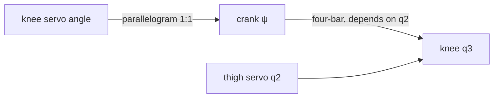

# Kinematics

Kinematics is the geometry of motion, without forces. Forward kinematics maps joint angles to the foot position. Inverse kinematics maps a foot position back to joint angles. The Jacobian links joint velocities to foot velocities. This page derives all three for the Strido leg, including its knee linkage.

::: tip In Strido
- **Leg model:** `packages/strido-core/src/strido/leg.py` (`foot_position`, `inverse_kinematics`, `calf_from_crank`, `crank_from_calf`, `transmission_angles`), mirrored in C++ in `firmware/strido_esp32s3/lib/strido_core/`.
- **Dimensions:** `hardware/kinematics.yaml` (`legs_linkage`, `legs_base`), measured from the CAD. **Limits:** `hardware/joint_limits.yaml`.
- **Practical guide:** [Kinematics and gaits](../software/kinematics-and-gaits.md) shows how the gait uses these functions.
:::

## The leg as a kinematic chain

Each leg has three revolute joints (`leg.py` docstring; the conventions match the Unitree Go2):

| Joint | Axis | Zero | Positive |
|---|---|---|---|
| hip $q_1$ | $+x$ | leg vertical | foot towards $+y$ |
| thigh $q_2$ | $+y$ | femur straight down | knee backwards |
| calf $q_3$ | $+y$, relative to femur | calf in line with femur | negative = knee bent |

From `hardware/kinematics.yaml` (front-left leg, rounded): the hip is at $\mathbf{h} = (0.1197, 0.039, 0)\,\mathrm{m}$ in `base_link`, the leg plane sits $d = 38.3\,\mathrm{mm}$ outboard of the hip ($40.2\,\mathrm{mm}$ on the rear legs), the thigh is $l_1 = 130.0\,\mathrm{mm}$ and the calf is $l_2 = 124.1\,\mathrm{mm}$ to the foot centre.

The thigh and calf move in a vertical **leg plane**. The hip joint tilts that plane about $x$. So the problem splits into two easier ones: a planar two-link arm, and one rotation.

## Forward kinematics

In the leg plane, let $u$ point forward and $v$ point up, both measured from the thigh pivot. Write $s_2 = \sin q_2$ and $s_{23} = \sin(q_2 + q_3)$, and similarly for cosines. The knee and the foot are at:

$$
\mathbf{k} = \begin{bmatrix} -l_1 s_2 \\ -l_1 c_2 \end{bmatrix},
\qquad
\begin{bmatrix} u \\ v \end{bmatrix} = \begin{bmatrix} -l_1 s_2 - l_2 s_{23} \\ -l_1 c_2 - l_2 c_{23} \end{bmatrix}
$$

The angles add because $q_3$ is measured relative to the femur, so the calf's absolute angle is $q_2 + q_3$. The signs are negative because zero means "pointing down" and positive $q_2$ swings the foot backwards (towards $-u$).

Next, the hip rotation. The foot in the hip frame, before abduction, is $(u, d, v)$. Rotating about $x$ by $q_1$ and adding the hip position gives:

$$
\mathbf{p} = \mathbf{h} + \mathbf{R}_x(q_1)\begin{bmatrix} u \\ d \\ v \end{bmatrix}
= \mathbf{h} + \begin{bmatrix} u \\ d\cos q_1 - v\sin q_1 \\ d\sin q_1 + v\cos q_1 \end{bmatrix}
$$

This is `foot_position` line for line. For the frame conventions, see [frames and rotations](frames-and-rotations.md).

## Inverse kinematics

We are given a foot target $\mathbf{p}$ and need $(q_1, q_2, q_3)$. Let $\mathbf{r} = \mathbf{p} - \mathbf{h} = (r_x, r_y, r_z)$.

### Hip abduction

A rotation about $x$ leaves the $x$ component alone and preserves length in the $y$–$z$ plane:

$$
r_y^2 + r_z^2 = d^2 + v^2
$$

The foot is below the hip, so we take the negative root:

$$
v = -\sqrt{r_y^2 + r_z^2 - d^2}
$$

If the term under the root is not positive, the target lies inside the cylinder of radius $d$ around the hip axis and cannot be reached. The direction of $(r_y, r_z)$ is the direction of $(d, v)$ rotated by $q_1$, so:

$$
q_1 = \operatorname{atan2}(r_z, r_y) - \operatorname{atan2}(v, d)
$$

### The planar two-link problem: law of cosines

Now set $u = r_x$ and solve the two-link arm. The thigh, the calf and the line from pivot to foot form a triangle with sides $l_1$, $l_2$ and $\rho = \sqrt{u^2+v^2}$. The law of cosines at the knee gives the knee angle. With our convention (the knee interior angle is $\pi + q_3$):

$$
\rho^2 = l_1^2 + l_2^2 + 2 l_1 l_2 \cos q_3
\quad\Longrightarrow\quad
\cos q_3 = \frac{u^2 + v^2 - l_1^2 - l_2^2}{2 l_1 l_2}
$$

There are two solutions, $\pm\arccos$, for knee-forward and knee-backward. Strido uses $q_3 = -\arccos(\cdot)$, a bent knee pointing backwards. If $\lvert\cos q_3\rvert > 1$, the target is out of reach.

The thigh angle is the direction to the foot minus the angle the calf adds inside the triangle:

$$
q_2 = \operatorname{atan2}(-u, -v) - \operatorname{atan2}\!\left(l_2 \sin q_3,\ l_1 + l_2\cos q_3\right)
$$

The minus signs in the first term come from the "zero = straight down, positive = backwards" convention. Use `atan2`, never `atan`, so that the quadrant is correct.

### The knee four-bar

The knee servo does not drive $q_3$ directly. A parallelogram (arm $24.0\,\mathrm{mm}$, short link $28.3\,\mathrm{mm}$, crank $24.0\,\mathrm{mm}$) copies the servo angle onto a crank $\psi$ at the thigh pivot. A four-bar (crank $26.9\,\mathrm{mm}$, long link $131\,\mathrm{mm}$, tibia crank $24.0\,\mathrm{mm}$, and the femur $130.0\,\mathrm{mm}$ as ground link) then turns the tibia. Because the four-bar's ground link is the femur itself:

$$
q_3 = f(q_2, \psi)
$$

Moving the thigh alone also moves the knee. `crank_from_calf` inverts this geometrically. The far end of the crank lies on a circle of radius $26.9\,\mathrm{mm}$ around the pivot, and also on a circle of radius $131\,\mathrm{mm}$ (the long link) around the tibia pin. Intersecting the two circles gives two candidates, and the assembly branch picks one. `circle_intersection` returns `None` when the circles do not meet. That means the linkage cannot be assembled in that pose.

## The Jacobian

The Jacobian maps joint rates to foot velocity, $\dot{\mathbf{p}} = \mathbf{J}(\mathbf{q})\,\dot{\mathbf{q}}$. Differentiating the planar forward kinematics:

$$
\mathbf{J}_{\text{plane}} = \frac{\partial (u, v)}{\partial (q_2, q_3)} =
\begin{bmatrix}
-l_1 c_2 - l_2 c_{23} & -l_2 c_{23} \\
\phantom{-}l_1 s_2 + l_2 s_{23} & \phantom{-}l_2 s_{23}
\end{bmatrix},
\qquad
\det \mathbf{J}_{\text{plane}} = -\,l_1 l_2 \sin q_3
$$

The full $3\times 3$ Jacobian adds the hip column, $\partial\mathbf{p}/\partial q_1 = \hat{\mathbf{x}} \times (\mathbf{p} - \mathbf{h})$, and rotates the planar columns by $\mathbf{R}_x(q_1)$. The Jacobian also governs forces through $\boldsymbol{\tau} = \mathbf{J}^\top\mathbf{F}$ (see [statics and dynamics](statics-and-dynamics.md)).

For the drive, the chain rule adds one more factor. The knee servo's rate is $\dot\psi$, and

$$
\dot q_3 = \frac{\partial f}{\partial q_2}\dot q_2 + \frac{\partial f}{\partial \psi}\dot\psi
$$

## Workspace and singularities

Ignoring joint limits, the planar foot reaches an annulus:

$$
\lvert l_1 - l_2\rvert \le \rho \le l_1 + l_2
\quad\Rightarrow\quad
5.9\,\mathrm{mm} \le \rho \le 254.1\,\mathrm{mm}
$$

The joint limits and self-collisions cut this down. `hardware/joint_limits.yaml` limits $q_3$ to $[-150^\circ, -45^\circ]$ and the front $q_2$ to $[-45^\circ, 125^\circ]$, found by sweeping the posed CAD for collisions on a $5^\circ$ grid.

A **singularity** is a pose where $\det\mathbf{J} = 0$. There the foot cannot move in some direction, however fast the joints turn, and inverse kinematics becomes ill-conditioned. For the planar leg this happens at $\sin q_3 = 0$: the leg fully straight ($q_3 = 0$, on the outer workspace boundary) or fully folded. The calf limit keeps $\lvert\sin q_3\rvert \ge \sin 30^\circ = 0.5$ (at the $-150^\circ$ end; at least $0.71$ at the $-45^\circ$ end), so the leg never gets close. This is one reason the stand pose keeps the knee well bent.

The four-bar has its own singularities. When the long link lines up with the crank or with the tibia crank (a transmission angle near $0$ or $180^\circ$), $\partial f/\partial\psi$ blows up or vanishes. `transmission_angles` measures both angles, and `joint_limits.yaml` requires at least $25^\circ$ (`transmission_min_deg`).

## Worked example: the stand pose

The stand pose puts each foot straight below its hip, $0.17\,\mathrm{m}$ down (`stand_pose(height=0.17)` in `strido/gait.py`). For the front-left leg, $\mathbf{r} = (0,\ 0.0383,\ -0.170)\,\mathrm{m}$.

**Hip.** $v = -\sqrt{0.0383^2 + 0.170^2 - 0.0383^2} = -0.170$, so $q_1 = \operatorname{atan2}(-0.170, 0.0383) - \operatorname{atan2}(-0.170, 0.0383) = 0$.

**Knee.** With $u = 0$:

$$
\cos q_3 = \frac{0.170^2 - 0.1300^2 - 0.1241^2}{2 \cdot 0.1300 \cdot 0.1241} = \frac{-0.00339}{0.03226} = -0.105
\quad\Rightarrow\quad q_3 = -96.0^\circ
$$

**Thigh.** $l_2\sin q_3 = -0.1234$ and $l_1 + l_2\cos q_3 = 0.1170$, so

$$
q_2 = \operatorname{atan2}(0, 0.170) - \operatorname{atan2}(-0.1234, 0.1170) = 0 + 46.5^\circ = 46.5^\circ
$$

These match `stand_pose()`, which returns $(0^\circ, 46.53^\circ, -96.03^\circ)$ for every leg. The calf's absolute angle is $q_2 + q_3 = -49.5^\circ$: the knee sits behind and above the foot, and the calf leans forward to reach it.

**Jacobian.** At this pose,

$$
\mathbf{J}_{\text{plane}} = \begin{bmatrix} -0.170 & -0.0806 \\ 0 & -0.0943 \end{bmatrix}\mathrm{m/rad},
\qquad \det = 0.0160\,\mathrm{m^2}
$$

A thigh rate of $1\,\mathrm{rad/s}$ moves the foot $0.17\,\mathrm{m/s}$ backwards and not at all vertically. To lift the foot you mostly need the knee.

**Linkage.** `leg.py` gives a crank angle of $\psi = 38.9^\circ$ and transmission angles of $84^\circ$ and $86^\circ$, close to the ideal $90^\circ$. The sensitivity is $\partial q_3/\partial\psi = -1.12$: the knee turns $1.12^\circ$ for each degree of crank.

## Check yourself

1. Why can the hip angle be solved before, and separately from, the thigh and knee?
2. What does $\lvert\cos q_3\rvert > 1$ mean physically?
3. At the stand pose, which joint mainly moves the foot forward, and which mainly moves it vertically?
4. Why do the transmission angles matter even when $\det\mathbf{J}_{\text{plane}}$ is far from zero?

Answers

1. The hip axis is the $x$ axis, and $q_2$, $q_3$ never change the foot's distance from it. So $r_y^2 + r_z^2$ depends only on the planar depth $v$ and the fixed offset $d$.
2. The target is farther than $l_1 + l_2$ or closer than $\lvert l_1 - l_2\rvert$, so no triangle exists.
3. The thigh moves it forward and back ($J_{11} = -0.170$, $J_{21} = 0$). Only the knee column has a vertical component.
4. They describe the *drive* linkage, not the leg. Near $0^\circ$ or $180^\circ$ the knee servo loses leverage and the crank–knee map becomes ill-conditioned, whatever the leg Jacobian says.

## Further reading

- K. M. Lynch and F. C. Park, *Modern Robotics*, Cambridge University Press, 2017, ch. 4–6 (forward kinematics, velocity kinematics, inverse kinematics).
- B. Siciliano et al., *Robotics: Modelling, Planning and Control*, Springer, 2009, ch. 2–3.
- R. L. Norton, *Design of Machinery*, McGraw-Hill, ch. 4 (four-bar position analysis and transmission angle).
- [Kinematics and gaits](../software/kinematics-and-gaits.md) in this wiki.
