# Legged locomotion

How a four-legged robot stays up while it moves: gaits and their timing, the support polygon, static and dynamic stability, and the foot-placement rule that Strido's trot generator uses.

::: tip In Strido
The scripted gait is `TrotGait` in `packages/strido-core/src/strido/gait.py`, shared by MuJoCo, Gazebo and the real robot (via `ros2/strido_control/strido_control/gait_node.py`). The learned policy (`packages/strido-sim/`) receives a clock with the same $0.4\,\mathrm{s}$ period (`GAIT_PERIOD_S` in `packages/strido-core/src/strido/policy.py`). Practical usage is in [Kinematics and gaits](../software/kinematics-and-gaits.md).
:::

## Gaits as timing patterns

A **gait** is a periodic pattern of foot contacts. Each leg $i$ runs through one **cycle** of period $T$ and is described by a phase $\phi_i \in [0, 1)$:

$$
\phi_i(t) = \left( \frac{t}{T} + \delta_i \right) \bmod 1
$$

where $\delta_i$ is that leg's **phase offset**. The leg is in **stance** (foot on the ground, pushing) while $\phi_i < \beta$ and in **swing** (foot in the air, returning) otherwise. The **duty factor** $\beta$ is the fraction of the cycle spent in stance:

$$
\beta = \frac{T_\mathrm{stance}}{T}, \qquad T_\mathrm{stance} = \beta T, \qquad T_\mathrm{swing} = (1-\beta) T
$$

Gaits differ only in $\beta$ and the offsets $\delta_i$:

| Gait | Duty factor $\beta$ | Offsets (FL, FR, RL, RR) | Feet on ground |
|---|---|---|---|
| Walk (crawl) | $\ge 0.75$ | $0, \tfrac12, \tfrac34, \tfrac14$ | always $\ge 3$ |
| Trot | $\approx 0.5$ | $0, \tfrac12, \tfrac12, 0$ | 2 (a diagonal pair) |
| Pace | $\approx 0.5$ | $0, \tfrac12, 0, \tfrac12$ | 2 (a lateral pair) |
| Bound | $\approx 0.5$ | $0, 0, \tfrac12, \tfrac12$ | 2 (front or rear pair) |

With $\beta \ge 0.75$ only one leg is ever in the air, so the walk can be **statically stable**. With $\beta = 0.5$ two legs are always in the air; the trot relies on **dynamic stability**: the body would tip if frozen, but each pair lands before it falls far.

## Centre of mass and the support polygon

The **centre of mass** (CoM) of bodies with masses $m_k$ at positions $\mathbf{p}_k$ is

$$
\mathbf{p}_\mathrm{CoM} = \frac{\sum_k m_k \mathbf{p}_k}{\sum_k m_k}
$$

The **support polygon** is the convex hull of the contact points projected onto the ground. A robot standing still (or moving slowly enough that inertia is negligible) is statically stable if the ground projection of the CoM lies inside this polygon: gravity then produces no net tipping moment about any polygon edge.

The **static stability margin** is the shortest distance from the projected CoM to the polygon's boundary:

$$
S = \min_{e \in \text{edges}} d(\mathbf{p}_\mathrm{CoM}^{xy}, e)
$$

$S > 0$ means stable; larger $S$ tolerates bigger pushes and modelling errors. In a trot the support "polygon" degenerates to the line segment between the two stance feet, so $S \le 0$ almost always: static stability is impossible and the gait must be dynamic.

## Beyond statics: ZMP and the capture point

When the body accelerates, inertial forces add to gravity. The **zero-moment point** (ZMP) is the point on the ground where the horizontal moments of gravity plus inertia vanish. For a point mass at height $h$ with horizontal acceleration $\ddot{\mathbf{x}}$ (the *linear inverted pendulum* model, constant height):

$$
\mathbf{p}_\mathrm{ZMP} = \mathbf{x}_\mathrm{CoM} - \frac{h}{g}\,\ddot{\mathbf{x}}_\mathrm{CoM}
$$

The contact forces can only push, so the ZMP must stay inside the support polygon; if the plan demands a ZMP outside it, a foot rolls or lifts and the robot tips. ZMP planning is the classic tool for walking humanoids.

The same pendulum gives the **capture point** (instantaneous capture point, divergent component of motion). Its dynamics $\ddot{x} = \omega^2 (x - p)$ with $\omega = \sqrt{g/h}$ have an unstable mode, and the point

$$
\boldsymbol{\xi} = \mathbf{x}_\mathrm{CoM} + \frac{\dot{\mathbf{x}}_\mathrm{CoM}}{\omega}
$$

is where a foot must be placed for the body to come to rest above it. Intuition: the faster you are moving, the further ahead you must step to stop.

**Worked example.** Strido's default body height is $h = 0.17\,\mathrm{m}$ (hip axis above the feet, `GaitConfig.body_height`). Then

$$
\omega = \sqrt{\frac{9.81}{0.17}} \approx 7.6\,\mathrm{s^{-1}}, \qquad \frac{1}{\omega} \approx 0.13\,\mathrm{s}
$$

At the maximum forward command $v = 0.30\,\mathrm{m/s}$ the capture point is about $0.30 \times 0.13 \approx 0.04\,\mathrm{m}$ ahead of the CoM. The pendulum's time constant ($0.13\,\mathrm{s}$) is comparable to the stance time ($0.2\,\mathrm{s}$, below), which is why the gait has to keep stepping: a frozen trot would tip within a fraction of a second.

## Raibert-style foot placement

Marc Raibert's hopping and running machines decomposed control into three parts: hopping height, body attitude, and **forward speed via foot placement**. The idea: during stance the body moves a distance $v\,T_\mathrm{stance}$ over the foot. If the foot lands at the centre of that path, the body passes symmetrically over it and speed is preserved (the *neutral point*):

$$
x_\mathrm{f} = \frac{v\,T_\mathrm{stance}}{2} + k\,(v - v_\mathrm{des})
$$

The feedback term $k(v - v_\mathrm{des})$ moves the foot further forward to brake and further back to accelerate. It is a capture-point rule in disguise.

## How Strido's trot generator works

`TrotGait` is a deliberately simple, deterministic, open-loop version of the above (no feedback term, $k = 0$). Its defaults in `GaitConfig`:

| Parameter | Value | Meaning |
|---|---|---|
| `period` | $T = 0.40\,\mathrm{s}$ | full cycle |
| `duty` | $\beta = 0.5$ | trot: stance and swing equal |
| `step_height` | $h_\mathrm{s} = 0.035\,\mathrm{m}$ | swing apex |
| `body_height` | $0.17\,\mathrm{m}$ | hip axis above the feet |
| `max_linear` | $\lvert v_x \rvert \le 0.30$, $\lvert v_y \rvert \le 0.15\,\mathrm{m/s}$ | command clamp |
| `max_yaw_rate` | $\lvert \omega_z \rvert \le 1.0\,\mathrm{rad/s}$ | command clamp |

`PHASE_OFFSET` gives FL and RR $\delta = 0$ and FR and RL $\delta = \tfrac12$: the diagonals alternate.

**Per-foot velocity.** For a command $(v_x, v_y, \omega_z)$ and a foot's nominal position $(p_x, p_y)$ in the body frame, the body moves over that foot with the rigid-body velocity $\mathbf{v} + \boldsymbol{\omega} \times \mathbf{p}$, so the stance foot moves at $-\mathbf{v}_i$ relative to the body:

$$
\mathbf{v}_i = \begin{pmatrix} v_x - \omega_z p_y \\ v_y + \omega_z p_x \\ 0 \end{pmatrix}, \qquad \mathbf{s}_i = \mathbf{v}_i\, \beta T
$$

where $\mathbf{s}_i$ is the stride over one stance.

**Stance.** With normalised stance progress $s = \phi/\beta \in [0, 1)$, the foot slides from half a stride ahead to half a stride behind:

$$
\mathbf{p}_i = \mathbf{p}_i^\mathrm{nom} + \mathbf{s}_i \left(\tfrac12 - s\right)
$$

**Swing.** With $s = (\phi - \beta)/(1-\beta)$, the foot returns and lifts on a half-sine:

$$
\mathbf{p}_i = \mathbf{p}_i^\mathrm{nom} + \mathbf{s}_i \left(s - \tfrac12\right) + \begin{pmatrix} 0 \\ 0 \\ h_\mathrm{s} \sin(\pi s) \end{pmatrix}
$$

So each foot lands at $+\mathbf{s}_i/2$: exactly Raibert's neutral point $v T_\mathrm{stance}/2$. Foot targets are then converted to 12 joint angles by inverse kinematics (see [Kinematics](kinematics.md)) and clamped to the joint and knee-crank limits (`clamp_leg`). With a zero command the feet stay at their nominal stance.

**Worked example.** Forward command $v_x = 0.30\,\mathrm{m/s}$:

$$
T_\mathrm{stance} = 0.5 \times 0.40 = 0.20\,\mathrm{s}, \qquad s_x = 0.30 \times 0.20 = 0.06\,\mathrm{m}
$$

Each foot sweeps from $+30\,\mathrm{mm}$ to $-30\,\mathrm{mm}$ about its nominal position, then swings back in $0.20\,\mathrm{s}$ peaking $35\,\mathrm{mm}$ up. Its swing speed relative to the body is $0.06/0.20 = 0.30\,\mathrm{m/s}$ on average and $\tfrac{\pi}{2} \times 0.035 / 0.10 \approx 0.55\,\mathrm{m/s}$ peak vertical speed.

For a pure turn, $\omega_z = 1.0\,\mathrm{rad/s}$: the front-left foot sits at $p_x \approx 0.120\,\mathrm{m}$, $p_y \approx 0.039 + 0.038 = 0.077\,\mathrm{m}$ (hip and thigh offsets from `packages/strido-core/src/strido/geometry.py`), so $\mathbf{v} = (-0.077, 0.120)\,\mathrm{m/s}$ and the stride is $(-15, 24)\,\mathrm{mm}$: the feet sweep along a circle about the body centre.

```mermaid
gantt
    dateFormat x
    axisFormat %L ms
    title Trot timing (T = 400 ms, duty 0.5)
    section FL + RR
    stance :0, 200
    swing  :200, 400
    section FR + RL
    swing  :0, 200
    stance :200, 400
```

**Limitations.** Being open-loop, the generator does not react to pushes, slips or tilt: nothing moves the foot further forward when the body is too fast. That is the gap the learned policy fills — it sees the IMU and can learn feedback (see [Reinforcement learning](reinforcement-learning.md)).

## Check yourself

1. A gait has $\beta = 0.8$. How many feet are on the ground at any instant, and can it be statically stable?
   

Answer

   Each leg is airborne for 20 % of the cycle; with staggered offsets only one leg swings at a time, so at least three feet are down. Yes, if the CoM stays inside the support triangle.

   

2. Why is the static stability margin of a trot almost always non-positive?
   

Answer

   Only two diagonal feet support the body, so the support polygon is a line segment; the CoM projection lies on it only by chance, never strictly inside it.

   

3. In `TrotGait`, what is the stride length at $v_x = 0.15\,\mathrm{m/s}$, and where does the foot land?
   

Answer

   $s = 0.15 \times 0.20 = 0.03\,\mathrm{m}$; the foot lands $15\,\mathrm{mm}$ ahead of nominal.

   

4. What does raising `body_height` do to the capture-point time constant?
   

Answer

   $1/\omega = \sqrt{h/g}$ grows, so the body tips more slowly but the capture point lies further ahead for the same speed.

   

5. Which Raibert term is missing from Strido's trot, and what does that mean?
   

Answer

   The speed-feedback term $k(v - v_\mathrm{des})$. The gait cannot correct speed errors or disturbances.

   

## Further reading

- M. H. Raibert, *Legged Robots That Balance*, MIT Press, 1986.
- B. Siciliano and O. Khatib (eds.), *Springer Handbook of Robotics*, 2nd ed., 2016 — chapters on legged robots and walking.
- J. Pratt, J. Carff, S. Drakunov and A. Goswami, "Capture Point: A Step toward Humanoid Push Recovery", *IEEE-RAS Humanoids*, 2006.
- M. Vukobratović and B. Borovac, "Zero-Moment Point — Thirty Five Years of Its Life", *International Journal of Humanoid Robotics*, 2004.
- R. B. McGhee and A. A. Frank, "On the stability properties of quadruped creeping gaits", *Mathematical Biosciences*, 1968.
